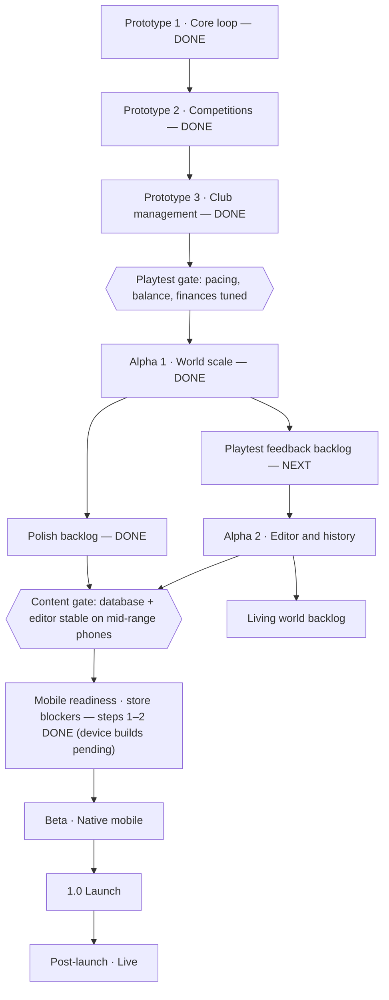

# Touchline — Roadmap

Oct 21, 2026 · Source: [Claude Docs version](https://claude.ai/code/artifact/4208fb1b-f42b-4a90-86c7-46c970e08ba9)

## Contents

- [At a glance](#at-a-glance)
- [Shipped](#shipped)
- [Systems pass](#systems-pass)
- [Next](#next)
- [Open questions and risks](#open-questions-and-risks)

## At a glance

Four prototype builds, Alpha 1, the polish and small-features backlogs and mobile readiness step 2 are done, and so are playtest feedback batches 1–6 and the rounds after them, up to round 24 (the newest: bulk edits and an On/Off switch for the in-game editor, a youth rating for every nation, sim forward, expansion drafts, loans and prospect management, and names of their own for more than thirty nations). Batch 7 (platform) is next, with a round 8 of ideas from comparative review merged in (batch 8 below), then Alpha 2 (editor and history) and a living-world backlog (with identity items from an external review: sandbox start, club recruitment philosophies, reputation web); device builds and a native store release follow. Phases are ordered but not yet dated.

## Shipped

The web prototype runs on a phone browser with no build step, covering 1877 fictional clubs in 132 leagues (the real structure under invented names) across 117 nations in three simulation tiers, and 117 national teams. Newest build first.

### Playtest feedback, round 24

- **Editing the world you play:** Settings → Edit the world has an On/Off switch (off hides every Edit button), the single-player and single-club edits, and a **Bulk edit** sheet that changes many at once with a live count on its button. It covers players (everyone, free agents, a nation or a league; a position group and an age range; attributes, potential, contract length, wages, morale, healing injuries), clubs (reputation, budget, bank balance, ground capacity, academy, training and medical levels), league and cup prize money, and nations' youth ratings.
- **Youth rating by nation:** every nation has a youth rating (about 50 is average; shown with a ▲ or ▼ on the World ranking and the nation's page). It moves a little each season toward what the nation's team (coefficient), its clubs' academies and its young prospects are worth, and sets the quality of its clubs' academy intakes: a little more ability and potential, and more wonderkids, in strong youth nations. Every season's rating is kept: the nation's page shows its place in the world and a line of its run since the world began, and a scout's region list shows each part of the world's average (🌱 with ▲ or ▼).
- **Eight more split leagues:** Northern Ireland (33 games then six and six), Iceland and Finland (22, then single-round groups), Slovakia (22, then double-round groups), Israel and Cyprus (26, then a top six and a bottom eight), Romania (30, then a top six and a bottom ten with points halved) and Bulgaria (26, then single-round groups) now split after their regular season like Scotland and Belgium.
- **Types of player for scouts:** an assignment can ask for a type as well as a position: ball-playing or no-nonsense centre-back, sweeper keeper, inverted full-back, wing-back, anchor man, regista, ball-winner, box-to-box, playmaker, inverted winger, inside forward, target man, poacher, false nine or pressing forward (the position and the role he plays best); the assignment line and the Scouting hub name it.
- **More small ones:** a Confirm before skipping switch in Settings makes Next match ask first (the 📅 sheet always does; both can be stopped while they run); the season review's league list has the eight biggest leagues as tap-to-follow chips, so a new career is not left with an empty card; and the world editor's national team screen sets a nation's starting youth rating (15 to 95, empty to let the game work it out).
- **Small conveniences:** the 📅 sheet opens on what you chose last time (days or a target); a bulk edit can be undone with an Undo button while the Bulk edit sheet is still open (it puts back the players', clubs', prize and youth-rating values it changed); and a queued expansion club has a Try another club button that swaps it for the next one waiting in the pool (the changes made to the old one go with it, and no two slots share a club).
- **Editor, sanctions and a balance check:** the world editor's International screen has Sanctions: a nation or a club kept out of international competition for some seasons (a ban or a what-if world). A nation sits out qualifying, the Nations League, the invitationals and the tournaments while it lasts; a club is passed over for its league's continental places, which go to the next club; the feed says when a ban begins and ends. The editor's home also has a Balance check, a look at the world before you play it: a club far ahead of its league, a league with no spread in reputation, a lower division stronger than the one above, each row opening the league.
- **Editing a nation itself:** the national team's screen in the world editor also edits the nation: its name, flag, part of the world, how its players play and how common they are in leagues abroad (a multiplier), saved with the world and put back when the database is cleared; the nations list marks a nation that was changed.
- **A world in CSV files:** the world editor has a CSV screen: this world's leagues, clubs and players as leagues.csv, clubs.csv and players.csv to open in a spreadsheet, templates to fill in, and an upload that puts the rows back (a club is matched by its id or its name, a column left empty changes nothing, a club with remove set is taken out, a player's attributes are made from his ability and position). Every problem is named by file, row and column and a row with a problem is left out while the rest go in. The same files start a world from Import a database on the new-career screen (a world put back from its own CSV is the same world).
- **When clubs fail, and phoenix clubs:** a club whose debts pass the limit at the start of a season goes into administration (a points deduction, 6 by default, and now a transfer embargo for the season: it cannot sign players), as before; and if the world allows it, a club that fails again within four years is liquidated: its players become free agents, the division below promotes its best club to fill the place, and so on down the pyramid, and supporters form a phoenix club (AFC and the old name, the same ground and colours, a small club owned by its fans) in the place left at the bottom. A club you manage, one in a closed league or with a B team, and clubs the world makes proof are never liquidated. The world editor's When clubs fail screen sets all of it (clubs can fail, embargo, liquidation, phoenix, the deduction, rich owners safe, and clubs that can never fail). The headlines of an administration, a liquidation and a ban stay in the feed (the news trimmer keeps up to 60 such rare stories, marked keep, instead of letting a day of transfer news push them out).
- **Engineering:** `npm run typecheck` (TypeScript over the files marked `// @ts-check`, twenty modules so far, now part of the deploy); `ui-live.js` and `ui-help.js` split out of the two largest screen files.
- **The text match view is the default:** matches play as live commentary (the same simulation, lighter on the battery) and the pitch view is switched off, with its Pitch / Text switch hidden in Settings; all of the pitch code stays in `js/matchview.js`, and `FM.MatchView.VISUAL = true` brings it back.
- **Setting up a career:** the first new-career screen has an Editing the world in game On/Off switch (Settings → Edit the world can still change it later), so a purist career never has Edit buttons.
- **Season review:** the end-of-season sheet lists your own league and only the leagues you follow (a Leagues you follow card with a hint to follow one), and cups only when followed or won by you, not the whole world's champions.
- **Simming:** the 📅 sheet now picks first and shows what it will do ("Sim 14 days", "Sim until your next match"), and nothing starts until Start simming is pressed; while a sim forward or a skip to the next match runs, a Stop simming button ends it at the end of the day it is on and keeps the days played.
- **Customising expansion clubs:** each queued expansion club on the Expansion card has an edit sheet for its name, short name, nickname, town, ground, capacity, reputation, colours and identity (checked for rude words and duplicate names), with a way back to the original; the changes are used when the club joins.
- **Sim forward to a target:** the 📅 sheet also has Until the window changes, Until my next match (stops on its day, before it is played) and Until the season ends (goes on through windows and deadline day; any of them still stops for a decision, a job offer or a sacking).
- **World editor:** a draft is saved (💾 button, autosave while you edit, a Continue card when you reopen it); a nation can be created (name, three-letter code, flag, part of the world, the culture its players' names come from, style, colours and how common its players are abroad), and with sixteen players it fields a national team.
- **Sim forward:** a 📅 button beside Advance and Next match asks how many days (3, 7, 14, 30, 60 or your own, up to 120) and plays them, your own matches as instant results. It stops early for a decision in the feed, a window opening or closing, deadline day, the season's end, a job offer or a sacking. (It had been squeezed out of sight on the home screen; it shows again.)
- **Expansion in closed leagues:** a league with no promotion or relegation shows an Expansion card on its table screen: add one to three clubs at the start of next season. 424 ready-made fictional clubs (js/expansion.js, tools/expansionpool.mjs) wait in the 106 closed leagues, and each fills its squad in an expansion draft (every club protects its best twelve and loses one to four players, replaced with younger ones). Split leagues (Scotland, Belgium, Czechia ...) refit their groups to the new size, and leagues of two zones or conferences (Argentina, the US) only take a number that keeps them equal. The card also has a No draft: start empty choice: the new clubs then start with no players at all, sign free agents and young players through the pre-season (about twenty by the first match), and no player is taken from the existing clubs.
- **Loans and prospects:** a new world starts with lower-division clubs holding about 400 players on loan from better clubs (two or three a club in the second and third divisions, mostly 18 to 22-year-olds). AI clubs manage their wonderkids and key prospects: one close to the first eleven is picked ahead of a slightly better player until he has played his share, and one too far from the team is loaned to a club where he would play, in every window. Your own loanees get a goal (appearances, and goals for a forward) and the feed reports every four games whether the loan is on track, with the recall offered when it is behind.
- **Scouting:** an assignment can target one exact position (ST, LW, RW, AM, LM, RM, CM, DM, LWB, RWB, LB, RB, CB) as well as a group; the three scouts a new manager starts with are one from the club's own nation and two from its part of the world (a Uruguayan club gets South Americans); staff on offer come mostly from the club's own part of the world and the regions it has ties with; reports discount the numbers of a player from a weaker league (down to 55%, with a note) and say what he will expect here (a key player, a starting place, rotation, development or back-up); a saved search can have a bell, and the feed names any player who newly matches it.
- **Dressing room:** a promise with a deadline can be renegotiated once with 🔁; the captain steps in first when a player's playing time lets him down (a strong leader settles far more of them, and a failed word opens the usual meeting); players remember what you told them, and meetings and promises quote it back ("You told me in October I was part of your plans."). Captains count: each season's end notes who wore the armband at every club, the legends card lists the longest-serving captains, and the feed tells when one of three years or more leaves your club.
- **Match and press:** a press-conference answer says what it did in brackets ("Fans like it. (squad morale +2, fans +3, board −1)"); pressing high on a short week (three days or fewer) costs 25% more legs and tired legs make mistakes late on.
- **Settings:** the default currency is pounds (Auto still follows the club's country); a Reduced motion switch; a Colour-blind kits switch (the away shirt differs to red-green colour blindness too, and the away side's players are squares on the pitch).
- **Realistic histories:** a player's earlier seasons follow his rank in his position at the club, so a star started most matches (last season's rating around 6.8 to 7.2) and a fringe player played little.
- **Choosing a club:** the browse screen has a dropdown for each continent holding its nations and their leagues, the question screen's Where? list is arranged by continent, and the world ranking on the International screen folds away behind its title with a part-of-the-world filter.
- **Names of nations and clubs:** thirty-one nations named from a neighbour's library now have words of their own (tools/namelib-new.mjs): Slovakia, Slovenia, Albania, Kosovo, Bulgaria, Moldova, Finland, Iceland, Azerbaijan, Kazakhstan, Estonia, Latvia, Lithuania, Georgia, Armenia, Kenya, Uganda, Ethiopia, Zambia, Zimbabwe, Jamaica, Trinidad and Tobago, Pakistan, Bangladesh, Vietnam, Bahrain, Kuwait, Oman, Jordan and Iraq (towns by each language's endings, clubs, nicknames, colours, divisions and cups in the nation's own words). Romania, Sweden, Algeria, Tunisia, Malaysia, Singapore, China, Canada, New Zealand, Egypt and the Gulf got the same, and about 530 clubs were renamed (tools/renameclubs.mjs; codes, colours, reputations and founding years unchanged). Sixteen nations (and Sweden and Norway) have player name pools of their own. About 250 more club nicknames (colour nicknames are rarer; tools/renick.mjs).
- **Lore consistency:** record crowds from the 1990s on stay within the ground; a rivalry that says two clubs split from one starts in the year the younger was founded; a police, army, union, railway or works club shows as State-Backed, Society-Owned or Company-Backed (new owners, also in the editor); anthem notes have 24 variants and a big club with no title still has an era; the generator refuses 450 more famous footballers' names in either order and any accent (hashes only, tools/realnames.mjs); abbreviations are unique and never rude; players have names from one community (India, New Zealand, Jordan); Vietnamese players have a middle name and a given name and are known by the given name.
- **Removed:** the English county cups (the 14 Senior Cups; older saves drop them), and the map (the By region start and the league screen's Map tab; distances and away trips stay).
- **Saves:** the Load a save screen has a rename button (a name of your own, kept through later saves and shown on the title screen's Continue button) and a delete button (a second tap confirms).

### Playtest feedback, round 23

- Super cups: one match at a neutral ground early in each season, 122 of them. In every nation the league champions meet the cup winners (the league's runner-up when one club did both); on each continent the champions cup winner meets the winner of its Shield (the European, South American, African, Asian and North American Super Cups). They have their own day after the first league round, a card on the Cups screen, count as a trophy for the winner and are kept apart from the season's cups in the archive. A new world has none in its first season (there is no last season).
- Six more regional club cups, groups of four then a final like the other regional cups: the Arab Club Cup (eight Arab leagues, taking the places after the Gulf Club Cup's), the West African Club Cup, the East and Southern African Club Cup, the Central American Club Cup, the Andean Club Cup and the Atlantic Club Cup (Scotland, Wales, Ireland and Northern Ireland). 22 continental cups in all, none of them with a club in two of them.
- Fifteen more regional tournaments for nations: the East African, Southern African, West African, North African, Arab, Central Asian, Nordic, Central European, Celtic, Caucasus, Central American and Caribbean, Andean and River Plate cups, the Baltic Cup and the Balkan Cup join the Southeast Asian, Gulf and East Asian ones and the three older invitationals: a host that rotates through the region's nations and the three best-ranked others. Three are played each season in turn (no nation in two of them, and none in a season where the host or guests have qualifiers in the window), so each comes round about every seven seasons.

### Playtest feedback, round 22

- Twenty-five more nations join the game, each with a national team, a top flight of ten to twelve clubs in the minimal tier and a domestic cup: Estonia, Latvia, Lithuania, Armenia, Azerbaijan, Kazakhstan, Moldova, Kosovo and Luxembourg in Europe; Jordan, Oman, Bahrain, Kuwait, Pakistan and Bangladesh in Asia; Zambia, Zimbabwe, Kenya, Uganda, Ethiopia, Togo and Mozambique in Africa; Guatemala, El Salvador and Trinidad and Tobago in North America. The world now has 117 nations and national teams, 132 leagues, 1877 clubs and 117 domestic cups. Their players join the squads of every league through the nationality mixes, with name pools of their culture (Baltic, Georgian, Turkish, Central Asian, Arab, South Asian, Bantu, East African and Caribbean).
- Their continental places: the Baltic nations the Northern League Cup, Kosovo and Luxembourg the Adriatic and Aegean Cup, Armenia, Azerbaijan, Kazakhstan and Moldova the European Trophy, Kuwait, Bahrain and Oman the Gulf Club Cup, Jordan, Pakistan, Bangladesh, Kuwait, Oman and Bahrain the Asian Shield, the six African nations the African Shield, and Guatemala, El Salvador and Trinidad and Tobago the North American Shield; every cup still has a whole number of groups of four (the Asian Shield 32 clubs in eight, the African Shield 24 in six).
- New name libraries for the Baltic states, and the Armenian league with its own division and cup names.

### Playtest feedback, round 21

- Thirty-four more nations have a top flight, so every nation in the game that has a national team now has a league and a cup (92 nations, 107 leagues, 1621 clubs, 92 domestic cups). Africa: Senegal, Ghana, Ivory Coast, Cameroon, DR Congo, Mali, Burkina Faso, Guinea, Cape Verde and Angola. Europe: Ukraine, Slovakia, Slovenia, Bosnia and Herzegovina, Albania, North Macedonia, Montenegro, Bulgaria, Finland, Iceland, Georgia, Israel, Russia, Belarus and Northern Ireland. South America: Venezuela and Bolivia. North America: Costa Rica, Jamaica, Honduras and Panama. Asia and Oceania: Uzbekistan, New Zealand and Iraq. Each has 10 to 16 clubs in the minimal tier, with fictional names (name libraries of their own for West and Central Africa, Georgia, Israel and Uzbekistan; Costa Rica, Honduras and Panama use the Spanish one, Cape Verde and Angola the Portuguese, Albania, North Macedonia and Montenegro the Balkan one), a nationality mix, places on the map and derbies.
- Their continental places: the African champions cup and the North American champions cup take the champion of each new league (two from each Central American nation, so that cup has 16 clubs and four groups), the second-tier shields take the next places, and the regional cups take the rest: Bulgaria, Bosnia, Albania, North Macedonia, Montenegro and Slovenia the Adriatic and Aegean Cup, Slovakia and Ukraine the Carpathian Cup, Finland, Iceland and Sweden the Northern League Cup, Russia, Belarus, Israel, Georgia and Northern Ireland the European Trophy, Venezuela and Bolivia the South American Shield, Uzbekistan, New Zealand and Iraq the Asian Shield (Uzbekistan and Iraq also the Asian Champions Cup). Every cup has a whole number of groups of four.
- `tools/newleagues2.mjs --data <file>` builds a batch of leagues from a structure file in the private folder; a one-off club of the world (Alexandra, Wednesday and so on) is counted across batches.

### Playtest feedback, round 20

- No real tournament names left: the national-team tournaments are the World Championship, the European Nations Championship, the South American Nations Cup and the African Nations Cup (with the Asia-Pacific Nations Cup), the invitationals the Cherry Blossom Cup, the Golden Elephant Cup and the Monsoon Cup, and the world club competitions the World Club Championship and the Intercontinental Cup.
- A domestic cup for every nation with a league: 58 cups (36 new, and the four nations added below), each a single-leg knockout with the final at a neutral ground. The clubs of a nation simulated by scores only now play their cup in the full engine, so those cups have real matches and stories (six of the older cups were empty for the same reason). A European nation's cup winner takes its place in the Holders' Cup.
- Second divisions for Japan (20 clubs), South Korea (15), Thailand (16), Indonesia (20) and Vietnam (12), in the light tier and linked to the division above by promotion and relegation (three down from Japan's first division, one from Korea's, two from Thailand's, three from Indonesia's, two from Vietnam's), so the Underdog climb and lower-league careers now exist in Asia.
- Four new first divisions: India (14 clubs, an Asian Champions Cup place and an Asian Shield place), Chile (16), Peru (18) and Paraguay (12), whose clubs take places in the South American Champions Cup (Chile two, Peru and Paraguay one each) and the South American Shield; India's invitational is now hosted by a nation with a league. 143 clubs in nine leagues, with fictional names (an Indian name library of its own), places on the map, nationality mixes and derbies: 1209 clubs in 73 leagues across 58 nations.
- Regional tournaments: the Southeast Asian Nations Cup (Thailand, Vietnam, Indonesia, Malaysia, the Philippines, Singapore), the Gulf Nations Cup (Saudi Arabia, Qatar, the UAE, Iran, Iraq) and the East Asian Nations Cup (Japan, South Korea, China, Australia) join the invitationals: a host rotating through the region's nations and its three best-ranked neighbours, semi-finals and a final in the international windows. Two regional club cups, the Southeast Asian Club Cup (16 clubs: Thailand, Vietnam, Indonesia and Malaysia three each, Singapore and the Philippines two) and the Gulf Club Cup (16 clubs: Saudi Arabia, the UAE, Qatar and Iran four each), are groups of four then a final, like the European regional cups.

### Playtest feedback, round 19

- English club names: Alexandra, Wednesday, Orient and Argyle are one-offs, as in real life (the generator keeps at most one of each in the world, and two Harriers); Redworth Alexandra, New Lamwold Wednesday, North Yeothorpe Alexandra and Old Yeowick Alexandra became Redworth Athletic, New Lamwold United, North Yeothorpe Albion and Old Yeowick City.
- The Intercontinental Cup, every season, mid-season: the continental champions of the season before, with the Asian and African champions meeting first (the African–Asian Cup), the American champions meeting in the Derby of the Americas, the winners playing the Challenger Cup and the European champion joining them in the final. Single matches at neutral grounds.
- The new World Club Championship format, in the summer of every fourth season (the year before the World Cup): 32 clubs in eight groups of four (a single round robin), then a round of 16, quarter-finals, semi-finals and the final. Places by continent (Europe 12, South America 6, Asia 5, Africa 4, North America 5): the continental champions of the last four seasons first, then by continental points (winners 10, runners-up 7, semi-finalists 5, quarter-finalists 3, a group stage 1, kept four seasons), no more than two clubs of a nation where there is a choice. The draw uses four pots and keeps a continent out of a group (Europe may have two). It has its own calendar days after the playoffs, a tab of the Cups screen with group tables and its history, and a prize fund. Older saves get the Intercontinental Cup and the new format from their next season.
- A map of the world (since removed; distances, away trips and the longest-trip note stay): `tools/geocode.mjs` gives every club a place from the real slot it sits on (the city's coordinates, which are plain facts; Wikipedia and Wikidata, with a small table of corrections), written to `js/geo.js`; the names stay fictional. Distances (`FM.Lore.km`) feed long away trips (a point of fitness for each 230 km beyond 350, up to 9, for the visitors, and a coach or charter cost for the away club, shown under Away travel in the finances; the longest trip of a league is noted on its table), and local derbies (neighbours within 30 km that had no rival of their own take each other, named for their towns, about 280 rivalries in all).
- Older glory: every club that existed before the generated seasons has a summary of the years before them: its league titles (years), its seasons in the top flight and its best decade, from its nation's first top-flight season (`FM.Lore.earlyHistory`; no table is stored). Each nation's champions are drawn year by year from how strong each club stood (a fallen giant had its best days at least twenty years before the generated seasons, an oil-backed club had none), no club wins more than a fifth of the seasons, and every Fallen Giant has at least three titles (so Aldcaster Wednesday, founded 1881, has its own). It shows as Honours before the records under every club's honours.
- Legends with variety: the plain lines (nine before, 60 now) and the stories drawn from a club's past (title, cup, staying up: 14, 10 and 11 wordings) are used least-used first within each nation, so no line is seen more than about a hundred times in a world of 1,000 clubs (the most common was 340); a save from before has its repeated lines rewritten once.
- Club details for every club (a card on every club's sheet): motto, anthem, mascot, ground nickname, record crowd, record win and heaviest defeat, most famous match (a cup final, title decider or promotion from the club's own generated past), named eras (the Golden Years, the Wilderness Years, the Cup Years, `The <legend's surname> Years`), and what kind of club it is.
- Rivalries with an origin: every derby has where it began (the title race, the cup final or the relegation both clubs shared in the generated seasons, the town they share, a feud) and the record between the two clubs before the save.
- Competition histories: each league, cup and continental competition has a History fold-out (founded, its trophy and the person who gave it, changes of format, the most titles, the giant-killings of the generated cup finals; the oldest cup in the world is marked), also on the Intercontinental and World Club Championships.
- Special club types are named and explained: military, police and security, railway, works and company, trade-union, university and reserve sides show a badge beside the club's identity and a paragraph on the club card ("Players serve here during national service" for Bujeong Garrison).
- The world's people: former players of the generated past are now in the game: about one club in ten has a legend of its own or of its rival as manager (named on the opposition card for the match, with a line when he faces his old club), one club in five has a legend as chairman or president, three in ten have an ambassador, and three great names of the big clubs join the Touchline Tonight panel. Legends' own cards say what they do now.

### Playtest feedback, round 18

- Proper restarts in the match view: after a goal and at half-time the sides walk back to their own halves, the side that did not score keeps outside the centre circle, and the ball is played from the centre spot (the second half is kicked off by the other side).
- A striker played in by a through ball or on a counter takes it toward goal before he shoots.
- A small shirt in each side's kit colour beside its name at the top of the match screen.
- Goal kicks and throw-ins on the pitch, with their share and landing places from the Wyscout data (`npm run carries`); a defensive wall for direct free kicks; free-kick crosses with the box filling as for a corner; carries fitted to the DFL open tracking (7 Bundesliga matches) and the PFF World Cup tracking (64 matches) at equal weight: about 34% of receptions are followed by a carry of 4 m or more, median 6.7 m (`npm run carries:tracking`), take-ons (about 26 a match, a win takes the carrier past, a loss gives the defender the ball) and short touches (1 to 4 m, after about half of receptions) from the real data. The StatsBomb open data (360 frames, `npm run layouts`) places the players at corners, throw-ins and goal kicks as real ones stand, sizes the free-kick wall by distance (6, 4.6, 2 and 1.2 men), and adds a third measure of carries and take-ons. The PFF World Cup events (`npm run events:pff`) set the goal kicks (about 13 a match) and throw-ins (about 38) of the match view and the pass accuracy of the match stats.
- Fewer unrealistic passes: no pass back to the keeper from the opponent's half, fewer passes back in that half, a pass into the box with no shot behind it is usually lost, and the ball is not passed around inside the box. Carriers past halfway dribble further and more often.
- The first Analyst view slice, in the post-match Shots & xG tab: the match in numbers, an xG timeline with each goal's scorer, minute and score, red cards and substitutions marked, a chart of who was threatening minute by minute, and each side's best shooters.
- The Analyst profile card on every player's sheet: per-90 percentiles against his position, a written summary, a shot map and the three players most like him; the engine records expected goals, expected assists and shot places for every player in every simulated match.
- The Analyst profile card on every club's sheet: its league season per match ranked among the league's clubs, a style radar, a written summary, the formations used, the run of its expected goals and (for your own club) where its chances come from.
- League charts: a Charts tab on the league screen with five scatter plots (chances for and against, goals against expected, possession against chance quality, pressing against possession, and every scorer's goals against expected goals), your club ringed and a tap opening any club or player.
- Tools to build a pack of your own: `npm run realplayers:fetch` and `realplayers:build` read openly licensed squads (Wikipedia, Wikidata) and write a world pack in the game's own format, with ratings estimated from how well known each player is, to a private folder outside the repository (`tools/private.mjs`). The game ships no pack and no real names.

### Playtest feedback, round 17

- The Nations League replaces the international friendlies: each confederation plays one in the seasons with no qualifying (the year with no tournament and the year of the Continental Champions Trophy), in leagues of sixteen nations and groups of four, on the first three matchdays of the breaks. Group winners go up, the last in each group go down, and the best League A group winner is champion. A nation with nothing to play in a window rests.
- Confederations in the world editor: International football → Confederations lists the five and any you add, and moves a nation between them. A confederation sets qualifying, the Nations League and the continental championship; one with four nations or more gets a World Championship place and a championship of its own.
- Prize money for leagues, cups and competitions: a league pays by final position from a fund the editor can set (automatic is a part of each club's revenue), a domestic cup pays its fund down the rounds, a continental or world cup pays per win and for the title; the Finances tab lists what the club won, the cups and league screens show the funds.
- A currency picker in Settings with 38 currencies at fixed rates (Auto follows the club's country).
- Catalonia and the Basque Country can be added as nations (new-career screen and the world editor): players of Catalan or Basque family can choose them, and each fields a national team with its own flag.
- Dropping down in the editor: a continental cup can send the clubs that finish third in a group into the cup one tier below, to play its group runners-up in a knockout play-off before the quarter-finals (tier 1 into tier 2, tier 2 into tier 3).
- The visual match engine's positioning comes from real tracking data: a shape table built from SkillCorner Open Data (MIT) by `npm run shapes` moves each position with the ball, with and without it, and the lines are drawn together as in real teams. The rest of the realism plan (passes, shots, set pieces, movement) is still to do.
- Shot locations and xG from real data: each chance is a real shot from the Wyscout public event data (46,000 shots; the model fits distance, angle, headers and free kicks, and matches the observed goal rate at every distance), with each kind's average chance kept so goals per match do not move. The match view's lines between players are gone.
- Pass choice from real data with an expected-threat grid: 1.65 million Wyscout passes give the share of passes that go each way from each part of the pitch and an xT grid (best cell 41%, the penalty area's centre 16%, our own box 1%); the match view picks receivers by them, with the style on top (Direct 29 m a pass, Possession 21 m). The shape of real passing is only partly matched (47% forward against 57% in the data), because the formations' geometry limits it.
- Real speeds in the match view from the Metrica Sports sample data: top speed by pace and the real spread of speeds, a limit on how fast a player can speed up, slow down or turn, and pass flight times from real ball speeds by length. The pitch is not drawn at real time (a match minute lasts about a second), so metres a second are scaled; players still move a little more than real ones (a median of about 2.6 m/s against 1.5).
- Set pieces from real data: 19,316 corners give where deliveries go (near post, middle, far post, the edge of the area, short), how often a corner ends in a shot (27%) and a goal (2.5%), and the first touch (attackers 43%, defenders 46%); free kicks give what is done from each distance (a shot from inside 25 m, mostly crosses from 30 to 40 m). The engine takes one real corner at a time, the view puts the ball at the flag, crowds the box and plays short corners, and the commentary names the zone.
- A goal replay in the developer tools (since removed, with the tracking data it used): tracked real goals beside goals recorded from the match view. First finding: real goals come from a crowded area (3.3 attackers and 6.4 defenders in the area at the shot on average) and the match view's was open (0.8 and 2.9); a minute that ends in a shot now sends attackers into the area from its start and the defending side back, giving 3.1 and 6.3.

### Playtest feedback, round 10

- Scotland, Wales, Ireland, the USA and Australia get club-name styles of their own (Thistle and Academical, Vale and Welfare, Celtic and Swifts, FC/SC and mascots, Strikers) with their own grounds, nicknames, division and cup names; league sponsors are local companies per nation; England and Nigeria keep "Premier Division".
- Scout and Transfers are now clearly different tabs (Scout: network, reports, search, shortlist; Transfers: window, offers, lists, free agents, Transfer Centre).
- Sorting can run either way.
- "Loan out" is now the loan list: wait for offers or offer him to clubs.
- Caps show beside the country on a profile, a capped player's other flag is hidden, and once one bid is accepted the other bids for him are withdrawn.
- A loan list beside the transfer list: players you list for loan are asked about first by clubs, and an Offer loan button gets up to two clubs asking at once.
- The Transfers tab always shows your transfer list and your loan list with an Offer button on each.
- Awards: a world best XI (and player of the year) for each season, awards and a team of the season for every league (Golden Boot, best player, best young player, best goalkeeper, most assists), and the same plus a team of the tournament for every cup, continental cup, the Club World Cup and the international finals.
- A League → Awards screen shows them so far and for previous seasons; finished cups and tournaments carry theirs; the news announces them.
- Sort by ability or potential on the squad list, reports, search, free agents and shortlist (by what your scouts judge for other clubs' players).
- The profile always shows international caps, or "Uncapped".
- Your manager reputation is shown as stars.
- The Facilities and Hall of Fame taglines are gone.
- A Transfers tab (window, offers waiting for you, your transfer list with Offer buttons, loans, payments to come, your deals, the biggest deals elsewhere, and ways into search, free agents, the shortlist and the Transfer Centre).
- International tournaments and qualifying groups fold away on the Nations screen.
- Club names on a player's profile (header, crest, career, season table, trained) open the club.
- A club's XI rating is shown in stars.
- An Offer button for players on your transfer list (on the profile and in a Your transfer list card on the Scouting hub): up to three clubs that can afford him bid at once, then he is left alone for a few days.
- Every player has a youth club and a home nation: "Trained" names the club that trained him between 15 and 21 (his academy, or the club where he spent most of those years, or the youth club he was given with the world) and "Homegrown in" the nation he grew up in.
- Players see only star ratings: club, manager and national-team reputations and staff abilities are stars too (the numbers stay inside the game).
- The name generator follows each country's habits more closely: Scottish, Welsh, Irish, American and Australian towns have building blocks of their own; every town and club name is checked against real towns and clubs ("Chelsington" is too close to a real town), for rude words, for hard consonant runs and for length; big clubs get short plain names, small clubs longer and quirkier ones ("North Litworth Wanderers"); German and Italian clubs often carry their founding year; the top divisions are sometimes named for a fictional sponsor.
- National teams: a player with two nationalities who has not been capped can switch allegiance (the first cap ties him to a nation); the national team manager can ask eligible players to commit, and AI players switch between seasons.
- The national job has a federation (confidence, the season's objective), a schedule of coming matches and recent results, a squad sheet with club, caps and form by position, a captain and set-piece takers, and an Eligible players list.
- One-word names for some Brazilian and Portuguese players (Rafinha-style diminutives).
- The match preview shows the opposition's predicted XI line by line (danger man starred, who they are missing).
- More variety in the generated world: more nicknames (and colour nicknames such as Red Devils and Bluebirds), more club-name patterns (Hotspur, Rot-Weiß, Olympique...) and division and cup names that differ by nation.
- Players of mixed heritage can be eligible for a second nation, shown as a second flag and in the profile.
- Club abbreviations come from each club's own name (no more CHE3 or CON for clubs that were renamed), names are filtered for rude words in every language the library writes in, England's divisions are ENG1–ENG4 instead of D1–D4.
- The pre-match win chance now moves with the crowd, derbies and confidence and no longer sits on a floor; a release clause is announced a day before it is paid; fans are angry when a talented teenager goes cheap.
- Danger man is an attacker, the assistant compares youngsters with their own position, a player's season table adds the earlier seasons the Career panel counts, "Born Leader" no longer repeats the Leader trait, plural and spacing slips, shorter club names in the match header, squad numbers best-first, and Vietnam, Indonesia, Malaysia and the Philippines join the world.
- Mobile pass: the match preview keeps Watch live / Instant in a sticky footer, the squad screen's sort and filter rows are compact and the assistant's notes show two at a time, bigger chips and a solid navigation bar, the new-career screens keep their buttons in a footer and fold the league's rules away, the welcome tour comes before the season preview, and the scouting screen works again (the county-cup data had overwritten the scouting regions).
- The American league is built like MLS: two conferences (East and West) with their own tables (and an overall table for the Supporters' Shield), a 34-game schedule weighted to the conference, seven clubs per conference in the playoffs (the top seed skips Round One; single matches through the Conference Semifinals and Finals to the MLS Cup, hosted by the better seed), the MLS Cup winner as champion, and the champion and Shield winner heading the CONCACAF places.
- A college draft each winter: three rounds, the clubs that missed the playoffs picking first and the champions last, from a class of generated prospects; the AI picks as the clock reaches it, you pick on the Draft board (a card on Home while you are on the clock, and a Draft button on the Transfers tab) or let your assistant finish it.
- Name generator tool and dashboard tab: `npm run names -- --kind clubs --nat SCO --count 20 --seed 3` (`tools/namegen.mjs`) and a **Names** tab in the developer dashboard generate player, town, club, ground, nickname, league and sponsor names by nation and seed, flagging names the world generator's checks would reject (rude, hard to say, too long, close to a real town or club).
- Naturalisation: a player who has lived in a country for a number of seasons after 18 can be granted its citizenship (`D.NATURALISE` in `js/data.js`, rules in [COMPETITION_RULES.md](COMPETITION_RULES.md)), at a yearly rate and cap per country and only for uncapped players the federation wants; he becomes eligible as a second nation, with a second flag and "Naturalised in <year>" on his profile, and news for notable cases.
- Youth and B-team simulation review: youth leagues are less one-sided (results use a gentler strength gap and each side has its own good or bad year, so top academies no longer win nearly everything; the table spread is roughly top ~85 points, median ~50, bottom ~25 of 114). B teams verified: stocked at 22, light-sim, never promoted level with their parent, rebalanced for AI parents.
- League formats like the real ones: league splits (Scotland 33 + 5 with the top six and bottom six; Belgium with a top-six playoff on halved points; Denmark, Austria, Switzerland, Czechia, Serbia, Greece, South Korea and Wales each with their own split), Mexico's Apertura and Clausura with a Liguilla (play-in, quarter-finals, semi-finals, final), Argentina's two tournaments in two zones with cross-zone knockouts, the A-League's top-six finals series, and a relegation play-off for France's Ligue 1 (Germany already had them). The league table shows the groups, the tournaments and the playoff bracket; the season archive and trophies record both champions.
- Fourteen more player traits, each with a real effect: Engine, Set-Piece Expert, Clutch, Aerial Threat, Hatchet Man, Slow Starter, Cup Specialist, Big-Match Nerves, Model Professional, Low Work Ethic, Versatile, Mentor, Homesick and Needs Game Time. Older saves are given the ones their players qualify for.
- Every league can be managed: the new-career screen lists all 42 leagues (grouped by nation in the league picker, the random pick draws from all of them), not just the first eight. A club in a minimal or light league gets a full squad, because your league and the ones just above and below it always run in the full simulation. Checked by starting a career in every league and playing the first six matchdays.
- Naming rules built from how clubs were founded (docs/NAMING_RULES.md): works, colliery, railway and church names in England; Hansa, Schwarz-Weiß and Eintracht in Germany; SD, Real Unión and Sporting in Iberia; SS, Fidelis and Polisportiva in Italy; Olympique, Athletic Club and Sporting Club in France; Excelsior and Vitesse in the Netherlands; Royal, KV, KRC and Standard in Belgium; Dinamo, Rapid and Partizan in the Balkans, with the Soviet-era Lokomotiv and Spartak only on old clubs; Mexican university, cooperative, trade and animal names; Japanese place + foreign-word names; Korean city + company + nickname; American foundry and lumber names; Australian migrant-club names; Thai United clubs; Nigerian, Ghanaian, West African and Moroccan clubs with their own towns and patterns. Checks reject names that mix cultures ("Real Hamburg"), read like fantasy, or let one suffix take over a league, and a Colliery side are the Miners. The world's club names were regenerated with the new library. Russia, Ukraine and Belarus have naming libraries of their own, apart from the Balkan one (Russian, Ukrainian and Belarusian towns, FK/FC clubs, Soviet-era sports-society and industry names only on old clubs, their own nicknames, divisions and cups); the Names tab lists them as library-only nations.
- Five more nations with national teams: Belarus, Bolivia, India, Qatar and the United Arab Emirates (90 in all), each with a name culture, a style, colours and the leagues its players move to, and eligible as a second nation for players of that heritage.
- Every nation always has a national team: a nation the world gave too few players (Malaysia, the Philippines, a small Balkan side) is topped up each summer to at least 18 with players who play outside the game's leagues. They are unattached, so they show as free agents that any club can sign, and they play for their country; an unattached international is no longer cleared out with the other free agents or retired for being without a club for a year.
- A bug sweep of the new formats: a split league's table no longer shows last season's groups (a promoted club vanished from it until the split), the title-playoff days are on the calendar once when two leagues have two tournaments, naturalisation residence starts at zero for a new host country (only a world's first summer back-fills it), Argentina's zones of unequal size keep their second halves, and a world with no manager can split a league. Played two seasons in Mexico, Scotland, the USA and Argentina with no problems.
- Basque and Catalan heritage: players of Basque and Catalan families (their own name pools, shown as heritage on the profile), and two clubs in Spain's second division that follow Athletic Club's policy: Eibar sign only Basque players and Andorra only Catalan ones. The policy covers transfers, loans, free agents, pre-contracts and trials (for you and the AI), and their squads and academies are made of such players.
- The Saudi Pro League and First Division (18 clubs each; 746 clubs in 42 leagues, 32 nations), with 20 of the 36 clubs Oil-Backed as in real life, ten foreign players per squad, the King's Cup, six places in the Asian Champions Cup, a Gulf naming library (Al + a concept: Al Fajr, Al Saqr) and Saudi riyals as the display currency.
- Dynamic potential: a player's potential now moves each summer until 25 (it was fixed at birth): with how he did against his curve, his ratings and game time, the club's academy and training, a long injury, and a little luck (now and then a teenager surges or stalls). The changes average out, so the world's supply of talent is what the calibration expects. Your players' news says when potential rises or falls, and the profile shows a ▲ or ▼ trend.
- Club season by season: every club's season is kept in the archive with its manager, top scorer and cup runs (Winners, Runners-up, Semi-finals, Group stage ...), and the club page shows each season with its league, position, record, goals, points and honours, with an All seasons view.
- Choosing a club in a world you don't know: every club gets a difficulty (Relaxed, Balanced, Tough, Brutal) from its squad rank in the league, its money and the board's likely expectations, with the reason. The club step opens with three questions (how hard, what kind of project, where) and suggests three clubs with a one-line reason each; Browse all, Random and No club remain, and the list filters by difficulty. Each league opens with a card, and the club you pick shows its story: a hook, tags, the likely objective, ground, money, founding year, rival and derby, and tradition. The first season keeps introducing the world: a rival manager's welcome, a derby-week preview, a card for each new opponent, and the league's star and wonderkid. Still to do: club histories (past champions, legends), a world primer, curated first clubs and story starts.
- Round-10 fixes: no sporting-director emergency cover (a warning in the feed instead of a goalkeeper or squad top-up signed for you; only a squad under 11 is filled with academy call-ups); instalment deals show and add up to the total fee; a transfer-listed player's tag stays visible beside a long name; realistic agency names; the suggested clubs show country, league and tier.
- Database import framework: a Database card on the new-career screen loads a world-definition file (clubs, ratings, players, past seasons), shows what is in it and any warnings, and builds the world from it; formats are adapters (`FM.DbImport.register`), so more can be added without touching the screen.
- Database import, round two: the historical CSV tables are an adapter (tables.csv, players.csv, clubs.csv picked together); a database can add clubs and whole leagues, rename the game's own and replace every player (a club given 11 or more players loses its generated squad and gets the gaps made up); the club picker shows the imported clubs and leagues before you choose; the world keeps the changes in its save and the simulation worker applies them; and Settings exports the world you play as a database, with or without players.
- Playtest round 11: squad morale drops before a match against an opponent in form or at a full away ground (nervy players most), shown in the feed and the team-talk card; stars instead of numbers when choosing a player in the tactics screen; Basque and Catalan names (wider pools, and named clubs for the two policy clubs); a club with a signing policy scouts only players it could sign; club history reworked (top scorer and most appearances for every season, a Club legends card with the all-time top fives, realistic legends); invitational tournaments (Kirin Cup, King's Cup, Nehru Cup) in the international windows; and shouts, seven touchline calls in a live match.
- MLS rules for the American league: a salary budget ($5.2M over the 20 biggest charges), a maximum charge ($700K), three Designated Players, a 30-man senior roster, with signings and renewals checked, the budget on the squad screen and the AI's clubs trimmed within it each week. Not yet: allocation money, Generation adidas, the under-22 initiative.
- Systems pass, step 1: a systems map generated from the code (`npm run sysmap`, docs/SYSTEMS.md: each system's uses, the closed loops checked hop by hop, state nothing reads); a tactic-response test (`npm run test:tactics`: 20 expectations that a high press, a low block, build-up, width and the opponent's press change possession, ball-winning, stamina and chances by type); the engine changes it asked for (a low block breaks quickly, a high press goes in more often); and a "Why it went this way" card on the post-match summary.
- Systems pass, step 2: every club has a market, supporters, a youth catchment and an owner, and a reputation ceiling that only a cause raises (a takeover, years of success); a season's reputation moves by a capped step toward what standing and history support; takeovers need a reason; a 30-year stability test (`npm run test:longrun`); identity now drives recruitment, fans' style expectations, players' willingness, the board's patience and revenue; and a manager profile (youth, attack, spending, stability) discovered from what you do, with your standing in each country.
- Systems pass, step 3: an opposition report before the match (their press, width, weaker flank and danger man, from their real system and XI) and match instructions that answer it, each changing the engine's chances and judged in the post-match reading; half-time reads of the first half with a specific fix; press and block animations that match the engine; scouting second opinions and scout leans, three prices for a target, and recommendations that depend on squad need and budget.
- Four more cups: the North American Shield (the second-tier cup for the American and Mexican leagues) and three regional cups, the Adriatic and Aegean Cup (Serbia, Greece, Turkey), the Carpathian Cup (Czechia, Poland, Hungary, Austria) and the Northern League Cup (Norway, Denmark), each a group stage then a final, with entrants from the places below the European cups; 14 continental cups in all (`npm run test:cups`).
- Playtest round 12 (a report on a first hour): club abbreviations are made from the first word of the name that is not a generic one (Little Tarncaster City is TAR, not LIE; Associazione Calcio Orvola is ORV, not ASS), never a rude or silly code, never padded, and unique across the world (a B team is its parent's first two letters and B), with `npm run abbrevs` to rebuild them and `npm run test:abbrevs` to check them, and old saves taking the new ones; a match left unfinished (the app closed mid-match) still counts, but opening the save now shows a full-time screen with the score, the goals and an explanation instead of a toast; the hub counts the match you have just played (the header read 0 played and the league card "Season starts soon" with the table already showing a game); a player who joined from another club has season rows that match his career panel, and a club's earlier seasons sit next to that club's rows; "a attacking mid", "Another a giant awakens", "3★ in the ENG4" and a fan account saying the team had been brilliant for weeks after one game are fixed; the predicted XI lists the formation's own lines (a 3-4-2-1 is three, four, two and one); the live match header shortens a long name by dropping its opening word (Tarncaster, not Little Tarnc…); an English fourth-tier club or any big name is not a part-time squad; generated squads carry three strikers; and the club picker's footer fades into the page.
- World editor, national team squads, qualifying, cup groups and split leagues: a player made for a country can be called up (a checkbox on the player and a squad list on the national team), and is picked ahead of better players for three years; the qualifying groups of the World Championship and the continental championships have three or four nations, or are pairs home and away; a continental club cup has groups of three, four, five or six (three and four home and away, five and six once each, the six group days; the best runners-up fill the quarter-finals when there are more than four groups); and a league can be split after its regular season into two to four groups, each with a name, a size and no more games, once each or home and away, with points carried over or halved, and the league's own splits (Korea, Serbia and the rest) can be changed. `npm run test:editor` plays a season with a split Portuguese league, African groups of three, North American groups of five and smaller qualifying groups.
- World editor, players in bulk, past transfers, kits, library, packs and cups taken out: a spreadsheet (CSV or JSON) of real players' season numbers is imported on a screen of the editor into players of the world (each row to its own club, to one club or to the free agents), through the real-stats converter, with rows it cannot place listed; a past season takes its big transfers (player, nation, clubs, fee; the biggest shows as the season's record deal); a club has shirt colours of its own, home and away, worn in matches; the editor keeps worlds on the device in a library, opens a world from a file, and makes and applies club data packs (names, short names, nicknames, cities, colours, crests, kits and grounds, plus league, cup and national team names; any pack fits any world, clubs matched by id; the new-career import reads a pack too); and the game's own domestic cups and invitationals can be taken out of the world. The world exports now keep national ranking points inside the range the editor accepts (the history importer test had been failing on that). `npm run test:editor` covers each.
- World editor, club extras: a screen for each club holds its crest (one of four shapes, eleven patterns and fifteen emblems, with a live preview; it shows on the club picker and everywhere in the game), its cash in the bank and transfer budget, the level (1 to 5) of its training ground, academy, medical centre, analytics, stadium, fan zone and museum, and its market, supporters, youth catchment and owner, which together set how high the club can grow (the ceiling follows from them). Anything left alone is worked out by the game as before. `npm run test:editor` checks that each reaches the club, that bad values are refused, and that clearing the database takes the crest out of the picker data.
- World editor, staff: a Staff, managers and agents screen. A coach or scout now has a personality, a contract length, a weekly wage and (for a scout) a network of how well they know each part of the world and how well they judge a player, or one made up from where they come from, all carried into the job; a club's manager also has a reputation, a personality and a system (formation, build-up, press, width) their club is set up in; a list shows every manager made; and the twelve agent firms can be renamed, added to and removed. `npm run test:editor` checks that a made scout's network, wage and contract, a manager's system and the agent firms reach the game, and that clearing the database brings the game's own twelve firms back.
- World editor, competitions: each league's format (home and away or once each; how clubs level on points are split, from five orders; its simulation tier and strength), the link with the league above (places up and down, then nothing more, a play-off of four clubs for one more place with a one-match or two-legged final, or a relegation play-off against the club just above the drop), and a cup of its own for a nation that has none (eight or more clubs in simulated leagues), with the same format, prize and entry choices as the game's cups; typed fields are kept when a button on the screen redraws it. `npm run test:editor` plays a season with one league once each, a changed tie-break, a relegation play-off pair and a new Uruguayan cup.
- World editor, international football: an International screen holds the summer tournaments (each one's name, and the World Championship's places for Europe, South America, Africa, Asia and North America, which must add up to its sixteen), the year of the four in which the World Championship falls (the continental championships follow two years on, the Trophy the year before), and the three invitationals' names and hosts; each national team also gets how it plays (formation, build-up, press, width) beside its name, colours and ranking points; and past seasons can name the winner and runner-up of each tournament, which count as the nation's titles and decide the Continental Champions Trophy's invitations. `npm run test:editor` plays a season with the cycle moved and checks that everything is back as the game has it after the database is cleared.
- World editor, cup money, entry and past cups: every cup has a prize fund (a domestic cup's was fixed at 3 million), a domestic cup can be kept to the top flight, the top two or the top three divisions (with fewer than eight clubs in them it is open to all), and a past season can name the winner and runner-up of each domestic cup, counted in the club's honours. `npm run test:editor` checks that the prize funds and the narrowed entry reach the world's cups and that a cup winner entered by hand is in the archive.
- World editor, cups, derbies, staff, national teams and history: every cup opens to a format (a domestic cup's rounds as one match, a neutral ground or two legs, with every tie neutral as an option; a continental cup's quarter-finals, semi-finals and final as one match or two legs, and its knockouts at one venue; the calendar makes room for the extra days), a club's derby and the club it is the B team of (checked: the same nation, a lower division, one B team per parent), the game's own derbies can be taken out or renamed, coaches and scouts (those made for a club come with the job when you take charge of it, those made with no club are on offer in the staff market from the first day), each national team's name, short name, colours and ranking points, and past seasons: who won each league (champion, runner-up, third), with a full table made to fit, the champion's titles counted in the club's honours, and a choice of leaving the other years empty or making them up. `npm run test:editor` checks all of it, including a cup format reaching the world's cups and a season entered by hand surviving the invented years around it.
- World editor, the rest of the world: free agents; a manager for each club; the rules (points for a win, substitutes, two-legged ties, away goals), honoured when the career starts; cup names; new leagues in any nation, with promotion and relegation places and continental places to set; the game's own clubs can be taken out and put back; a new club's id follows its name. Three groups in a continental cup now make two (a league that adds a club to the Champions Cup can no longer break its draw). `npm run test:editor` builds a world with a removed club, a league in a nation that had none, a free agent, a manager, a renamed cup and two points for a win.
- World editor, players: each club has a squad screen and each player a screen of his own (name, nationality, position, foot, age, contract, all 14 attributes with the live ability, "fill in" from an ability, potential), and the first screen chooses whether made players are added to the squads or replace the squad of a club given 11 or more; `npm run test:editor` checks that eleven made players are the squad.
- World editor, first screens: from the Database card on the new-career screen, edit any league's clubs (name, short name, nickname, city, colours, identity, reputation, ground, capacity, founded, league), add clubs, name the world, save it as a file or start a career in it; checked by `npm run test:editor` (an edited world with a renamed, a moved and two new clubs plays a season).
- Three more cups: the European Summer Cup (eight clubs just below Europe in the first rounds; its two finalists take the last European Trophy places), the European Holders' Cup (each European nation's domestic cup winner, or its best club without another European place, over six cup days) and the Continental Champions Trophy (the continental champions, the world champions and a host, in the year before the World Cup); `npm run test:cups` checks all three.
- Bug sweep: an unanswered "isn't playing" loan decision (after the host had promised minutes) crashed the next day; the Asian cup's fifth group could never go through (the five winners and the three best runners-up now make the quarter-finals); a playoff champion could be in two continental cups; a club's keeper cover counted keepers in the U21 or U18 side, and a keeper made by the club was invisible to the squad list until the next signing; the college draft pushed AI clubs over the salary budget until the weekly check; cup cards said "neutral final" for two-legged finals and "two-legged knockouts" for the Asian cup's single matches; a board note could read "Your approach ()". New checks in `npm test` (desk defaults, first-team keepers) and `npm run test:cups` (every group winner reaches the knockouts).
- Systems pass, step 4: six more top flights (Singapore, Malaysia, Vietnam, Indonesia, the Philippines, South Africa: 828 clubs in 48 leagues across 38 nations) with club-naming cultures of their own; the AFC's 3 + 1 and ASEAN foreign-player places; Gulf money buying famous names for Saudi clubs; Korea's military service; Japan's university graduate draft; part-time clubs; story starts and good first clubs on the club picker; a world primer under Help; thirty seasons of champions and cup winners before the save; and `npm run test:asia`.
- Playtest round 13: the favourite club is gone from the new-career screen (no homecoming, no boyhood-club news or job-offer pull; older saves simply ignore the field). Midweek football: every day of the calendar has a date, league days fall Friday to Sunday (some midweek in a long league season) and cup days Tuesday to Thursday, and at most one cup day sits between two league rounds, so a club in a continental cup, the domestic cup and the league no longer plays three days running because competitions share a round (days that would fall together move to the next gap, in order). Days of rest count: a day's recovery follows the days to the next day, a short turnaround gives less back, and the match preview warns of a crowded spell (days since the last match, games in 14 days, tired starters). A Fixtures screen in League shows your whole season in date order across every competition (league, domestic and continental cups, friendlies), midweek or weekend, home or away, the days of rest before each match, the next round of a cup you are still in as 'to be drawn' on the day it is played, a read of the next fortnight, and filters for league, cups, continental, coming up, played. Squad, scouting and transfer filters: the squad has a name search, multi-select positions, age bands, home or foreign, contract, foot, role (starters, rotation, prospects, surplus) and status (on loan to us, listed, out of the squad), with value, appearances and goals to sort by; scouting (reports, search, free agents) picks several positions at once, a side and a foot, an exact age range, ability and potential in stars as your scouts see them, listed players, a youngest / wage / contract sort, 'show 50 more' past the cut-off, a count of matches and up to six saved filters per list; the Transfer Centre searches by player or club and filters by position, country, fee and who signed or sold. Editor: each league has its own points for a win, substitutes and foreign-player limits, each cup its own substitutes, extra time (or straight to penalties), away goals and, for a continental cup, points in the groups (the world's away-goals rule is now honoured, it was never applied); a Season calendar screen moves pre-season, the domestic cup's rounds, every stage of the continental cups, the Club World Cup and the two international breaks; and Fixed fixtures puts a match on a matchday (home side first), the rest of the schedule built around it each season by swapping clubs in the round-robin (a search that refuses a set of pins no schedule can hold). `npm run test:schedule` checks all of it, including a season played with two points for a win, a cup without extra time and a different calendar.
- Playtest round 14: Northern Ireland gets its own flag (the Ulster Banner, drawn, since no emoji exists) wherever a flag sits in a screen. Every league rule can be edited: a league's registration rules (the squad list and its homegrown places, work permits, non-EU limits and signings, foreign players on the books and in a matchday squad, the Asian and Southeast Asian places, nations that never count as foreign, a salary budget), the matches a club plays, a title play-off (a finals series of the top six or a liguilla of the top ten) and two tournaments a year. Expansion drafts: the clubs added to a league can take their players from the clubs already in it (each protects its best, loses at most a few, the new clubs pick in turn for a balanced squad, and the club that loses a player signs a younger one). Competitions made in the editor: continental competitions of a chosen tier (1 a champions cup fed by the leagues' places, 2 a shield, 3 a trophy, 4 a regional cup, the last three fed by named leagues and places), for any part of the world, with their own format and rules; a league's continental places can go to any tier 1 cup of its part of the world, and the feeders of the game's own lower-tier cups can be changed. League structures are editable too: any league can be one table, two zones (Argentina's format: two zones by reputation, two tournaments a year, a top-eight play-off in each) or two conferences (the American league's: names, which club is in which, a college draft of up to five rounds, seven clubs a conference in the play-off), and promotion and relegation can be switched off for a pair of leagues (the places are remembered) or for the whole world (closed leagues). `npm run test:competitions` checks it all.
- Playtest round 16: sixteen more top flights, all in the minimal tier, with their clubs, nationality mixes and continental places: Egypt, Tunisia, Tanzania (a new nation, with a Swahili name pool), Algeria, Cyprus, Croatia, Sweden, Romania, Ecuador, Uruguay, Colombia, Canada, the UAE, Iran, Qatar and China (238 clubs: 1066 in 64 leagues across 54 nations, 92 national teams). The name library writes Egyptian, Tanzanian, Iranian, Chinese, Cypriot (Greek) and Canadian names, and avoids every name already in the world. Places: the Africa cup takes Egypt 2, Tunisia 2, Algeria 1, Tanzania 1 (16 in all), the South American cup Ecuador 2, Uruguay 2, Colombia 4 (16), the Asian cup the UAE, Iran, Qatar and China 3 each (32), the North American cup Canada 1 (Mexico down to 3), the European Champions Cup one each for Cyprus, Croatia, Sweden and Romania, the European Trophy one each too, and the shields of Asia, Africa and South America take a club or two from the new leagues. Foreign-player limits for the Gulf, Iran, China and Tanzania. `node tools/newleagues.mjs` builds them from `tools/newleagues-data.mjs`.
- Playtest round 15 (a report on story starts, boards and histories): a story start only picks clubs that fit it ("A giant awakens" a fallen or declining giant, never a squad at full strength or a comfortable old club; "New money" a rich club with a thin squad, never rated Relaxed; "Against the odds" the weakest squads); the board's league aim is one function (`FM.Board.aim`) that the club guide's "The board will likely ask" also calls, so the card keeps its promise, and a weak squad is no longer asked to dominate (2+ goals a game only where the club is expected in the top half; the guide's twist follows the same rule); fan-owned clubs say "every coin counts" instead of "pound"; three malformed club names fixed (La de Aranjero, El de Calatosa, Beau-Beauens) and the name generator no longer puts an article before "de" or repeats a prefix its stem starts with, with `npm run test:abbrevs` now failing on a stray article or a doubled word; a keeper's career total says his clean sheets are counted in the games on record when his career is longer; a player with games at a club but no season of his own shows the season-by-season table (the earlier seasons as rows); career spells are written as seasons (2024/25–2025/26) to agree with the rows, and a seeded spell starts at his first season with games; the match preview describes the danger man and the weaker flank in words, not rating points; and the full-time card for a match left unfinished waits for the rest of the day to be simulated instead of sitting blurred behind the progress layer.

### Playtest feedback, round 9

- Your world screen shows the rules of the league you picked (format, tiebreakers, promotion and relegation, continental places, cups, squad and foreign-player rules).
- Bigger name pools, a few hundred names per culture, and a family heritage for each player (a Frenchman of Algerian descent has a Maghrebi first name), shown on the profile.
- Star ratings instead of overall numbers, measured against the league you manage in: a Championship regular is two stars in the Premier League and four and a half in League Two.
- Real work-permit rules: the Governing Body Endorsement for England, Scotland and Wales (automatic by share of national-team games and ranking band, otherwise 15 points), Germany's eight locally trained players, and Cotonou and Euro-Med players counting as EU in Spain and France.
- A text-only match view that plays exactly the same match as the pitch, compared with it in the design document.
- Forty-three more nationalities (81 in all, each with its own national team where it has enough players and a name culture of its own), so squads look like a real world.
- Season-by-season now includes the current season, a line per club for a mid-season move.
- A goalkeeper's international record shows clean sheets instead of goals.
- Before the save starts you can choose which leagues are simulated in full, lightly or minimally (your league and its neighbours are always full), with a load estimate.
- The tagline: The deepest football management experience built for mobile. Your club. Your stories. Your history.
- Squad numbers for every player (a keeper 1, a striker 9; kept when free at a new club), on rows, profiles and line-ups; every player named in a scout report is tappable.
- Platform batch: text size, screen-reader labels, higher-contrast text, a first-time tutorial, a local error log in problem reports, and five save slots.
- Regional competitions: 14 English county cups (knockouts among each area's clubs from all four divisions; the big clubs field reserve sides) and 5 Brazilian state championships (a league phase then a final; the small states play together), each on its own early-season days.
- Ratings: stars are measured against the regular starters of the league you manage in, at the player's own end of the pitch (keepers against keepers, defenders, midfielders, attackers), with the size of a star set by that league's own spread; the old single scale made a typical striker look a full star worse than a typical keeper.
- On profiles the attributes a position asks for are in bold and the ones it does not use are dimmed.
- Ability: the weights behind a position's rating are measured from the match engine (goal difference regressed on every attribute over 150,000 simulated matches), explaining 21% more of a result than the hand-made table, with a constant per position keeping ratings and values on the old scale; older saves are re-rated on load.

### Playtest feedback, round 8

- Comparative-review feedback.
- A training ground that caps development (a player who has outgrown it develops slowly until it is upgraded).
- Position percentiles on scouting cards, a contract cost table in talks, and a backfilled player history for new worlds.
- Real-life club abbreviations and nicknames, and overall shown at the slot and per position.
- A "What's new" list in Settings, built from this table.
- A Positions card on the player profile and an Other positions switch on the squad list.
- A standout stat in words on squad and shortlist rows.
- A Press room with five outlets that report on your club in their own voices, and a switch for your club's colours as the accent.
- Developer tools (left out of public builds) and a wonderkid test: over 10 seasons 8/8 measures in range.
- Calibration 49/50.

### Playtest feedback, round 7

- Four more leagues (A-League Men, Hungarian NB I, League of Ireland Premier Division, Cymru Premier; two new nations; the Serbian SuperLiga was already in).
- Wide midfielders (LM/RM) with their own roles and the flat-four flanks.
- Position versatility (second positions from neighbouring positions, utility players, faster learning for the young, natural positions that change with age) and better selection (swap-improved XIs for every club, bench cover by who can play where).
- Transfers closer to real life (free transfers about a fifth of the market, home-first buying for small clubs, selling leagues and clubs, blockbusters between giants, veterans to MLS).
- A coefficient ranking instead of Elo.
- An evenly spaced bottom bar.
- Six more domestic cups (Coppa Italia, Taça de Portugal, KNVB Cup, Copa Argentina, U.S. Open Cup, Emperor's Cup) and three more continental cups (Conference League, AFC Champions League Two, CAF Confederation Cup).
- Real rules per competition ([COMPETITION_RULES.md](COMPETITION_RULES.md)): each league's tiebreakers, two-legged and neutral-ground cup rounds, centralised AFC knockouts, two-legged CAF and CONCACAF finals, two-legged play-off finals in Spain and Italy, German relegation play-offs, no away goals.
- A bug sweep (pre-contracts against squad limits, keepers after rollover, double sales, a league table crash).
- Real-life club abbreviations and nicknames.
- Player overall shown at the slot and at each position he can play.
- Profile card comparing a player's stats with his position in his league, a cost-by-season table in contract talks, and three seasons of backfilled history for every player of a new world.

### Playtest feedback, batch 6

- Big features.
- Training (team focus and intensity, individual focus or a new position) and analytics (your season in xG, against the league, chance types, goal times, the analyst's notes).
- Staff abilities with real, listed effects.
- Press conferences, journalist questions, warm-ups and half-time options.
- Player stats view, keeper numbers (saves, save %, clean sheets, goals prevented), season-by-season history kept forever, club seasons and league leaderboards.
- Money by country (TV in England, gates in Germany, sales in Brazil and Portugal), attendance that reacts, wage pressure up to administration.
- UEFA Europa League and Copa Sudamericana.
- Six more divisions (League Two, Primera Federación, 2. and 3. Liga, Serie B, Ligue 2): 664 clubs in 36 leagues.
- B teams (Castilla, Barça Atlètic, Stuttgart II, ...) that can never go up to their parent's division, with the parent's players; U21 and U18 sides and youth leagues.
- Follow clubs, competitions, nations and players.
- More natural match movement (a back line, marking, jockeying, early runs, spacing).
- Groundwork for saves that start in a past season.
- The new divisions run in the light simulation (full when they're your league or next to it).
- Calibration 52/53 and 53/53 on two seeds (elite growth eased to keep the world's best from inflating; the one miss is a borderline goals trend of −0.022 a season).

### Playtest feedback, round 2 (batches 2 and 4)

- International tab.
- Scouting filters (position, age, level against your XI, fee, wage, contract, nationality, league, availability), judged on your scouts' estimates.
- Transfer fees in green (in) and red (out), and every transfer history links to the player.
- Deadline day hour by hour: a live ticker of deals, late bids and collapses until 23:00.
- Pre-contracts from the mid-season window, for you and AI clubs (yours get a warning first).
- Players running down their contracts sell cheaper.
- Fan and board reactions to your transfers.
- Full negotiation of bids for your players (fee, instalments, add-on, sell-on).
- Loan offers for your players, some with an option to buy.
- Loan suggestions that name where he'd play.
- Scouting reveals more, rung by rung (foot and second positions, best role, situation, mentality, wage demands, agent).
- Calibration 51/51 on both seeds.

### Playtest feedback, batch 5

- Tactics depth.
- Plan A and Plan B, each with its own familiarity, switchable mid-match.
- Six more formations, a width instruction and a Wing Play build-up.
- Roles that decide who shoots, creates, wins headers and wins the ball back, plus ten new roles.
- Positions by side (the stronger foot matters on the flanks), second positions and learning new ones.
- Keeper howlers and big-game stars.
- Home advantage that varies with the crowd, stadium, derbies and travel.
- Weather by climate and season (rain, snow, heat).
- Club confidence from recent results.
- A calibrated amount of upset.
- Calibration 51/51 and 50/51 on two seeds (two new measures: underdog wins, keeper errors); title races more open (top-three champions 83–87%).

### Playtest feedback, batch 4

- Transfer market depth.
- A deadline with a countdown, a warning three days out, deadline day (more AI buyers at a premium, late bids, the skip stops for it) and a window summary.
- Trials for free agents.
- A loan watch for loanees who aren't played (recall them, or tell the club to play them).
- Fee talks that go back and forth (clubs counter down to a floor, agents make their own proposals, you can counter bids for your players).
- A relative market (players who want away and clubs in debt sell cheaper; clubs short at a position pay more).
- Players choosing between clubs and saying why.
- Fees in instalments, add-ons and sell-on clauses, with payments to come in the finances.
- AI clubs replacing ageing starters.
- Each real league's foreign-player rules (homegrown quotas, non-EU limits, MLS international slots, foreign caps) for new careers.
- Calibration 48/49 and 47/49 on two seeds; over-30s' share of top-flight minutes now ends six seasons at 25% (was 27–30%).

### Playtest feedback, batches 1–3

- Three playtest reports worked through.
- Bugs (undefined nationalities, offers for your own loanees, captaincy switching, replaying lost matches), interface (feed of your club, needs-reply list, daily transfer round-up, tap any badge for the club, club picker search, money in the club's currency, readable crests), speed (pre-season days ~8× faster), realism (settled players after a move, fans judged against expectations, transfer-window rules, no foreign-player limit by default, auto pick with roles, market value by league and club, deeper squads, club icons and testimonials).
- Calibration now 48/49 measures in range on two seeds: title dominance, elite inflation, injuries and retirement ages fixed.

| Build | What shipped |
| --- | --- |
| Code cleanup | No gameplay change, proven by identical seeded test and calibration results. Removed dead code, merged duplicate name pools and the test tools' copied loaders (`tools/harness.mjs`), split the three largest files (clubs into `clubs.js`, player development and retirement into `careers.js`, the transfer market into `transfers.js`). ESLint and Prettier added (`npm run lint`, `npm run format`); every deploy now has to pass both before it goes live. |

### World expansion and dynamic tiers

- Your league, the one above and the one below always play in the full engine: relegated from the Premier League, League One switches from light to full; out of work, every league returns to its own tier.
- Ten more leagues in minimal simulation, in UEFA coefficient order: Belgium, Turkey, Czechia, Greece, Norway, Poland, Denmark, Austria, Switzerland and Scotland (146 real clubs, 19 derbies), with six new nations (Turkey, Czechia, Greece, Poland, Austria, Switzerland) and national teams.
- Name pools at least doubled for most nations (every nation 40+ first names and 43+ surnames), with more real-player combinations blocked.
- The world is now 547 clubs in 30 leagues, about 10,600 players and 35 national teams

### Manager profile and lighter lower leagues

- New careers start with a full manager profile: first and last name, country (your own national team is more likely to offer you a job and will take a chance on a lower reputation), favourite club (managing them is a homecoming with warmer fans and a more patient board; managing their rival starts frostier; their job offers come more often and their trophies, promotions and relegations reach your feed) and an avatar (24 faces, 8 colours) shown on the manager card and out-of-work header.
- League One and the Segunda División now use the light simulation: clubs take their league's tier on promotion and relegation, the club you manage is always fully simulated, and both still play in the FA Cup and Copa del Rey

### Real leagues

- Real league and competition names (Premier League, LaLiga, Bundesliga, UEFA Champions League, Copa Libertadores, FA Cup, FIFA World Cup, ...) and real league sizes: 401 clubs in 20 leagues (Premier League 20, Championship 24, League One 24, LaLiga 20, Segunda 22, Bundesliga 18, MLS 30 playing 34 games, Argentina 28 playing a single round-robin, ...) with real kit colours and 106 derbies.
- The season has 46 league days: every league spreads its own rounds across them so all finish together; cups, European nights and international breaks are placed by share of the season, and the FA Cup has enough rounds for 68 clubs.
- Rates retuned for real-length seasons and a world twice the size (injuries per match, AI market quotas).
- Cost: saves ~6 MB and simulation ~1.8× slower per day

| Build | What shipped |
| --- | --- |
| Real clubs and free agents | Club names across all 20 leagues (207 clubs with colours, cities and stadiums, and 63 derbies), keeping the game's own ratings, league names and fictional players. Free agents are mostly lower-league standard: the unattached players the world creates now centre on ability 47, with only about 3% good enough for a top flight; free agents of top-flight quality are ~0.1% of the pool (new calibration measure) |

### Careers and market pass

- Hostable on GitHub Pages (a workflow builds and publishes on every push).
- Hidden career arcs: wonderkids who flop (stall, plateau well short of their potential, or peak at 22–25 and fall away fast), one-season wonders (a sudden big year, given back within two), early primes at their best by 18–19 (a teenage prodigy) and long primes still at their best at 33–34 (a veteran star); `npm run test:regens` checks the career shapes.
- A realistic market: a loan market (young players with room to grow and fringe seniors go where they'll start; ~1.4 top-flight loans out per club, loanees ~13 games), free agents who sign any day to fill real gaps and lower their sights the longer they wait (median ~3 weeks), winter contract cancellations for unused veterans, and no more players conjured each summer (full clubs carry three keepers); calibration adds four market measures

### Steady scoring pass

- Fixed goals per match creeping from ~2.6 to ~3.0 over 10 seasons; now flat (trend −0.01 to 0.00 a season, every season 2.6–2.9).
- Two root causes: players who developed in the simulation barely grew their secondary attributes, so defending eroded as academy products replaced generated players; and new managers picked tactics at random instead of the usual mix, drifting the world toward open shapes.
- Plus tactical equilibrium: if the whole game drifts, the chance rate eases back toward the calibrated level each summer (capped ±15%, never changing differences between teams).
- Academy and generated-player potential retuned so each generation's elite is closer to the last (elite growth down from +0.5 to about +0.3 ability a season).
- Calibration adds goals-trend, elite-trend and player-shape measures

| Build | What shipped |
| --- | --- |
| Squad turnover pass | Fixed the long-save drift toward ageing top-flight squads (over-30s' share of minutes climbed from 22% to 32–35% over 8–10 seasons; now steady at 22–28%). Top-flight clubs were making ~0.1 signings a season because full squads blocked buying; AI clubs now upgrade their weakest starting spot, judge ageing players on where they're heading, buy from smaller clubs or peers (never a direct domestic rival), sell the displaced player down the pyramid to fund the next deal, and renew veterans more strictly. ~3 top-flight signings per club-season; title races stay open (pre-season top-3 clubs win 73–88% of titles, real 70–90%) |

### Careers and injuries pass

- Player careers and injuries measured against real football (`npm run calibrate` now reports 41 measures).
- Career shapes: fast growth in the teens, a peak around 27–29, decline through the thirties (pace first, reading of the game last), keepers and centre-backs ageing later, a personal ageing clock per player, veterans on one-year deals and retirement at ~33–35 depending on form and injuries, a new world generated with a realistic age profile.
- Injuries: 23 real types from hamstring strains to ACL ruptures, ~35 a club-season with ~9% of a squad out, risk from proneness, age, fatigue and a recent return, training knocks and illness, re-injuries, long layoffs costing development and sometimes pace; for your players, medical news, surgery-or-rehab decisions and "risk him?" before big games

| Build | What shipped |
| --- | --- |
| Calibration pass | Match engine tuned to real top-flight numbers with a calibration report (`npm run calibrate`): 19–20 of 20 measures in range over six-season runs, goals steady at ~2.7 a match instead of creeping up; home advantage, game state, booked-player caution, realistic cards and penalties |
| Long-term pass | Start unemployed, a real out-of-work state after a sacking (offers come and go while the world plays on), squad safety net, fixes for tournament and save/load bugs found by 4–16-season simulations, leaner long saves (format v6), staff ageing and retirement, rarer wonderkids, every club keeps enough goalkeepers (outfielders were ending up in goal and goals per game crept up) |
| Small features (moderate) | World News filter chips, managers who move between clubs (poached, rehired or new) with tracked careers, stadium opening years and capacity histories with expansion stories |
| Small features (easy) | Club records and record-breaking news (club, all-time, world transfer), all-time head-to-heads, rivalries that emerge from knockouts and red cards, Player of the Month, injury histories with recurring-problem warnings |
| Small features | Transfer fees on career timelines, captain badge in squad lists and live matches, set-piece goals after the match, in-form and out-of-form players in the digest, team-talk record, last-backup date and season-end backup reminder |
| Mobile readiness 2 | Save migrations (format v5, original kept), saves as real files in the native app, compressed backup export/import, matchday simulation in a Web Worker with progress, autosave when backgrounded, back button / safe areas / keyboard / portrait lock / tablet layout, native haptics, share sheet and status bar, production build and headless regression test, Capacitor 8 Android and iOS projects |

### Alpha 1 polish

- Harder polish batch: captain choice (armband boost, Leader effects, morale reactions), pre-match team talk, weekly matchday digest in the feed, penalty / free-kick / corner takers in the match engine.
- Moderate polish batch: wage and bonus breakdown, negotiation memory, feed read state and Clear read, clean pitch labels, clinched/eliminated group markers.
- Easy polish batch: restore dismissed reports, compare from report rows, rating-change arrows, stats across all leagues, head-to-head and full fixtures on the team overview, window alerts when skipping.
- Very easy polish batch: season-preview and haptics toggles, haptic taps, full names and release clauses on scouting rows, opponent's last result on the match card, auto-pick names who it rested, "level on aggregate" extra-time banner.
- Earlier: match fitness indicators and fitness-aware auto-pick; rating numbers, sort and filters on the squad list; contract-end tags, expiry reminders and no automatic renewals; formation changes keep familiarity; before-kick-off reminders; team overview from any table; Home icon jumps to decisions; dismissable scout reports; compact saves (~3 MB); installable, offline web app (mobile readiness step 1)

### Alpha 1 · World scale

- 12 more leagues in light (Italy, Portugal, Netherlands, Argentina, USA, Japan) and minimal (Mexico, Korea, Thailand, Nigeria, Morocco, Serbia) simulation tiers; Asian, African and North American champions cups and a mid-season Club World Cup; two-legged knockouts and playoff semi-finals with an optional away-goals rule; international qualifying groups, double-header breaks, summer finals as live calendar days, national team jobs; contract clauses (squad status, signing-on fee, appearance and goal bonuses, release clauses, yearly rise, relegation cut) and agent personalities; player talks, promises and player-requested meetings; board meetings, mid-season review and ultimatums; coaching licences; "Next match" skip; world simulation roughly 3× faster

| Build | What shipped |
| --- | --- |
| Prototype 4 · World expansion | 8 leagues in 5 nations (England 3 tiers, Spain 2, Germany, France, Brazil), domestic cups in every nation, 16-club European cup with quarter-finals, Copa Continental (South America), international football (national teams, Elo ranking, breaks, World and continental championships, caps), fluid match motion, unique player names, fairer board model, finance and development rebalance, IndexedDB saves |
| Prototype 3 · Club management | Staff hire/fire with ability effects, assistant notes and scout picks, season preview with odds and best XI, pre-season friendlies and camps, tactical familiarity, loans in/out, free agents any time, graded scout reports with filters and comparison, fine-grained fee/wage negotiation, realistic nationality mixes (28 nations), post-match shot map, xG race, player stats and analyst insights, sim to half-time, random club at new game |
| Prototype 2 · Competitions | La Primera (Spain, 12 clubs), Crown Cup and Copa Nacional knockouts, Continental Champions Cup (groups + knockouts) with data-driven qualification, cross-border AI market, Transfer Centre |
| Prototype 1 · Core loop | Top-down match engine with highlights and tactical prompts, two-division England with promotion, relegation and playoffs, player traits and personality, word-based scouting, youth intakes, story feed and shareable cards, living world events, Hall of Fame, Football Archive, dark/light theme, 3 save slots |

## Systems pass

From a review of how the systems feed one another (docs/SYSTEMS.md). Principle: every system should feed another, and a feature that exists only because other games have it is cut. Each step ends when its checks pass.

- [x] **Step 1, measure:** the systems map, the tactic-response test and the post-match reading (above).
- [x] **Step 2, the long run and club identity (done, except collapses with causes):** per-club attributes (city size, supporters, stadium and financial ceilings, youth catchment, ownership) setting a long-run reputation target; takeovers, collapses and dynasties with causes; a 30-year stability test; identity driving recruitment, fans' style, players' willingness, job security and revenue; a manager profile discovered from what you do, and reputation by league and country.
- [x] **Step 3, tactics and scouting:** an opposition report and match instructions that answer it; half-time prompts that read the first half; press and block animations that match the engine; scouting second opinions, scout blind spots, three prices for a target, and recommendations that depend on need and budget.
- [x] **Step 4, start anywhere and Asia (done, bar the Asian Champions Cup squad places and community-club jobs):** the missing nations (Singapore, Malaysia, Vietnam, Indonesia, the Philippines, South Africa), lower-league realism, challenge and story starts, a world primer, club histories before the save, Japan's university route, Korea's military service with an army club for conscripts (Bujeong Garrison), Southeast Asian club naming, the AFC foreign-player slots and ASEAN recruitment, Gulf spending.

## Next

The order below is proposed; each phase ends when its gate passes, not on a date.

**Playtest gate (before Alpha 1)**

- [ ] Tune match pacing at 1× and prompt frequency from real play sessions
- [x] Rebalance club finances — done: revenue now tracks reputation, median club roughly breaks even, excess AI cash is reinvested
- [ ] Check difficulty across club identities and both nations
- [x] Fix development inflation (growth now scales with season length) and reputation drift (reverts toward league standing) — done
- [x] Assistant notes clear once acted on or ticked off — done

**Alpha 1 · World scale**

- [x] More leagues using the three simulation tiers (full, light, minimal) — 20 leagues: 8 full, 6 light, 6 minimal
- [x] More continental competitions — Asian, African and North American champions cups and the Club World Cup
- [x] Two-legged knockout ties (each competition's real format since round 5)
- [x] National teams, call-ups and international tournaments — qualifiers, summer finals as calendar days and national team jobs
- [x] Contract depth: clauses, bonuses, release fees, agent personalities
- [x] Player interactions and promises; board meetings; coaching licences

**Playtest feedback backlog (next, before Alpha 2)**

Playtest feedback grouped into seven batches, in working order; most important first within each. Sizes: S under half a day, M one to two days, L several days, XL a week or more. Save size is not a constraint: the game is headed for a downloadable app, not the browser, so long histories and bigger worlds are fine; simulation speed still is.

*1 · Bugs and wrong behaviour*

- [x] Players described as "undefined" in news (e.g. "undefined striker makes international debut") (S)
- [x] No offers for your own players who are out on loan (S)
- [x] Error message when a new save has no manager name (S)
- [x] Captaincy doesn't switch automatically (S)
- [x] Players who just signed or renewed don't want to move (S–M)
- [x] Transfers and loans only while the window is open; free agents any time. AI clubs fix squad gaps in the window with transfers or free agents, and after it shuts sign free agents only for gaps that remain; free agents are mostly journeymen (S–M)
- [x] Fan reactions judged against expectations: a draw with a better team isn't bad news; a loss to a much better team is neutral (M)
- [x] Career-shape test (`npm run test:regens`) deterministic under a fixed seed (S–M)
- [x] Long text never overlaps or gets cut off: labels keep their width and long values wrap beside them on narrow screens (e.g. a long ground name ran over its label); every main screen checked at phone width (S–M) — round 3
- [x] Penalties look and read like penalties: taken from the spot on the pitch (direct free kicks from a dead ball too), and the commentary says who won it ("Penalty to TOT! …"); no other goal is labelled a penalty (S) — round 3
- [x] Followed news about other clubs, players and competitions goes to the Following feed, never the My Club feed; your boyhood club counts as followed (S) — round 3
- [x] Tackles and interceptions in every match (not only the ones drawn on the pitch), about 25 a team as in real football, and each one adds to the player's match rating; defenders and holding midfielders no longer rate lowest (S–M) — round 3
- [x] Leaving on the full-time screen no longer leaves a half-played round: a save that loads with your result in but the rest of the day unplayed finishes the day at once (S) — round 4
- [x] Auto pick prefers natural and accomplished players: an improvised one must be clearly better (5%) to start, so the assistant's "a natural there is just as effective" note no longer contradicts it (improvised starters across 58 top-flight squads 19 → 10, flagged 7 → 0) (S) — round 4
- [x] "Next match" says why it stopped ("Stopped after 2 days: 2 offers for your players need a reply") and opens the Needs reply list (S) — round 4
- [x] One out-of-position warning before kick-off, not two (S) — round 4
- [x] Finishing checked against xG over full seasons: goals 0.98 per xG (every chance type 0.92–1.01), 32% of shots on target scored, teams over or under their xG by −17 to +13 goals a season, as in real leagues; no change needed (S) — round 4
- [x] White text on white: club banners in light kit colours (clubs in white or pale blue, ...) are shaded until white text reads clearly, and the light theme's green, amber, red and gold are deep enough to read on white; every screen checked in both themes (S) — round 5
- [x] Heat map removed from the player profile; club song and tradition removed from the club screen and the welcome story (S) — round 5
- [x] Real rules for every career, with no choice at a new game: three points, five subs, each league's foreign-player rules, two-legged continental knockouts and play-off semi-finals, no away goals; older saves move to them on load; random rule-change events removed (S–M) — round 5
- [x] More detailed, realistic board demands, set when the season starts: a league aim and a minimum in football terms ("Qualify for the UEFA Champions League (top 4) — at the very least a UEFA Europa League place"), domestic and continental cup targets that fit the club, finances (wages below 70% of revenue, reduce debt, net transfer profit) and identity, each critical, important or a bonus and judged by weight at the season's end (M) — round 5
- [x] Four board meetings a season (pre-season, autumn, the mid-season review, spring): the board's view (targets, form, finances), its own demands checked at the next meeting, and one request from ten (transfer funds, a wage budget, a facility, a stadium expansion, a youth project, a marquee signing, a lower target, patience, a training camp, nothing), answered on confidence, money, form, your reputation and what you asked before (M–L) — round 5
- [x] Instant results play the same simulation as live matches: your assistant takes the decisions you would take live (tactical moments, substitutions, the half-time talk), and passing counts in match ratings in every match. Tested over 600 matches each: instant result 2.15 points a game, the old instant result 2.09, live without decisions 2.13 — the same within noise (M) — round 5
- [x] Deep bug sweep (seeded multi-season runs with you at a giant, a promotion chaser, a B-team parent and out of work; world invariants checked every five days; phone-size crawls of every screen in both themes; a full season played in the browser; old-save migration): fixed a crash when the board pays for a training camp, a club counted twice in a league when a B team dropped back after promotion, very old low-stamina players whose fitness ran below zero (everyone now recovers at least 5 a day), bids for your players that never lapsed (now 5 days, or the window closing), a mid-season appointment replaying every missed board meeting, a marquee-signing target text that stacked, a Follow button white on white in the light theme, and your B team acting as an AI buyer, borrower and bidder on your wage bill (S–M) — round 5
- [x] Smoother flow between screens: tabs slide in from the side you tapped, sub-tabs crossfade, ordinary refreshes stay still, sheets slide away when closed (and respect the system's reduced-motion setting) (S–M) — round 6
- [x] Auto pick never starts a player out of position while a natural (or accomplished) one can fill the slot, calling up a natural from the U21 or U18 side when the first team has none (improvised starters across 120 top-flight squads: 0 with a natural available) (S) — round 6
- [x] Crests: no lettering (a simple emblem instead: ball, star, crown, tower, diamond or ring in the club's colours), drawn inside the frame so the border is never cut off, and every crest its own clip so no pattern spills outside it (S) — round 6
- [x] Player names tappable everywhere they are plain text: match player stats and ratings, scorers, man of the match, the pre-match XI, the match report, transfer lists, and the players named in feed stories (S–M) — round 6
- [x] Better match ratings: goals conceded cost by role (and the keeper by how saveable the chance was), big chances missed cost more, clean sheets by role, the win bonus grows with the margin, short cameos stay near 6.5, less randomness. Over 600 matches: average 6.81, keepers 8% of man-of-the-match awards, attackers 42% (S–M) — round 6
- [x] Registration deadlines: no signing, sale or loan is called off over registration; the squad is registered at the window's last day (players you choose to leave out first, then the weakest in each group over a limit), unregistered players can't play until the next deadline, and the squad screen shows the limits and the days left (M) — round 6
- [x] Promises tab (Squad): every promise you've made a player, how it is going and the time left, and the ones kept or broken (S) — round 6
- [x] Loan destinations that make sense: clubs where he would start or rotate in his position, at a level that stretches him, in as strong a league as possible for a young player, close to home when it fits, each offer saying why (S) — round 6
- [x] Transfer logic: clubs buy at home first, buy prospects (21 or under) as well as starters, players in their last year or wanting away can step up to a bigger club, giants raid smaller clubs for stars (at home or abroad, never a direct rival) and can dip into reserves for one (M) — round 6
- [x] Left and right: full-backs and wingers have a natural side (LB/RB, LW/RW), shown everywhere; squads are built with both sides; the other flank costs fit unless he is two-footed; older saves get sides from the player's foot (M) — round 6
- [x] Wing-backs as a position (LWB/RWB): their own attribute weights (a full-back's defending plus the stamina, work rate and delivery to cover the whole flank), close to natural at full-back and the other way round; squads are built around the club's formation (a back five carries two wing-backs, a back four one), academies produce them; older saves turn each club's most attacking full-backs into wing-backs, one per flank first. AI line-ups with a poor fit fell from 93 to 53 across 120 clubs (S–M) — round 6
- [x] Transfer realism test (`node tools/transfer-realism.mjs`): 13 measures of the market against real football (ages, fees against value, step-ups, domestic share, whether signings start and fill the weakest area, elite moves), 9 of 13 in range; and `--player "age=24,ca=84,pos=ST,club=c_TET"` to see where the market takes a player you describe (that one: moved every season, to the richest clubs of the top leagues, 36–48M). Still out of range, for a later pass: free transfers (5% against 20–50%), domestic moves (30% against 40–75%), elite moves (2 a season against 3–25) (M) — round 6
- [x] Keepers: profile attributes grouped as Goalkeeping, Distribution, Mental and Physical; outfield skills a keeper's (finishing 1–5, not 11) for new and existing saves; career line shows clean sheets (S) — round 6

*1b · Playtest report fixes*

- [x] Out-of-position XI: default to no foreign-player limit (some real leagues have none); pick the best XI within a cap by position fit; warn before kick-off when the XI has players out of position (S–M)
- [x] No replaying lost matches: apply and save the result at full time, and mark the match started at kick-off so a reload finishes it (S–M)
- [x] World transfers rolled into one daily "Transfer round-up" card (S)
- [x] Objectives show ⏳, not ✅, until a few games are played (S)
- [x] Board expectation and the assistant's preview shown side by side (S)
- [x] "Next match" in pre-season skips to the next friendly or the league opener (S)
- [x] "Clear read" renamed "Remove read stories" (S)
- [x] Realistic pass totals and accuracy in match stats, from possession and playing style (S–M)
- [x] Club-picker buttons get a solid backing (S)
- [x] Live commentary wraps to two lines instead of "…" (S)
- [x] Money in the club's currency (£, €, …) with a setting to override (M)
- [x] A neutral fallback manager name instead of "Alex Morgan" (S)

*1c · Second playtest report: speed and polish*

- [x] Faster days: the AI transfer market indexes players by position and caches asking prices and squad levels (it took 0.8–2 s of every window day, more than all the matches); loans likewise. Pre-season days ~8× faster (1.2–1.35 s → 0.14–0.21 s), league days 1.7–3.7 s → 0.7–1.35 s (M)
- [x] Cheaper AI market for leagues far from yours (S) — not needed: the whole market now takes 0.1–0.3 s a day
- [x] No league position before matchday 1: "Season starts soon" instead of "9th · 0 pts", and a dash instead of "Currently 9th" (S)
- [x] Assistant never advises selling a starter, and skips "barely plays" advice for the first matchdays (S)
- [x] Predicted table shows the number it is sorted by (predicted points) (S)
- [x] No hard-coded £ in club and fan text ("kids' tickets cost £1", "Paid £40") (S)
- [x] Match log: an injury is logged before the substitution it causes (S)
- [x] Club picker: search box and league filter; compact footer that doesn't cover the list (M)
- [x] Crest letters on a solid band so stripes never cross them; badge only at tiny sizes (S)
- [x] Pitch dots get a contrasting outline (S). Clubs always keep their own colours: a green kit gets a white outline, and only a clash with the other team changes kit (batch 2)
- [ ] Later, if days still feel slow on a mid-range phone: pre-compute the next day in the background (M–L)

*2 · Quick interface wins*

- [x] Home feed shows only items about your club; world items stay in World News (S–M)
- [x] Button to see must-respond messages (S)
- [x] Tap a club name or badge anywhere to open the club overview (M)
- [x] Club overview: squad first, then the next five fixtures (S)
- [x] Transfer history in the club overview (S)
- [x] International screen: tap a country to see its squad (S)
- [x] Current matchday shown on more screens (S)
- [x] "No limit" option for foreign players (S)
- [x] Nationality as a scouting criterion (S)
- [x] "Fan culture" section becomes "Club culture" (S)
- [x] More crest designs in real club colours (M)
- [x] Tap the nation on a player's profile to open the nation overview (S)
- [x] Match events coloured by team (substitutions, cards, goals), so you can tell at a glance whose they are (S)
- [x] Green clubs keep their own kit on the pitch; contrast comes from the dot's outline (only a clash with the other team changes kit) (S)
- [x] International tab on the bottom bar: national teams, rankings, tournaments and your national job in one place (now inside the League tab) (S–M)
- [x] More filters in the scouting hub: position, age, ability, potential, value, wage, contract end, nationality, league, and loan or free-agent availability (S–M)
- [x] Transfer lists show fees for players coming in in green and going out in red (S)
- [x] Tap a player's name in any transfer history (finances, club overview, round-ups) to open his profile (S)

*3 · Realism of existing systems*

- [x] Title dominance: champion from the pre-season top 3 in 80–90% of seasons (was ~90–100%). AI clubs' tactical familiarity now counts like yours, a new manager's ideas take time to land, and a big club well off the pace sacks its manager; AI managers' ability counts too (about −2.5% to +3%) (L)
- [x] Elite creep: players already at 75+ grow at half the rate; the top 200's trend is now about +0.2 a season (was +0.4), top-100 age 26.6 (M)
- [x] Small calibration misses: squad injured now 8.3–8.6% (training injuries up slightly), top-100 age in range, retirement age from a top flight 33.7–33.8 (was 33.0–33.2: released veterans who are still decent now look for a club lower down instead of retiring on the spot). Over-30s' share of top-flight minutes: older players now recover more slowly between matches and get rested more, so it stays at 18–26% across six seasons (was creeping to ~30%; real 17–28); still rising slowly, worth watching in longer saves (S)
- [x] Club icons (250+ appearances, or 8+ seasons and 150+): ⭐ tag, testimonial in the tenth season, fans furious if sold, usually kept by AI clubs; veterans 32+ take pay cuts to stay; new worlds start with a club history so icons exist from day one (S–M)
- [x] Bigger squads and more depth at the start (M–L; watch save size and simulation time)
- [x] Scout valuations reflect both current and potential ability (M)
- [x] Market value from league, club, transfer interest, current and potential ability, and age (L)
- [x] Auto pick sets the whole starting XI, bench and player roles (M)

*4 · Transfer market depth*

- [x] Deadline: a warning three days before it with what you still have in hand, a deadline day (more AI clubs buying at a premium, late bids for your players, the skip stops for it) and a summary when the window shuts; the top bar counts the days down (M)
- [x] Trials for free agents: up to three at a time for about two weeks; the coaches learn everything about him and report on his level, character and fitness; then sign him (he asks a little less), keep him another week or let him go. Other clubs can still sign him meanwhile; established players won't audition (M)
- [x] Loanees who aren't played (under 40% of the borrowing club's games over six): recall him (at once in the window, otherwise when it opens), tell the club to play him (they pick him more), or leave him; a recall button on his profile too (M)
- [x] Negotiation with back-and-forth: the selling club counters and comes down a little each round to a floor (three counters, then a final word; insulting offers twice and they stop talking for a few days); the agent makes his own proposal and softens a little when you keep coming close; you can counter AI bids for your players (they agree up to their limit, raise part of the way or pull out) (L)
- [x] Relative market: a player who wants away, isn't playing or is unhappy, a club in debt and a surplus at his position all lower the price; a club short at the position or buying on deadline day pays more, and its bids for your players are higher (L)
- [x] Player choice: sometimes other clubs are in for the same player (shown in your talks); once everything is agreed he weighs league, club, playing time, wages and home, and says why he chose. Your own players can turn down a move you agreed to a smaller club (M)
- [x] Structured fees: up to three yearly instalments, add-ons after 25 appearances and sell-on clauses, valued by the selling club (money later is worth less, add-ons half, a sell-on more on a young player); AI bids for your players come structured too; payments to come and sell-on clauses on the finances screen (M)
- [x] AI squad planning by age: a starter of 31+ (keepers 33+) with no heir in the squad is replaced by a player of his level aged 27 or under, and the weakest player in that part of the squad is sold on (S)
- [x] Each real league's foreign-player rules (new careers; a setup option keeps one world-wide rule): England and Italy 8 homegrown in a 25-man list of over-21s, non-EU limits in Spain (3) and France (4), Italy's two non-EU signings from abroad a season, MLS's 8 international slots, foreign caps in Argentina, Mexico, Korea, Thailand and Turkey, matchday caps in Brazil (9) and Japan (5, Thais count as local). New worlds start within them, nobody signs a player they can't register, and the squad screen shows where you stand (M)
- [x] Deadline day as a live event that advances hour by hour: late bids, deals collapsing and completing, a ticker of the market, until the window shuts at midnight (M)
- [x] Pre-contracts: a player whose contract ends this season can be signed in the window before it expires (from January), free, joining in the summer; your own expiring players can be approached too (M)
- [x] A player running down his contract whom his club wants to sell loses market value: the club takes less rather than lose him for nothing (S)
- [x] Fan and board reactions to transfers in and out: delight at a statement signing, anger at selling a favourite, the board on fees, wages and age profile (S–M)
- [x] Negotiate bids for your players: a full negotiation (fee, instalments, add-ons, sell-on clause), not only the two counter buttons (M)
- [x] Loan offers for your players from other clubs, with wage share, minutes promised and an option to buy (S–M)
- [x] Smarter loan suggestions: who needs games, where he'd start at the right level, in a league that suits his development, and when to recall (S–M)
- [x] Deeper scouting reveals more: the potential range narrows, hidden attributes, traits, personality, injury history and how he'd fit your system, step by step as knowledge grows (M)

*5 · Tactics depth*

- [x] Plan A and Plan B: a second tactic with its own familiarity (grows when you use it, rusts over the summer); edit either on the Tactics screen, make Plan B the starting plan, or switch to it mid-match from the in-game Tactics sheet: style, pressing, width, roles and shape at once, the players re-arranged into the new formation by who fits each slot (M)
- [x] Six more formations (4-1-4-1, 4-4-1-1, the 4-1-2-1-2 diamond, 4-3-1-2, 3-4-2-1, 5-4-1) and two new instructions: width (narrow plays through the middle and leaves the flanks, wide stretches and crosses) and a Wing Play build-up; AI clubs use the new shapes too (M–L)
- [x] Roles that matter in the engine: each decides who shoots, who creates, who wins the ball in the air and who wins it back (the opponent keeps it less), and pressing roles run more. Ten new roles: No-Nonsense CB and FB, Regista, Ball-Winning Mid, Roaming Playmaker, Enganche, Wide Playmaker, Raumdeuter, Advanced Forward, Complete Forward; every role has a one-line description (L)
- [x] Positions by side and versatility: slots are labelled by side (LB, RCB, LWB, RM, LW, ...); a full-back or wing-back is best on the side of his stronger foot, a winger too unless his role cuts inside (then the other flank); a third of players start with a second position, and anyone learns a new one by playing there (about 25 games to become accomplished), shown on his profile (XL)
- [x] Match moments: keeper howlers (a saveable shot slips through; more likely with poor handling and nerves, and in the rain; ~0.04 a match, real 0.03–0.1) and a big-game lift for each side's best player in derbies, knockout ties and top-of-the-table meetings (M)
- [x] Home advantage that varies: fan mood, stadium size, derbies and a long trip for the visitors (another country) make it bigger or smaller (half to 1.6 times the usual); the pre-match Conditions card says how big the crowd's lift will be (S–M)
- [x] Weather that matters, by climate and time of year: rain hurts short passing and makes keepers fumble, snow (cold countries, midwinter) means fewer chances, heat (warm countries early and late in the season, the tropics) tires legs faster; the forecast shows before kick-off and the match is played in it (S–M)
- [x] Confidence: every club's results against what was expected of them build it up or wear it down (up to ±3% strength), recent games counting most; shown as Flying / Confident / Steady / Shaky / Low on the club overview and before kick-off, half-reset each summer (M)
- [x] Upsets: each side's form on the day varies a little (capped), calibrated so a bottom-half side beats a top-four side ~14% of the time (real 9–18%, new measure) and cup upsets stay at ~20%; champions from the pre-season top three fell to 83–87% (was 90–97%) (S–M)
- [x] Passing and movement that visibly follow the chosen tactics: short build-up plays out from the back (centre-backs split, the holding midfielder drops, the keeper joins in), possession recycles (5–6 passes a spell, a touch before each), direct goes long and first time (2 passes), counter breaks with 1–3 fast passes after winning the ball, Wing Play goes through the flanks; width stretches or tucks in the shape, a low block stays compact, a high press pushes the front line on, and counter sides leave their forwards up (L) — round 3

*6 · Big features*

- [x] Staff ratings with real impact: every role's ability changes something measurable (coach: development and position learning; assistant: familiarity; analyst: set pieces and match analytics; physio: injury risk, layoffs, recovery; director: fees and wages) (M–L)
- [x] More options for press conferences, journalist questions, warm-up and half-time talks (M–L)
- [x] Better player stats view, plus league leaderboards (M)
- [x] Keeper stats: saves, save %, clean sheets, goals conceded and goals prevented (xG faced minus conceded) instead of goals and assists (S–M)
- [x] Season-by-season stats on the player profile: a row per season and club (apps, goals, assists, rating; keepers their own), every season kept (M)
- [x] Training and analytics tabs: a team focus (eight) and intensity (three) and an individual focus or new position for any player, shaping development, which attributes grow, training injuries, recovery, set pieces and familiarity; analytics of your season (xG match by match, against the league, chance types, goal times, the analyst's reading, which improves with his ability) (L–XL)
- [x] More realistic player and ball movement in the match view: a back line that steps up and drops together, goal-side marking, a presser who jockeys rather than running into the ball, runners who set off before a through ball and passes played into space, players who keep their spacing and jog into shape, a first touch on receiving (XL)
- [x] Club finances by country: TV money in England, gate receipts in Germany, player sales in Brazil and Portugal (M)
- [x] Wage-to-revenue pressure: budgets cut above ~70%, debt, forced sales and, at worst, administration (M)
- [x] Attendance that reacts to results, ticket prices and stadium size (S–M)
- [x] A second-tier continental cup: UEFA Europa League and Copa Sudamericana (M)
- [x] More of the lower pyramid: EFL League Two, Primera Federación, 2. Bundesliga, 3. Liga, Serie B and Ligue 2 (117 clubs; 664 clubs in 36 leagues in all) (L; watch simulation speed)
- [x] Follow clubs, competitions, nations and players: their news in your feed and a Following screen (M)
- [x] Reserve and youth teams (U21, U18) at every full and light club, with national youth leagues each league day, squads you move players between, and youth games that count (a little) toward development (L–XL)
- [x] B teams in Spain and Germany (a club's second side, such as "X B" or "X II") as in real life: reserve sides in the lower divisions that can never be promoted into their parent club's division, with players contracted to the parent club and moving freely between the two (L)
- [x] Groundwork for historical stats and historical saves: per-season player and club stats kept in an archive, and a data model that can start a save in a past season (L)

*7 · Platform*

- [x] "Report a problem" that exports the save through the share sheet (S); crash reporting stays in Beta
- [x] Test suite beyond regression, calibration and career shapes (all seeded, run headless): sim speed (time per day and per season, on a throttled CPU too), career sim (a manager across 10+ seasons: sackings, jobs, national team, retirement), transfer market (fees, windows, loans, free agents, squad sizes per club stay sane), squad building (every club can field a legal XI and bench at every position, within registration rules), finances (no club drifts into impossible debt or wealth), competitions (fixtures, tables, promotion and relegation, cup draws and continental qualification add up), save round-trip and migrations from every old version, long-run stability (20+ seasons without drift or errors), save size and memory, and a UI smoke test that opens every screen and sheet in a headless browser (M) — done: `npm run test:suite` (three seasons) and `npm run test:long` (twenty) in `tools/suite.mjs` cover speed, tables, promotion and relegation, legal squads, finances, drift and save size on top of `npm test`; the UI smoke test lives in the developer panel and opens every tab, sub-tab and a sample of sheets in the app; a throttled CPU is a `--budget` multiplier, not a real throttle
- [x] Wonderkid test (`npm run test:wonderkids`): over 10+ seeded seasons, how many wonderkids each intake produces, how many reach world class, how many stall, flop or peak early, and how their careers compare with real ones (S–M) — round 3
- [x] Real-stats converter: a tool that turns a real player's numbers (age, position, minutes, goals, assists, xG, passes, tackles, saves, league strength) into in-game attributes, ability and potential, for the editor and database packs (M–L) — round 3 — done: `js/realstats.js` (`FM.RealStats.convert`) turns per-position numbers into attributes, ability and potential, measured against a position-group reference and the league's strength, with few minutes pulling toward the league average; `tools/realstats.mjs` converts CSV/JSON files and `npm run test:realstats` checks it. The reference table is approximate: it ranks players, it does not quote them

*8 · Comparative-review feedback (round 8)*

Ideas from reviewing other football management games, merged with the platform batch above and the phases after it. Done items first; the rest in working order.

- [x] A card on every known player's profile: his best and worst three stats against other players in his position in his league ("Finishing: top 4%"), widening to his country or the world when the league is small (S)
- [x] Contract talks show what the deal costs: a one-line summary and a season-by-season table of wages, bonuses and fees, and the wage bill against revenue (S)
- [x] A new world starts with a past: up to three seasons of stats behind each player, with club spells and career totals to match (S)
- [x] **Brand pass:** your club's colours as the app's accent (header, buttons, highlights, with a contrast check for dark kits); one hook line for the title screen and store page; one source for the headline numbers so the title screen, README and docs always agree (S)
- [x] **Feedback and changelog:** the "Report a problem" button above, with a "Send feedback" route that attaches the game version and save size, and a "What's new" screen generated from this roadmap (S)
- [x] **Scouting in words:** reports voiced by the scout ("I think he could be a 4-star, 75% sure") with potential bands that narrow as the player ages, and a "your level / his level" view that describes attributes (Poor, Average, Good) against his league instead of raw numbers (M)
- [x] **Feed stories:** a record of what drives each player's mood ("not getting games, −19"), shown on squad rows and the profile; then staff who disagree (the academy director and head coach) with a later story about who was right; then fan-account voices after big results, derbies and appointments (M)
- [x] **Constraints that bite:** work permits for non-EU signings, a training-ground level that caps development, stadium requirements for continental competitions, each with a board and fan reaction (M)
- [x] **Position versatility, next round:** a familiarity rating for every position (not only a few learned second positions) with plain labels (natural, accomplished, competent, unconvincing), shown on the profile and in the squad list; training and match minutes raise it, long absences lower it; auto-pick and AI managers use it, including playing out of position when injuries bite; a squad cover report saying which formations you can field and where you are thin (M) — done: a Positions card on the profile lists every position with its plain label and his overall there, the squad list has an Other positions switch, and the squad cover card, learning from matches and training, and fading of unused positions were already in
- [x] **Team of the Week** for every gameweek in every league, picked from match ratings (a best XI in a sensible shape, one per position, a manager of the week), in the league tab and the feed, with TOTW appearances on player profiles and a Team of the Season at the end (S–M)
- [x] **Media element:** newspapers, TV and radio with their own voices: headlines after results and transfers, pundit opinions (retired players as pundits, from Alpha 2), journalists with views of you, media pressure on the board and on morale, and the fan-account voices from the feed stories above (M–L) — first version done: five outlets (tabloid, broadsheet, local paper, television panel, radio phone-in) with their own voices and a view of you that moves at its own speed, headlines after matches, runs, signings, sales and seasons, press-conference answers picked up, a Press room under Club, a Press filter in the feed, and a press mood that moves the board and the fans a little each match.
  - Pundits are invented for now (retired players as pundits come with Alpha 2), and papers with a bias towards other clubs, podcasts and unreliable rumours belong to the later media ecosystem
- [ ] **Club mode:** run the club as well as the team, not only the touchline. Scope still to confirm: for example an owner or director-of-football role where you set the strategy, budgets and hire the manager, with the club's story as the point (M–L)
- [ ] **Fictional world (decided):** the game ships with fictional leagues, clubs and competitions, keeping the real structure, sizes, formats and rules.
  - This replaces the licensing risk; real names become optional packs people make themselves.
  - Needs a fictional name set for all 42 leagues, the B teams, derbies, cups and continental competitions, with crests, nicknames and abbreviations (the first fictional set is in git history, commit 4bad4f6, and covers 20 leagues) (L) — first version done: the names the game once had are set aside in a names database kept in a private folder outside the repository (keyed by club code; `tools/private.mjs`), and the game runs on a generated fictional world (`tools/worldgen.mjs`, seeded: `node tools/realworld.mjs placeholders - 1`; the names are saved in `data/fictional-world.json`).
  - It keeps the real structure and rules untouched: the same 42 leagues, sizes, promotion and relegation, cups, continental places, registration and work-permit rules, kit colours, rankings and rivalries.
  - New (names library in `tools/namelib.mjs`): towns in the sound of 20 language groups (English, Spanish, Mexican, Argentine, Portuguese, Brazilian, German, Dutch, Nordic, French, Italian, Balkan, Polish, Czech, Hungarian, Greek, Turkish, Japanese, Korean, Thai) built from stems and endings with tidy joins, prefixes and joins such as "Upper", "San", "Saint-", "-on-Sea" and " del Mar"; clubs named by local convention and weighted (Town, City and United are common, Argyle, Alexandra and Wednesday rare), big cities' later clubs named for districts; native division and cup words (Hauptliga, Liga de Honor, Campeonato Nacional, Puchar Federacji), club naming conventions, stadiums, nicknames from kit colours, native league and cup names, derbies from the towns, and the real towns and clubs are never reused.
  - `apply` puts any names file into the game, and club codes and ids are unchanged by it, so saves keep working.
  - Also: a founding year for every club (the old giants and historic clubs of the old football countries first), and crests with emblems drawn from each club's nickname and town (paws, wings, anchors, hammers, trees, suns, waves, mountains, boats).
  - Player names: the pools behind every nation are 50–100% larger (Japan 95/96 first names and surnames to 170/195, Poland 63/94 to 99/151, Turkey 72/75 to 106/112, England 154/303 to 231/436).
  - Still to write: hand-made names, a real feel for the biggest clubs, the national cup trophies and an editor for the names
- [x] **Editor framework, first step of Alpha 2:** the data architecture before any editor screen: a world definition format kept apart from a save (world, clubs, players, staff, competitions, rules, history), validation, loading it into a new world, and an editing API the editor, the packs, the fictional set, the importer and the real-stats converter all build on (L) — first version done: `js/worlddef.js` (`FM.WorldDef`): a versioned world-definition format kept apart from a save (leagues, clubs, players, managers, competitions, past seasons), export from a world, validation, an editing API, and loading onto a new world as an overlay (rename and recolour clubs, change ratings and stadiums, add real or invented players, load past seasons into the archive); `tools/worlddef.mjs` exports, validates and self-tests.
  - Still to do: adding whole clubs and leagues, and replacing every player
- [x] **Historical data importer:** a tool that reads historical datasets (seasons, tables, clubs, player stats) into the editor's world format, using the real-stats converter for attributes; the base for historical eras from 1992 (L) — first version done: `tools/import-history.mjs` reads tables, player stats and club details (CSV or JSON) into a definition through the converter, matches clubs by id, name or short name, reports what it cannot match, and validates before writing; a synthetic sample is in `data/samples/history`. Real datasets, and eras with their own rules and tactics, come with the later Alpha 2 items
- [x] **Developer tools, for me only:** the test suite, calibration, transfer-realism, regens and wonderkid runs as interactive tools in a developer panel, behind a developer switch and left out of public and store builds (M) — done as a separate local app: `npm run dev-tools` opens a dashboard (tools/devserver.mjs) that runs the tools as jobs with live output and a compared history, hosts the converter and importer, and frames the game with the in-game panel; the game's own page carries no developer code.
  - The dashboard also closes the tuning loop: a gate against pinned baselines, trends across runs, a seed matrix and parameter sweeps, and lets you look inside a world: a world explorer with a scan for anomalies, a day-by-day replay with run-until conditions, a match lab and a save inspector, plus data tools: a definition editor with live validation, converter calibration against trusted ratings and an importer column mapper with club matching, and release and health tools: a release checklist (repository, deploy, live site, build size, docs sync, smoke test) and CPU profiles with speed trends
  - Tools for after launch (October 2026): a problem-report inspector and a private inbox for feedback and reports (the game's report now carries the player's note and a version and area tag), a win-chance calibration check (quick, instant and watched matches), a screen crawler, a screenshot comparison against reference pictures, speed at phone speed in a browser (CPU throttled, kept as a trend), a library of old saves and kept reports, translation tooling, store screenshots from a script, and for finding a fault: bisecting a job or measure to the first bad commit, the first bad day of a seeded world, code coverage, and tests that give different answers on the same code. Every check is a dashboard job with a one-line description, grouped on the Run tab.
  - Economy in proportion (October 2026): values, wages and transfer budgets were out of proportion with club income (the richest English club's squad was worth 5.5 years of revenue and the best player more than a year of it; a value dropped 30% on a 29th birthday and 43% on a 31st; a striker and a keeper of one ability cost the same; wages ignored the league; budgets were a share of the bank balance). Now: values on a scale of one to two years of revenue per top squad, smooth age and contract curves, a position factor, wages from ability and what the club and league can pay (an oil-backed owner pays over the odds), budgets planned from revenue less wages and running costs, squads trimmed each summer, shorter deals for veterans and wage cuts at over-stretched clubs so wage bills stay in step with income, and an Economy job in the dashboard (`npm run test:economy`) that checks the proportions and the drift over a long run. Save format 8 works every value and budget out again.
- [x] **Club data packs:** club names, crests and kits as swappable data with a pack format to import and share, so real-name packs can be made and shared by players on top of the fictional default, and clubs that agree can opt in to licensed badges; builds on the editor framework and the importer (L) — first version done: a pack (`touchline-pack`) holds each club's name, short name, nickname, city, colours, crest, kit and ground, the names of leagues and cups and the national teams' names and colours, matched by club id, so it fits any world; the editor makes and applies them, and the new-career import reads one. Still to do: opt-in licensed badges as images (a pack carries the crest's design, not a picture), and a library of packs to browse
- [x] The two transfer measures still just out of range: paid moves to a bigger club (43–44% against 45%+) and domestic share (36% against 40%+), limited by leagues with no second tier (S–M) — done: on three seeds paid moves to a bigger club are 45.7–46.7% and domestic moves 40.3–42.7% (all in range; domestic has the thinner margin), so no change to the market was needed

**Alpha 2 · Editor and history**

Priority order. Principle: make what the game already has remember what happened, rather than adding screens.

- [ ] **Real database accuracy (top priority):** make the ratings of a pack built with the tools, and the real-stats converter behind them, as accurate as open data allows. Reference numbers per position computed from the Wyscout and StatsBomb data instead of the hand-estimated table; about eight position groups; defensive statistics adjusted for the opponent's possession; expected goals and assists weighted over goals and assists; passing judged by role with progressive passes; league strength measured from continental results and from players who change leagues; two or three seasons weighted 3 : 2 : 1; physical attributes from age curves with measured speeds where there are any and a low-confidence flag where the proxies are weak; a back-test that builds a league from last season's statistics, simulates it many times and compares the average table with the real one; potential from ability, age, level and minutes as a range. Done so far: a built pack's ratings are an estimate from how well known each player is (`npm run realplayers:build`); the converter's reference table is measured from 299 StatsBomb matches in eight position groups (`npm run refstats`), with possession-adjusted defending, expected numbers weighted over raw ones and passing judged by role and progressive passes. Also done: several seasons weighted 3 : 2 : 1, age-curve physicals with a per-attribute confidence and a low-confidence list, potential as a range. Still to do: measured league strength (it needs continental results or transfer data the repo does not have), the back-test (it needs a full season of real player statistics for a league). Also done: a built pack's ratings are partly behind the converter (425 players the StatsBomb data has seen), and the table is widened with the Wyscout public dataset for goals, assists, shots and pass completion (`tools/refstats-wyscout.mjs`).
- [ ] **Engineering (second priority, after the real database):** make advancing a day faster and lighter on memory. The worker owns the game state (or at least only changed players and clubs travel), attributes rounded and empty season records created lazily, a nation index for `I.pool`, fewer `W.squad` rebuilds and one market list a day for `T.aiWindow`; plus shared plural and a/an helpers, seconds-fast unit tests run in the deploy, automatic HTML escaping for imported packs, `@ts-check` with JSDoc types for player, club and fixture, and splitting the files over 2,800 lines.

- [ ] Database and world editor — data architecture first (world, clubs, players, staff, competitions, rules, history), then the UI — first screens done: a world editor opened from the Database card on the new-career screen (`js/ui-editor.js`): every league and its clubs, each club's name, short name, nickname, city, colours, identity, reputation, ground, capacity, founding year and league, new clubs added to any league, a club put back as the game has it, the world named and saved as a file, and handed to the new career as the database it is made from; then players: a squad screen for each club and a player screen (name, nationality, position, foot, age, contract, the 14 attributes with the ability they add up to, or set from an ability, and potential), with a choice of adding the players to the generated squads or replacing the squad of any club given eleven or more. Also: free agents, a manager for each club, the rules (points for a win, substitutes, two-legged ties, away goals), the names of the cups, whole new leagues in any nation (a nation with none gets its first; its clubs are made with placeholder names), promotion and relegation places between a league and the one above, the places a league sends to its continental cup, and taking clubs of the game's own out of the world (and putting them back). Also now: the format of a cup, derbies and B teams, coaches and scouts, national teams and past seasons. Done since: the rules of a single league or cup, the season calendar and fixed fixtures (a schedule creator with calendar and fixture-level control). Still to do in the editor: (1) league formats are now choices (one table, two zones, two conferences, a split, a title play-off, two tournaments); what remains is a free-form format with more than two conferences or zones; (2) eras: a world definition with its own start year, rules (points for a win, substitutes, foreign-player limits, two-legged ties) and tactical mix, so a world from 1992 plays like 1992; (3) a scenario creator on top of the editor (a start year, a premise and objectives, saved as a definition)
- [ ] Historical eras from 1992 with era-appropriate rules and tactics
- [ ] Alternate-history setup and scenario creator
- [ ] University draft, high-school graduates, scholarships, overseas trials
- [ ] Player and manager career histories: transfer timelines, biographies, archive stories; managers who move around the world — first slice done: a "Story so far" card on every player profile (origin, each move and its fee, totals, caps, honours, longest layoff)
- [ ] Retired players as owners, pundits and academy coaches — first slice done: a great who retires joins the Touchline Tonight panel (up to six; manner from personality) and speaks with weight about the clubs he played for; owners and academy coaches remain
- [ ] Dynamic rivalries that emerge, grow and cool down
- [ ] World News screen with filters
- [ ] Club, manager and player relationships
- [ ] Club, player and world records
- [ ] Deeper economics and different financial models by country
- [x] Database and scenario export / import (community infrastructure): in-app import on the new-career screen through pluggable adapters (world-definition JSON and the historical CSV tables), a database that adds clubs and whole leagues, renames the game's own and replaces every player, the picker showing the imported clubs and leagues, saves and the simulation worker keeping them, and an export of the world you play from Settings. Still to do: a world editor screen, sharing and a library of databases, an adapter for other games' formats, replacing the national teams and the cups, and past seasons' cups and transfers

**Living world backlog (after Alpha 2; items can be pulled forward)**

- [ ] Football World screen: continents, nations, league coefficients and stats; more nations
- [ ] Club ecosystems: evolving identity, supporters, infrastructure ratings, club history
- [ ] Club philosophy that drives the board, budgets, expectations and job offers
- [ ] Deeper staff with personalities, specialisms and staff politics
- [ ] Tactical evolution driven by successful managers
- [ ] National youth pathways (academies, schools, universities, drafts)
- [ ] Agents as characters with client networks and relationships
- [ ] Media ecosystem: biased papers, podcasts, journalists, unreliable rumours, fan forums
- [x] Injuries as events: history, recurrence, rehab, surgery, "risk him?" dilemmas — done in the careers and injuries pass
- [ ] Stadium histories: expansions, new stands, moves, renaming

**Review ideas: conversations, a believable market, scouting and memory (external review, October 2026)**

Checked against the game: already in are AI clubs filling the positions they lack, selling surplus and replacing ageing starters before they decline, individual ageing clocks and career arcs, two scouts disagreeing, a manager profile built from what you do, AI managers settling in with a new tactic, and the long-run test. These are the rest, each a change to rules and text rather than a new screen.

- [ ] Proportional reactions to broken promises: missing a target by one game earns a grumble, not a crisis, and an injury excuses it; the size of the reaction follows the size of the miss and the player's personality
- [x] Players remember what you told them: feed lines quote the talk or promise back ("You told me in January I'd get more games"), so a saved game reads as a conversation
- [x] Renegotiating a promise: when things change (a better player signed, a long injury), one tap offers a new deal on the promise at a small cost in trust
- [ ] Complaints spread through friendships: unrest reaches the player's friends and the influential teammates only, never the whole squad (builds on the relationships row)
- [x] The captain steps in first: before a minor issue becomes a dressing-room row, a card says the captain has had a word with him and offers one quick decision; a good captain settles more of them
- [ ] AI clubs avoid bloated wage bills: they stop signing, sell or loan out surplus wages and renew less generously when the bill passes what their revenue carries (long-run test: no club carries a wage bill it cannot pay for twenty seasons)
- [ ] Development leans more on playing time and coaching quality, on top of the individual ageing clocks and career arcs already in: the same prospect grows differently at a club that plays him
- [ ] Fit for how we play: a report says when a good player suits the squad or the system badly (position, role, style), beyond his star rating
- [x] Role expectations in a report: a scout warns that a target will expect to be a key player, so a wasted negotiation is avoided
- [x] Stats from weaker leagues count for less: a scouting report discounts numbers made in a weaker league by the league's strength, so the small leagues do not hand over every bargain
- [ ] Staff take positions in the feed ("your Head of Youth wants Mace promoted"), alongside the disagreements already there, and only when it matters
- [ ] A board with a long-term plan: aims over three years (reduce the debt, build the academy, a stadium) that fit the club's identity (Selling Club, Oil-Backed, Fan-Owned) and are judged alongside the season's league target, so the club card and the board agree
- [ ] The world remembers: press questions that refer back to earlier events (the final lost, the player sold, the promise broken)
- [ ] Transfer sagas that build over several weeks: interest, a bid, a refusal, a rival's offer and the outcome as a thread in the feed
- [ ] Commentary that mentions past finals and meetings between the two clubs
- [x] Captains become club legends: a long-serving captain's years as captain count towards the club's legends card and are told when he leaves
- [ ] Rest defence as one choice: keep two, three or four back when we attack
- [ ] AI managers adjust in the match (a back five to protect a lead, a second striker when chasing) and the commentary says so
- [x] Pressing every three days costs: tired players make mistakes late on, shown in the match and the squad's fitness, not through a new menu
- [ ] Set-piece report: how the opposition defends and attacks corners and free kicks, and the routine that answers it
- [ ] National-team chemistry: players who are often picked together play better together, a simple boost without a training-camp system

**Review ideas: variety, specialists, pathways and accessibility (external review, October 2026)**

Checked against the game: the training-ground cap and stadium expansion, saved filters, Plan A and Plan B with the opposition report and its instructions, agent personalities with back-and-forth offers, fan mood, loan recalls and a system-wide reduced-motion setting are already in. These are the rest, each one small on a phone and each one visible to the player.

- [ ] Scrappy goals: a rebound after a save, a deflected shot and a goalmouth scramble as outcomes of their own in the engine (not only commentary on a blocked shot), so results feel less samey
- [ ] Build-up goals told as moves: a goal that follows a long passing sequence is described that way ("a ten-pass move ends with ...") in the commentary, key moments and match report
- [ ] Set-piece coach: a specialist role with one job, more goals from corners and free kicks, shown as a visible result ("set-piece goals up from 4 to 9 since she joined")
- [ ] Sports psychologist: a specialist role that helps players recover from bad form and handle big matches, pairing with the Big-Match Nerves and Clutch traits; each hire reports its effect in the feed
- [ ] Youth hub with clear pathways: one card per youngster saying where he is, what comes next and who blocks him ("Mace (18), ready for first-team minutes in about a year, blocked by Fouda")
- [x] Loan objectives: one simple goal per loan ("15 league starts", "play as a striker"); the monthly loan report says whether it is on track and offers the recall if it is not
- [ ] Negotiation moments with a little drama: at key points two or three choices (the agent says another club has offered more: match it, call the bluff or walk away), with the agent's personality changing how each deal goes
- [ ] Tactics for the opponent: save a tactic as "use against high-pressing teams" or "use away at big clubs" and the assistant suggests it on the matchday screen when the opponent fits
- [x] Colour-blind mode: team colours on the pitch and in the match view stay distinguishable when both sides wear similar colours (red against red)
- [x] Reduced motion setting inside the game: tones down the ball trail, slow motion and screen animations (the system's own setting is already honoured)
- [x] Public comments show their effect: a press conference answer says what it did to the fans ("Fans approved of your defence of the captain: mood +3")
- [ ] A visual of the ground growing: the stadium picture changes with each expansion and with the training ground's level
- [x] Saved searches that alert you: a saved filter ("young left-backs under 2M") tells you in the feed when a new player matches it

**Identity and living world (external review, October 2026)**

Feedback said Touchline needs a stronger identity than "Football Manager, smaller": a football management sandbox, where you create a football universe, manage within it and watch it evolve. Four pillars: **Manage** (run your club), **Build** (players, facilities, finances), **Shape** (edit or create football structures) and **Simulate** (a world that evolves without you). Most of the review is already planned (editor, historical eras, club philosophy, national youth pathways, rivalries, media); these items are the ones that were missing, and pull some Alpha 2 and Living world items forward. Suggested order: 1, 2, 3, then the rest.

- [ ] **Create-a-club sandbox start:** Already in: the in-app database import adds clubs and whole leagues and replaces every player, the club picker lists every league with story starts, and the world editor sets everything a founded club needs (name, colours, crest, kit, ground, reputation, cash and transfer budget, facilities, supporters and owner, league and place in it, manager and staff). Still to do: a start that is one screen, begin as a new club in any nation, down to a tiny club in a weak league, with name, colours, stadium, budget and league slot chosen in one flow that ends in a career as its manager; the football world builds around it. Builds on the editor UI and `FM.WorldDef`. The world generator fills the rest of the pyramid around the new club, with rivals, a youth pool and a board whose expectations fit the club's size, so the first season plays as a long-shot underdog story. Done when a player can start a save as the founder of a tiny club in any nation (M–L)
- [ ] **Identity-driven AI recruitment:** Already in: club identity drives recruitment for five identities (youth, selling, fan-owned, oil-backed, giant) and the board questions an off-identity signing. Still to do: finer profiles. The identities are broad. Give clubs recruitment philosophies that change who they buy: young high-potential resale (Brighton-type), established stars on high wages (Saudi-type), a restricted regional pool (Bilbao-type), academy and technical youth (a selling-club type), free agents, loans and cheap veterans (lower-league). Hooks: `T.aiWindow`, `T.prospect`, `T.outlook`; measured with `tools/transfer-realism.mjs` so different clubs visibly shop differently. Each club gets a recruitment profile (age target, potential weight, resale weight, wage tolerance, nationality pool, loan and free-agent use) that its board objectives and job-offer text reflect, and the club screen says what it tends to buy. Done when the transfer-realism tool shows distinct buying patterns per profile without breaking the existing realism measures (M)
- [ ] **Reputation web:** Already in: a ceiling on each club's reputation from its market, supporters, youth catchment and owner, capped reputation steps, and manager standing by country. Still to do: split the single reputation number. Club: domestic, continental, youth, financial and prestige. Manager: tactical, youth-development, big-game, loyalty and adaptability. Player: reputation, perceived value. Plus regional pull: a club known for developing players from one nation draws more of them, gets scouted from that region and attracts sponsors there. Feeds scouting, job offers (`Sea.jobMarket`), `M.refusesMove` and sponsorship. Reputations move slowly with results, signings and youth graduates, are shown in plain words on the club and manager screens, and decide who answers a scout's call or accepts an offer. Done when two clubs of equal strength can differ visibly in who wants to join them (L)
- [ ] **Personalities that change behaviour:** Already in: 26 traits, including Homesick, Mentor, Needs Game Time, Model Professional and Low Work Ethic. Still to do: more traits (Ambitious, Homebody, Journeyman, Club Legend, Professional, Troublemaker, Wonderkid) and rules for how traits interact with age, club tier and playing time: a 19-year-old ambitious wonderkid at a second-division club acts very differently from a 34-year-old loyal veteran (requests, contract demands, mood, reactions). Traits become visible as scouting reveals them, show on the profile with a one-line effect, and can change over a career (a Journeyman who settles, an Ambitious player who mellows with age). Done when requests and moods read differently by trait, age and club tier (M)
- [ ] **Consequence chains:** Already in: tracked promises and desk decisions. Still to do: events that come back years later. A transfer request leads to a choice (promise first-team football, new contract, sell or loan), which is judged later and ends in a payoff ("three years later he is worth €18m"). Builds on promises (`js/people.js`) and desk decisions; a `p.story` thread shown on the profile and in the feed. Each chain has stages with a deadline and a judge (did he get minutes, did the club keep its word), so a choice made years ago comes back as thanks, a grievance or a fee. Done when at least three chains (request, loan, contract) run end to end and appear in the player's story card (M–L)
- [ ] **Matchday insight and targeted instructions:** Already in: the opposition report, up to two match instructions that answer it, half-time reads and the post-match "why it went this way" card. Still to do: live, mid-match read the match for the manager ("their left-back keeps exploiting your right winger's defensive positioning") from chance types and analytics, then offer the response through `FM.Prompts`: mark a player, shift pressing, drop the line, swap a role. Insights come from the same chance-type and xG data as the analytics tab, appear as a prompt at natural stopping points (not every minute), and the later report says whether the response worked. Done when a user can spot and fix a one-flank problem mid-match without opening the analytics tab (M–L)
- [ ] **Youth ecosystems by nation:** Already in: a youth catchment for every club, Japan's university route and graduate draft. Still to do: each nation gets a youth profile (pool size, technical or physical lean, development rate) that changes with investment; clubs can invest in academy, scouting, coaching, facilities and overseas academies. Investment grows a nation's pool and quality slowly over many seasons, so a small nation can become a producer of talent in a long save, and the effect shows in intake reports, scouting and the nation's youth teams. Done when 20-season runs show investment changing a nation's output without breaking the wonderkid and age-curve calibration. Extends national youth pathways (`Sea.YOUTH`, `W.AGE_GAP`) (L)
- [ ] **Legacy and long-save goals:** Already in: club season-by-season history and club histories before the save. Still to do: a "your football world" history screen for 30-season saves: club rise and fall, league-structure changes (new leagues, mergers, a new continental competition), generational waves by nation, dynasties and collapses; the endgame is the world you shaped. The screen reads from the per-season archive already kept, adds a timeline of structural changes, and lets the player share it as a card. Done when a 30-season save produces a readable history of the club and its league (M)
- [ ] **Dynasties, decline and surprise rises:** Already in: takeovers and reputation changes with causes, and the 30-year stability test. Still to do: club dynamics beyond match randomness so great clubs fade and small ones climb (champion-from-top-three now sits just under the real 70–90% range, at 67%); bankruptcies, surprise promotions and tactical trends feed the world news. The approach is club dynamics (fan base, finances, infrastructure and ownership drifting with results) rather than tuning match randomness, so the champion-from-top-three rate settles inside the real 70–90% range without hurting the other calibration measures. Done when the calibrate tool's dominance measure is in range over 10-season runs (M–L)
- [ ] **Newspaper and database look:** presentation as football newspapers, match programmes, a transfer-site market and scouting reports rather than spreadsheet screens; the media outlets already have voices, this is the visual layer. A shared set of components (headline, column, scoreboard strip, player card, programme page) reskins existing screens rather than adding new ones, and respects the club-colour accent. Done when the home, match report, transfer and scouting screens share the look and stay readable at phone width (M)

**Regional and qualifying competitions**

Competitions that live between the big ones, so smaller clubs have somewhere to go and the calendar feels fuller. All of them use fictional names that follow the structure of the real thing, in the same way the existing continental cups do (European Champions Cup, European Shield, European Trophy); the real names stay out of the game and can be restored by a names pack. All of them run in the modern game, with no era switch. The three regional cups share one framework (a small group stage then a final, drawn from a rule listing the nations), built once.

- [x] **North American Shield:** Second-tier cup for every confederation: the European Shield, Asian Shield, African Shield and South American Shield are in, and the North American Champions Cup stands alone. Add a North American Shield (the structure of the real Central American and Caribbean second-tier cups) for clubs that miss the top competition, with its own places from the North American leagues. Each existing second-tier cup should have the same shape: group or knockout format, places taken from the leagues just below the top competition's places, and a final in the calendar. Done when every confederation has a top and a second competition and the qualification tables in COMPETITION_RULES.md list both (M) — done: `N2` in `js/data.js`: eight clubs (places 5–8 of the American league and of Mexico's league) in two groups, then a final over two legs; a playoff league's champion is never in both the Champions Cup and the Shield
- [x] **European Summer Cup:** A qualifying cup on the structure of the old Intertoto Cup: a summer cup for the clubs that just miss Europe, played in the first rounds of the season, whose two finalists take the last European Trophy places. It runs in every save. Done when a club can win a European place through it and the competition appears in the archive and the news (M) — done: `SM` in `D.EURO_CUPS`: eight clubs (the next place after the Trophy's in England, Spain, Germany, Italy, France, Portugal, the Netherlands and Belgium) in three knockout rounds, the final before the Trophy's group stage; the two finalists take the places of the lowest-ranked Trophy entrants that are not your club
- [x] **European Holders’ Cup:** A European knockout cup on the structure of the Cup Winners' Cup: each European nation sends its domestic cup winner (its best club without another European place where a nation has no cup), and a club that wins both cup and league hands its place to the cup runner-up. It runs beside the European Champions Cup, Shield and Trophy, on days of its own through the season. Done when domestic cup winners enter it and its winner is recorded in the archive (M) — done: `HC`: 21 clubs in six cup days, semi-finals over two legs and a neutral final, the same knockout machinery as the domestic cups
- [x] **Adriatic and Aegean Cup:** A regional cup on the structure of the Balkan Cup, for clubs from the Balkans and its neighbours (Serbia, Greece, Turkey and others in the game's world): a group stage and a final over the season. Regional cups share one format, so this and the next two are one piece of work with three rule sets. Done when the regional-cup framework runs an Adriatic and Aegean edition each season with entrants from the leagues that have no European group-stage places (M) — done: `AA`: a regional cup of eight (Serbia 3, Greece 2, Turkey 3, from the places below their European cups); the regional cups are continental-cup definitions at tier 4, so the one group-and-knockout framework serves all three
- [x] **Carpathian Cup:** A regional cup on the structure of the Mitropa and Eastern European cups, for clubs from Eastern and Central Europe, on the same regional-cup framework as the Adriatic and Aegean Cup, with its own entrants, calendar days and prize money. Done when a club from a smaller Eastern European league can enter it, play it and win it (S–M once the framework exists) — done: `CT`: sixteen clubs, four each from Czechia, Poland, Hungary and Austria, in four groups
- [x] **Northern League Cup:** A Nordic club cup on the structure of the Royal League, for clubs from Norway, Denmark and the neighbouring leagues: a group stage and a final over the winter break, on the same regional-cup framework as the Adriatic and Aegean and Carpathian cups. Done when the Nordic edition runs and its winner is recorded (S–M once the framework exists) — done: `NR`: eight clubs, four each from Norway and Denmark, in two groups
- [x] **Continental Champions Trophy:** A national-team tournament on the structure of the Confederations Cup: the continental champions, the world champions and the host, played in the year before the World Cup, in the international calendar already used by the invitational tournaments. It runs in every save. Done when the continental champions and the host play it, with a team of the tournament and a place in the nations' records (M) — done: `CT` in `js/intl.js`: eight nations (the four continental champions, the world champions, a host and the best-ranked others) in two groups, semi-finals and a final in the summer of the season before each World Cup; an invitation, so a national team job is neither lost for missing it nor judged on it

**Polish backlog (alongside Alpha 2)**

Small quality-of-life items, ranked by effort. All four tiers are done.

*Very easy — done*

- [x] Toggle to skip the season-preview popup
- [x] Haptic tap on buttons
- [x] Longer names in report rows (fee moves to the second line)
- [x] Release clause shown on transfer-list rows
- [x] Opponent's last result on the home match card
- [x] Toast after Auto-pick: how many players were rested for fitness
- [x] "Level on aggregate" in the extra-time banner for second legs

*Easy — done*

- [x] Undo a dismissed report ("Dismissed" filter + Restore)
- [x] Compare button on each report row
- [x] Rating-change arrows (▲/▼) on squad rows
- [x] Top scorers across all leagues
- [x] Head-to-head against a club on its team overview (this season)
- [x] Full fixture list on the team overview
- [x] "Next match" skip stops when the transfer window opens or closes

*Moderate — done*

- [x] Wage and bonus spend broken down on the Finances tab
- [x] Negotiation remembers the agent's last demand and shows your progress
- [x] Mark feed items read and "Clear read" (open decisions never cleared)
- [x] Fix crowded pitch labels in 3-5-2 and 5-3-2
- [x] Clinched / eliminated markers in continental groups

*Harder — done*

- [x] Captain choice with morale and Leader effects
- [x] Pre-match team talk
- [x] Weekly digest card summarising each matchday
- [x] Set-piece takers used by the match engine

**Small features backlog — done**

Quick wins, ranked by effort; most are first slices of an Alpha 2 or Living world system.

*Very easy — done*

- [x] Transfer fee on every club spell in the player's career
- [x] Captain's badge on squad rows and in live matches
- [x] Set-piece goals in the post-match summary
- [x] In-form and out-of-form players in the matchday digest
- [x] Team-talk record on the Manager tab
- [x] Last-backup date and a season-end backup reminder

*Easy — done*

- [x] Club records on the Club tab (first slice of Records)
- [x] Record-breaking stories in the feed
- [x] Head-to-head history against each club across seasons
- [x] Rivalry heat and "A new rivalry is emerging" (first slice of dynamic rivalries)
- [x] Player of the month
- [x] Injury history on the player card

*Moderate — done*

- [x] World News filter chips
- [x] Manager movements between clubs, tracked
- [x] Stadium milestones and expansion stories

**Content gate (before Beta)**

- [ ] Large database runs smoothly on mid-range phones; saves stay small

**Mobile readiness · store blockers (1–2 weeks)**

Step 1 is done: the game installs to the home screen and plays offline (web app manifest, service worker, bundled fonts). Step 2 is done in code; the native builds still need a machine with the Android SDK (and a Mac for iOS) to compile and test on devices:

- [x] Save migrations: every format change upgrades old saves instead of refusing them (save format v5; the pre-upgrade save is kept)
- [x] Saves written to real files (Capacitor Filesystem, atomic temp-and-rename) plus compressed export/import backup
- [x] Season simulation in a Web Worker with a progress indicator (main-thread fallback)
- [x] Autosave when the app is backgrounded (live matches pause)
- [x] Phone behaviour: Android/browser back button, safe areas and notch, keyboard, portrait lock on phones / wider tablet layout
- [x] Native plugins: haptics, share sheet for story cards and backups, themed status bar
- [x] Build step (concatenate + esbuild minify, hashed URLs), headless season sim as an automatic regression test (`npm test`)
- [x] Lint (ESLint) and formatting (Prettier) checks on every deploy
- [x] Package with Capacitor for iOS and Android (projects generated; not yet compiled)
- [ ] CI smoke test: `npm run test:smoke` (a world, a few matchdays, a save packed and unpacked, the save migrations, the cheap data checks) runs before every deploy; the full suite stays a pre-release step
- [ ] Compressed autosaves: gzip the save written after every matchday (about 3.6 times smaller), read either format by its first bytes, base64 in the native files and the localStorage fallback, plain JSON where the device cannot compress; pack, compress and write times in the developer panel to time it on a cheap Android phone
- [ ] Compile and test on real Android and iOS devices; app icons and splash screens

**Beta · Native mobile (store readiness, 2–4 weeks)**

- [ ] Apple Developer and Google Play accounts; TestFlight / Play internal testing builds
- [ ] Cloud saves (iCloud / Play Games or own server) with a rule for conflicting saves
- [x] Onboarding and first-time tutorial (six cards after a new career, replayable from Settings)
- [x] Accessibility: text-size setting, screen-reader labels on icon-only buttons (and keyboard activation), light-theme contrast to 4.5:1 (system text size follows with the native build)
- [x] Crash reporting, local first: errors are logged on the device and carried by "Report a problem"; no analytics (a remote service such as Sentry stays open)
- [ ] Cosmetic stadium themes and retro kits
- [x] Five save slots (three before)

**1.0 Launch and live**

- [ ] Store release at $9.99–$14.99 with regional pricing
- [ ] DLC, cosmetics and extra save slots through Apple/Google billing (e.g. RevenueCat)
- [ ] Store listing: screenshots, description, age rating, privacy policy
- [ ] Historical database DLC; community sharing of databases, leagues, scenarios and graphics

## Open questions and risks

- **Licensing:** club, league and competition names are trademarks, so the game ships fictional leagues, clubs and competitions with fictional players (known real name combinations are blocked). Real names are left to packs people build themselves with the tools, kept out of the repository and the game's site. Decision (round 8): the game ships fictional; the names database and any pack live in a private folder.
- **Tech stack for release:** proposed answer — keep the web engine inside a native wrapper (Capacitor) rather than porting; the game is plain HTML/CSS/JS with no server.
- **Store updates:** JavaScript updates still normally go through store review, so fixes can't be pushed instantly.
- **Performance at scale:** the 30-league world has about 11,300 players; a league day takes ~0.7–1.35 s and pre-season days ~0.15–0.2 s in Node, and saves are ~7 MB with the compact player format. Save size is not a constraint (the target is a downloadable app with native file storage); the 5 MB localStorage fallback only matters for the web prototype in private browsing. Mid-range phones are still untested (content gate).
- **Balance:** after the training-ground cap, calibration is 49/50 in range on a 3-season run (only miss: champion was a top-3 club, 67% against 70–90%; goals per match 2.77–2.81, over-30s' minutes 20–23%) and the 2-season `npm test` passes.
  - The 10-season wonderkid test (348 followed) is 8/8 in range: 23% reach world class, 59% become good professionals, 18% never pass 69, 6% flop outright, median peak age 26.
  - Earlier: calibration was 50–51/51 on two seeds (title dominance, elite growth, injuries, retirement ages and upsets in range; over-30s' share of top-flight minutes ends six seasons at 24–25%, real 17–28, though it still rises from ~19% early on); one seed still shows the elite improving a little too fast.
  - Finances and difficulty still need tuning from playtests.
- **Scope:** the editor and history modes are large; they may need to ship after 1.0.
