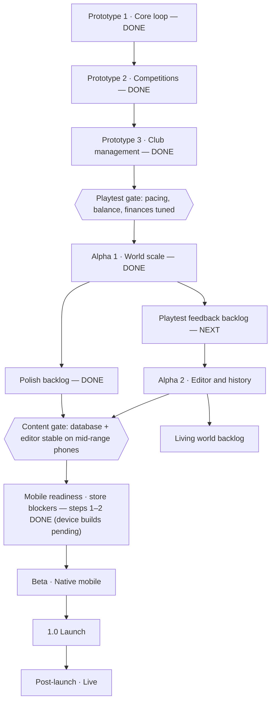

# Touchline — Roadmap

Oct 21, 2026 · Source: [Claude Docs version](https://claude.ai/code/artifact/4208fb1b-f42b-4a90-86c7-46c970e08ba9)

## Contents

- [At a glance](#at-a-glance)
- [Shipped](#shipped)
- [Systems pass](#systems-pass)
- [Next](#next)
- [Open questions and risks](#open-questions-and-risks)

## At a glance

Four prototype builds, Alpha 1, the polish and small-features backlogs and mobile readiness step 2 are done, and so are playtest feedback batches 1–6 and the rounds after them, up to round 24 (the newest: bulk edits and an On/Off switch for the in-game editor, a youth rating for every nation, sim forward, expansion drafts, loans and prospect management, and names of their own for more than thirty nations). Batch 7 (platform) is next, with a round 8 of ideas from comparative review merged in (batch 8 below), then Alpha 2 (editor and history) and a living-world backlog (with identity items from an external review: sandbox start, club recruitment philosophies, reputation web); device builds and a native store release follow. Phases are ordered but not yet dated.

## Shipped

The web prototype runs on a phone browser with no build step, covering 3711 fictional clubs in 253 leagues (the real structure under invented names) across 117 nations in three simulation tiers, and 117 national teams. Newest build first.

### Playtest feedback, round 24

- **Loans on the squad screen, first club, editor confirmation:** (1) a player on loan at your club has "on loan from {club}" on his line in the squad list (as well as the "Loan · club" pill), and your own players out on loan are listed under "Out on loan" on the squad screen, with the club they are at. (2) A player's first club is the club that trained him: the seasons at 17 to 19 of a player made with the world are at his youth club (`p.youth` or `p.trainedAt`), with the first spell and the rows to match; older saves have his first seasons moved there, once, when his profile is opened (`W.reworkPast`, history version 2). (3) Applying changes in the world editor, for a new career or a career in progress, ends with a sheet that stays until closed: how many changes were made and the first twelve of them.
- **Intercontinental play-offs, sub-confederations, Slavic and Balkan cups:** (1) *Play-offs:* the last places at the World Championship are played for as in real life: the best nation of each part of the world that did not qualify (Europe settles its own in its pools' play-offs), a few more of the next best to make three for each place, the top seeds waiting and the rest playing semi-finals in the third break, each winner meeting a seed in the final on the second day, single matches on neutral ground (`Intl.icpoDay`); the winners are in the finals, and the Nations tab shows the bracket. A calendar without a third break fills the places by ranking as before. (2) *Sub-confederations:* 19 unions within or across the confederations (Nordic, Baltic, Balkan, Slavic, Central European, Celtic, Caucasus, North, West, East and Central, and Southern African, the Southeast, East, West (Gulf) and Central and South Asian, the Central American and Caribbean, Andean and River Plate, and the Arab Football Union), each with a name, a parent confederation and members that can overlap, and each holding the Nations Cup drawn from its members; the world editor's Confederations screen renames them, changes their confederation, moves nations in and out and adds sub-confederations of its own (`Intl.subs`, `S.confeds.subs`). (3) *Slavic and Balkan cups:* a Slavic Nations Cup (13 nations) beside the Balkan one (now "Balkan Nations Cup"), and a Balkan Club Cup and a Slavic Club Cup, tier-5 regional cups for the clubs of those nations that take the places below the other regional cups' in each league. The game now has 24 continental cups.
- **Realistic past seasons:** the seasons a player had before the world began (`W.pastSeason`) are now drawn the way a season goes: the games he was fit for (injuries by his own proneness and age: mostly a few missed games, one season in four or five a real spell out), his place in the team, minutes from starts and substitute appearances (a keeper plays all or none of a match), then goals, assists, shots, key passes, tackles, interceptions and cards per 90 minutes for his position at the match engine's own rates (measured over a played season of the whole world: a regular striker 0.42 goals a game, a winger 0.22, a midfielder 0.13, a centre-back 0.08), raised or lowered by how far above his club's level he was, his finishing or vision, and a run of good or bad form that carries from season to season. Counts are drawn by chance, so a striker's 17 goals one year are 9 the next; ratings run from 6.6 to 7.3 with the player's quality, and a keeper's clean sheets and goals against follow his side's strength. A save made with the old numbers (which ran high for attackers, with the same minutes every year and no injuries) has them drawn again, once, the first time the player is looked at; his spells and career totals move by the difference. New worlds write up to 24 seasons. A unit test holds the rates.
- **Days counted as days:** Sim forward by a number of days now goes on for exactly that many days of the calendar, never past it: a day with no match, cup night or break just goes by and the date in the top bar moves on by one (`S.dnNow`, `Season.dnToday`, `simDaysSteps`); "Stopped after N days" says how many days really went by. The Until choices (next match, window, season) and Continue still go from one day with something on to the next, and the daily running of the world (training, healing, transfers) still happens on the days with something on, not on the quiet ones.
- **Loan indicator, optional substitute keeper:** a player on loan at your club shows a "Loan · club" pill in the squad list (hover or long-press for the full name and the end of the loan). A bench you set yourself no longer gets a substitute keeper added: the game picks one only when you leave the bench to it (`W.pickXI`), and if the keeper has to go off with none on the bench an outfield player takes the gloves (`Match.makeSub`).
- **A full season-by-season history:** a player's Season by season table has a row for every season since he was 16, with no "Earlier" or "Before: other clubs" lines. The seasons the game recorded show as before; any other is rebuilt from what is known (`W.fullHistory`): the club of the spell it falls in, or his youth club or a club of his nation at his level before his first spell, with the games and goals his spells and career totals have over the recorded rows shared out by his age then (and an estimate for early seasons an older save left out of the totals). A rebuilt row is dimmed with a ~ and shows games and goals only; it is worked out from his id and the year, so it is the same every time, and the Career total follows the table. New worlds now write up to 24 past seasons instead of 16.
- **Fold all, profile tabs, registration at the deadline, one budget slider:** (1) the Nations tab (tournaments, qualifying pools, Nations League) and the World leagues view each have Open all and Fold all (`UI.foldBar`, `foldAll`, `wvFoldAll`), beside the one the Cups screen already had. (2) Switching tabs in a player profile (overview, attributes, career ...) keeps the tab strip where it was instead of scrolling to the top. (3) The manager's signings are no longer refused for breaking the squad limits (the squad list, non-EU and foreign places, the matchday cap): the offer sheet warns, the deal goes through, and the squad is registered within the rules at the registration deadline (the players over a limit sit out until the next window closes). The club's own signing policy, embargo, work permit, signings from abroad a league allows and MLS salary rules still refuse (`Reg.canSign` with `soft`). (4) The wage and transfer budgets are one slider that moves the club's money from wages to transfers.
- **Less memory after a sim (music stopping):** the game has no audio code, so a player's music stopping when a sim finished was put down to memory: a big world is hundreds of megabytes as live objects, and the simulation worker kept a whole second copy of it for as long as the page was open. The worker now lets the world go as soon as the day has been sent back (the next run sends a fresh copy), which takes roughly half the memory the page holds when idle. Not confirmed on the phone that reported it.
- **A third international break:** the season has three windows of two match days, after league rounds 7, 15 and 20 (the last late in the season, as the June window). The first two carry the qualifiers and the Nations League as before; the third has every nation without a match play a friendly against a neighbour in the ranking (your own nation rests unless you set up a friendly), and the season's invitational tournaments (semi-finals and final) now play there, where no qualifier or Nations League game can get in the way. The world editor's calendar has a third break to move; a definition with two breaks keeps two, with the invitationals on the second (`D.INTL_AFTER`, `Intl.breakDay`).
- **Family ties for nations of your own:** a nation made in the world editor can name the nation its people have family in (Greenland: Denmark; the territory presets fill it in) and the share of its players with those ties (40% unless set): they are generated with names of that culture and a second nationality, and the usual citizenship rules settle whether they hold the passport. A small share of the parent's own players have a link back. A completely new country with no ties gets about 8% of its players with family in nations of its part of the world (`familyTies` in `js/worlddef.js`). Before, a nation of your own had only players of its own culture and no dual nationals.
- **Squad status filter, sliders, budget speed, better crests:** (1) the squad screen's filters have a Status choice: counts as foreign or non-EU, non-EU, EU passport, foreign Asian, ASEAN, African or American, homegrown, not homegrown, dual nationals (`SQ_REG`, by the league's own registration rules). (2) Contract and transfer negotiations use sliders for the fee, wage, signing-on, appearance and goal bonuses, release clause, wage rise and contract length, and for your asking fee when selling; the figure follows the thumb and the sheet redraws when it is let go. (3) The transfer and wage budgets are sliders too, and no longer save the whole game and redraw the screen on every tap: the figure updates at once and the save follows 1.2 seconds after the thumb stops (`Finance.setBudget`). (4) Club crests: eight shapes (hexagon, lozenge, oval, scalloped shield added), seventeen patterns (diagonal stripes, chequers, saltire, split, target, double chevron, chief added), a soft light, a dark or light edge by the base colour and a fine inner border on about two crests in three.
- **Hosts in qualifying (option):** each tournament in the world editor can have its hosts play the qualifying groups too (`tn.hostsQual`): they are drawn in and play every match but take no place, so the next team in their group goes through. Off by default: hosts skip qualifying, as checked for every tournament.
- **Seven requests, one batch:** (1) *Observer status:* in the world editor's Confederations screen each nation has an Observer switch; an observer belongs to its confederation and plays its Nations League and friendlies but is left out of the qualifying groups, the continental championship, the World Championship places and guest lists (`S.confeds.observers`, `Intl.observer`, `Intl.qualRanked`). (2) *More territories to turn on:* Create a nation offers sixteen more starting points (Galicia, Canary Islands, Brittany, Corsica, Sicily, Sardinia, Frisia, Sark, Falklands, Saint-Pierre, Wallis and Futuna, Zanzibar, Western Sahara, Tibet, Kurdistan, Northern Cyprus) beside the existing Catalonia, Basque Country, Jersey, Guernsey, Vatican City, Monaco and Greenland. (3) *A national team is a job:* a manager with a country and no club is "between clubs", not out of work (`W.hasNationJob`, `W.hasJob`): the Home screen, top bar and offers screen say so. (4) *Clubs come for you:* a bigger club may approach a manager who is doing better than the board expected (not often: 70 days in the job, 8 games played, one approach at a time, a week to answer, a cool-down after) with a card on Home; Accept leaves your club (a successor is appointed), Decline pleases the board and fans a little (`Season.poachTick`). (5) *Tournament hosts:* the editor lets each tournament have chosen hosts (up to four, for co-hosted finals) or draw one to four; hosts are in without qualifying whatever their ranking, head the pots and play at home against a team that is not a host. (6) *Short names:* `UI.cshort` and `Intl.tshort` give a short name for tight spaces (the Home table label, cup pills, the match hero); "Canadian Canadian Championship" is now "Canadian Championship". (7) *Press conferences:* 26 new questions (injuries, contracts, the window, form, the title race and relegation, the derby, youth, scorers, board money, boos, the papers, being linked with another club, foreign squads, rich clubs, international duty, draws).

- **Nationalities, the rest of the plan:** AI buying now leans toward the nationalities a league's mix is rich in (`T.natAffinity`) and back toward the league's starting foreign share (`S.natTarget`, `T.natBalance`); the foreign nations in a mix are flattened a little (`FOREIGN_FLATTEN`), so the big five average 10.7 nationalities a squad (was about 5); small nations with 16 to 22 players are topped up to a pool of 23 at world creation (`W.fillNationPools`, 78 nations under 23 became 36); a league's academies draw from its mix at a younger, more domestic share; and a fictional nation in the editor can stand in for a real one (`template`), taking its ties and its pull in every league. The first drift reading (10 seasons, every league at the quick tier): 108 of 117 top flights lost more than 5 points of foreign share, up to 43. With the academy change, 3 seasons move 30 of 117 by more than 5 (largest England -19, Germany -18, Turkey -16, France -15): better, not solved. The league targets are still rough and unchecked: no per-league CIES table could be found; the loans between lower-division clubs are domestic and need no corridor.

- **Youth pathway, first steps:** the Pathways card marks a youngster who is "ready to step up" (an Under-18 as good as the middle of the Under-21s, an Under-21 or B-team player good enough for the first team) and one who "needs more minutes" (a prospect playing under a quarter of his club's matches, or under a third out on loan); a minutes plan for each player (play regularly, bench cover, loan for minutes), warned against on the card (`UI.youthFlag`, `UI.PLANS`). Development now depends on the challenge of the football a young player plays (`Sea.challengeK`): about a level above his own teaches most, cruising far below teaches less and being far out of his depth hurts, the Under-21s and Under-18s count as a level or two below their club; the curve is set so the world's growth is as before (the regens check passes 10 of 12 as it did, the two near misses unchanged). A youth-pipeline check (`npm run calibrate:youth`, `tools/youth-check.mjs`) measures how many academy players reach a first team and a top flight, debut ages, the academies' share of top-flight games and whether loans help.

- **A job board for out-of-work managers, and Mauritius's names:** out of work (and with a national team only) the Home screen has a Job board under the offers: about a dozen clubs in your reputation range that are looking for a manager (the unhappy boards come first, refreshed every week), each with a Look and an Apply button and how good the chance is (a good chance, a fair chance, a long shot), and your open applications with the days to a reply (`Sea.jobBoard`, `Sea.applyForJob`, `UI.jobBoardHtml`). Three applications at once at most; each is answered in two to six days (`Sea.answerApplications`, run by the job market every day): an offer that stands for a week, or a no. The odds follow the gap between the club's reputation and yours (0.7 at five points above you, falling by 3.5 per point, up 0.15 where the board wants a change). Clubs of reputation 75 or more want a Continental B licence and 85 or more Continental A (`Sea.jobGate`), shown on the card with the Apply button disabled. Taking a job ends the applications and clears the board. Checked in Node (an out-of-work manager of reputation 38: a board of 12 clubs, a fourth application refused, all three answered with offers within nine days, a club of reputation 88 refusing a Continental B manager). Mauritius had every player named from a South Asian pool: its players now take the names of the island's communities (66% Indian descent, 27% Creole and French, 4% Chinese, 3% English; `comm('MRI')`). Not done: income for a manager with no club (the game has no personal money to pay it into), interviews with questions, minutes at Minimal fidelity, the half-time glitch, the world-size warning, the Rest fixtures' explanation.
- **Playtest report: save loading, national jobs and smaller fixes:** (1) A save that will not open shows a screen with the real reason and the step it failed in (reading, rebuilding the world, the world's history, upgrading, finishing the day, drawing the first screen), with Export this save and Delete this save (a second tap confirms), instead of a silent return to the title (`UI.loadFailed`; the console logs the step). (2) A skip that goes round without getting anywhere throws a reason (`Sea.simDaysSteps`, `Sea.skipSteps`) and the sim's toast shows it, in place of "Simulating the matchday" for ever. (3) A manager with a national team and no club has only that job: no skip, timed sim or "sim without stopping" plays a match of the nation's unseen; each stops before it (`natMatch`, with a toast). Checked in Node on Scotland, whose match is on day 40: the wait for an offer stopped there and no day was played with the match waiting. (4) Licences: club and national-team matches both count toward the games a licence needs, the Manager screen shows "3 of 20", and a manager with a national team and no club can enrol, the federation paying the fee (`Pe.gamesInCharge`, `Pe.startCourse`). (5) A national result moves a manager's reputation three times as much as before (a win was 0.6 of a point, invisible next to the 6 a trophy gives: now 1.8). (6) The Squad, Transfers and Scouting tabs of a manager with no club but a national team say where the national squad is and link to it (`UI.noClubView`). (7) The opposing national manager in the matchday dialog is the federation's (`t.mgr`), the same the Nations screen shows, not a club staff record a nation does not have. (8) A qualifying objective says "Win Africa C to qualify" where the pool has a group for each place, and not "9 places from Africa C" (the places of the whole pool) (`I.objective`). (9) "Coming up" counts days by the calendar (`dn`), as the sim does, not entries of it. (10) The advice about a player out of position offers Auto-pick XI when there is no natural to swap in. (11) A derby is "the Old Firm", not "the The Old Firm" (`U.theName`, three unit checks). Not done: a job board with applications, income for a manager with no club, a permanent test of offers over a season, what "Rest" fixtures are (dates, draw timing, stage), minutes at Minimal fidelity, the half-time glitch, the name pool for Mauritius, and the world-size warning that differed between two creations.
- **Your league and its neighbours are always Full, and league detail can be changed every season:** your league, the one above it and the one below it (where there is one) are Full for as long as you are at the club, whatever was chosen, and cannot be set lower (`W.focusLeagues`, `W.applySimFocus`: it used to leave a league chosen as Minimal alone). When the club changes league (promotion or relegation) the three follow it and the league it leaves goes back to the tier chosen at the start or the last time (a second-division club with a Minimal world: divisions 1, 2 and 3 are Full; relegated, 3, 2 and 4 are Full and division 1 is Minimal again), and when the job ends every league goes back to its chosen tier. A league that becomes Full gets the bigger squads of that tier (`W.topUpFullSquads` at the season rollover and when a job is taken). The tier of every league can be changed on the last day of each season, for the next one: a card on Home that day and a League detail screen in Settings (read-only the rest of the year) list the leagues by nation with Full, Light and Minimal for each, "everything else Minimal" and "everything else Light", and the leagues around your club shown as always Full; the choices wait in `S.simNext` and take effect when the season ends (`Sea.applySimNext`). A skip that reaches the last day stops once for it (`Sea.detailDue`, a pending decision), unless the sim runs on its own. Tools and tests that play with Minimal worlds now get the three leagues around their club in Full too. Checked in Node (promotion and relegation of a second-division club, the pending choice, the job ending, the stop) and in the browser (the card, the sheet with the leagues around the club locked, Everything else Light, Done, read-only off the last day).
- **Leagues you did not choose start as Minimal, and an out-of-work career gets job offers in any world:** the new-career default for a league the player does not choose is Minimal (it was Light; with the world at 4,800 clubs every league Light made a day of play cost about 35 CPU seconds in the transfer window; with the default Minimal it is 3.6 on average). Your own league and the ones just above and below it are still Full, and every league can still be set to any tier on the new-career screen, whose text now says so. Job offers (`Sea.jobMarket`) came only from Full leagues and two lower divisions in Light, so a career that began with no club (no league of its own to be Full) in a world of Minimal leagues had no job to offer, ever (a playtest report: nine months without an offer): any club of any tier can now have a vacancy, within the usual reputation window. The leagues around your club are Full whatever was chosen (next bullet), and the squads of the clubs that became Full are filled up once to the Full size (`W.topUpFullSquads`, marked per club). Tested in Node on an all-Minimal world: an out-of-work manager of reputation 38 got 3 offers at the start and 14 clubs offered over 40 days; he took a job in a Peruvian second division, whose league and neighbours went Full (34 clubs, 226 players made), and played on. Not done: a permanent test of offers over a season, the job board with applications, reputation gain from national-team results, and the other items of that report.
- **A day of play, profiled (a first 12% faster, the world unchanged):** a CPU profile of two days of a new career at 4,860 clubs put 88% of the time in the AI transfer window (`T.aiWindow`), which runs every day the window is open. Two exact fixes: the loan search for prospects (`T.aiProspects`) looked through every club of the world for every prospect and worked out each one's squad again each time (now the clubs are listed once and a squad is worked out once between two signings), and the market list worked a player's age out four times (now once). Three days of play from the same prepared world and seed give the same state hash before and after, at 32 to 46 CPU seconds a day instead of 39 to 51. Not done, and the real size of it: the window's work grows with the number of Full and Light clubs (the day's shoppers are 60 a hundred and ten clubs, about 1,300 a day at 4,800 Light clubs), so a day at the new-career default (every league Light) costs about 35 seconds while one with most leagues Minimal costs a few. A default of Minimal for the leagues you did not choose would bring the day back; it needs the vacancy fix for out-of-work careers first (a Minimal world has no sackings).
- **Saves of a big world are stored in pieces (a P0 fix):** playtesters reported that new saves failed to load, silently, by every route. The cause was not the career (an out-of-work career saves and loads like any other): a browser refuses one IndexedDB value over about 127 MiB ("The serialized keys and/or value are too large", Chrome), a save of the current world is about 130 MB packed (accented text counts two bytes a character), and the write had no handler for an aborted transaction, so it never finished and never said so, while the slot's small summary had already been written: the title screen listed a save with nothing in it, and loading it did nothing. A long value is now kept as chunks of 24 MB at most with a small manifest, in one transaction (stored whole or not at all, `IDB.put`, `IDB.get`, `Sv.splitValue`); an aborted transaction fails with its reason; the slot's summary is written only after the save is stored (a failed write no longer leaves a slot that lists a save with nothing in it); a save error says why and points to Export save, and a load error shows the real reason. Checked in the browser: an out-of-work career saves (11 chunks), reloads and opens, and a second save over it leaves the same keys. Not done from the report: the sim iteration cap with a visible error and chunking, the save manager, atomic export, the national-fixture stops, vacancies without managers and the job board.
- **A prepared world: a new career starts in seconds:** `tools/buildworld.mjs` (`npm run build:world`, run by the deploy and by `cap:sync` after the build) makes the world once with a fixed seed (every league in the Light tier, the 30 seasons of history and the clubs' legends included), packs it and gzips it as `data/world.touchline` (26 MB; 129 MB packed, 4,860 clubs, 107,361 players) with `data/world.json` naming the simulation build it fits. A new career fetches it (`UI.loadPreparedWorld`), takes the leagues you chose in the new-career screen (`W.fitPreparedWorld`), draws each young player's hidden potential again around what the world gave him (the clubs, squads and history are the same for every save; the futures are not), and fills up the squads of the leagues you run in full (`W.topUpPreparedSquads`, 502 players for a typical start). In the browser a career is ready in 9 seconds, against minutes for a generated world. The new-career screen has a World choice: the shared world (the default) or a random one; the game also makes a world the old way when the file is missing or belongs to another build (a game run from its sources, a failed download), and when a database is chosen. The service worker leaves the file to the browser and the smoke test checks the file belongs to the build. Not done: the long checks (names, history, balance) run once on the shipped world, a lighter file for phones (the world holds 1.3 GB of heap once loaded), and a day of play still costs about 100 CPU seconds at this size with every league Light, in the prepared and the generated world alike.
- **A new world builds six times faster:** a CPU profile of `W.newWorld` (4,860 clubs, 82,661 players) showed 75% of its time in three "is my cache still valid?" checks run for every player made: `W.clubForeign` rebuilt an array of every club to find its league's mean (50%), `W.squad` rebuilt its index of every player after each club's squad (13%), and `W.assignYouth` counted every club (12%). The clubs of each league and the club count are now kept as clubs are made (`W.clubMade`, called by `W.mkClub` and the overseas clubs), and a club's new players are added to the squad index when it was complete. The same seed makes the same world (a hash of the whole packed world matches before and after: 96.0 MB), and a build takes 119 CPU seconds instead of 764. This speeds every test, the gate, the editor and databases, and a new career from the random generator.
- **The army's club says what it is:** Bujeong Garrison's signing policy is `military-service`, so its club picker line, club card and scouting note read "Only military-service players" and "A military-service club: it signs only players of military-service heritage, like Athletic Club". They now say "Conscripts only", "Conscripts on national service" and that its squad is conscripts on loan from their own clubs; other policy clubs (the Basque ones) read as before (`clubguide.js`, `ui-screens.js`, `ui-alpha.js`, `ui-extra.js`).
- **Load a save that is gone says so:** the title screen lists a slot from a small summary in `localStorage`, while the save itself is in IndexedDB; if the save was cleared or its write ran out of room, Continue and Load a save did nothing at all. They now say "Slot N has no save data on this device" (and an error while the game starts a save that did open is shown instead of swallowed) (`UI.load`, `UI.acts.continue`).
- **Real competition formats, sheets 03 to 19:** (1) Domestic cups follow the sheet's legs (24 cups: two-legged semi-finals in Spain, Belgium, Bulgaria, Denmark and Slovenia, whole two-legged cups in Canada and Colombia, two-legged quarter-finals and semi-finals elsewhere), and Argentina and Brazil go straight to penalties, France has extra time only from the round of 32 (`etFrom`, `play.extraTime`). (2) A cup winner without a continental place takes the one his cup carries (`D.CUP_PLACE`, 98 cups), replacing his nation's lowest club in that cup. (3) Continental finals: single matches in the North American and African Champions Cups, two-legged in the Southeast Asian, Gulf and Central American Cups; the Libertadores and South American Shield play extra time in the final only (`etFinalOnly`), as does the Copa América. (4) Guests: the Gold Cup invites an Asian nation; guest selection works for any tournament; the COSAFA, CECAFA and CAFA invitationals take one outsider. Not done, listed in `docs/REAL_FORMATS.md`: the 36-club league phase, group-stage cups, replays (none needed), regional tournament sizes, the fourth international window and 2030's six hosts.
- **Real competition formats, second pass (sheets 03, 05, 06, 17 to 19):** four international windows of 4 + 2 + 2 + 2 matchdays, qualifying groups home and away, the six 2030 World Championship hosts qualifying automatically, group stages for eleven domestic cups and late entry for the top divisions of six, the Gulf, Southeast Asian and Central Asian nations cups drawn from their real members. What the engine does not yet allow (the 36-club league phase, staged confederation qualifying, bigger regional nations cups) is listed in [REAL_FORMATS.md](REAL_FORMATS.md).
- **Real competition formats, third pass (sheet 04):** the European Champions Cup, Shield and Trophy play the 36-club league phase (eight matches each against different opponents, a knockout play-off for ninth to 24th, a round of 16), with more places for each league and qualifying rounds that fill the Champions Cup, and a calendar of eight league-phase matchdays, two play-off days and two round-of-16 days (`D.CC_AFTER`). Monaco stays without a nation, national team or confederation place: it is not a FIFA member, so that is intentional. See [REAL_FORMATS.md](REAL_FORMATS.md).
- **Real competition formats, fourth pass (sheet 19):** staged World Cup qualifying: the lowest ranked Asian, North American and Oceanian nations play a two-legged first round on the first two matchdays and the groups are drawn after it (`pending`, `Intl.drawPending`); Africa plays nine groups of six and its four best runners-up play off for the intercontinental play-off place. What needs a qualifying over two seasons (the later Asian and CONCACAF rounds, the CONMEBOL league of 18 matchdays, the European play-off paths) is listed in [REAL_FORMATS.md](REAL_FORMATS.md).
- **Real competition formats, the leagues sheet:** all 139 leagues follow the workbook's leagues sheet (`docs/real-formats/02-leagues.tsv`). Club counts: 165 fictional clubs added in 40 leagues and 8 weakest removed (`tools/realclubs.mjs`; the Netherlands' second tier gets four Jong teams and Portugal's two B teams). A generic title play-off (`rules.playoffs` type `ko`: the top n with byes, one or two legs per round, once at the end or after each tournament; type `groups4`: Colombia's cuadrangulares) with second-leg days `N1` to `N4` in the calendar, used for Costa Rica, El Salvador, Guatemala, Honduras, Panama, Colombia, Peru and Uruguay; Paraguay's two tournaments have a champion each with no play-off. New splits for Bulgaria, Cyprus, Israel, Czechia (single rounds), Egypt, Ecuador and Greece, and Belgium's plain 34 matches. Relegation play-offs against the division below for Portugal, the Netherlands, Norway, Sweden, South Korea (two ties) and Vietnam (`relegate.playoff`, a number for more than one tie). Youth and homegrown minimums for 40 more leagues (`FM.Reg.RULES`). Then the left-overs: Spain's third tier as one division of two groups of 20 (`rules.pools`: each group its own table, places counted in each group), Uruguay's Intermedio (`rules.intermedio`: two groups of 8 between the tournaments, 37 matches), points-average relegation for Argentina, Colombia, Paraguay and Uruguay (`rules.average`), Europe play-off knockouts for Czechia, Bulgaria and Greece (`playoffs.europe`), and relegation play-offs against the lower divisions the game now has (Belarus, Bulgaria, Kenya, Tanzania, Romania, Czechia, Russia, Ukraine, Sweden's, Norway's and Portugal's second tiers). The sheet's "check" rows: France's Ligue 2 16th v the third tier's 3rd, Japan's J2 promotion play-off (3rd to 6th). Ten new second tiers (Albania, Bolivia, Estonia, Georgia, Kosovo, Latvia, Lithuania, Luxembourg, Montenegro, North Macedonia: sizes unverified, `tools/newtiers.mjs --only`) with their top flights' relegation play-offs. What is left is in `docs/REAL_FORMATS.md`.

- **Lower-league stars, part 5: the season digest:** each summer two items go to the news: Late bloomers of the year (the four best players who broke out, among the clubs the game simulates in full) and The step up (the four best who settled after a move to a much bigger club and the four best who struggled) (`Sea.lateDigest`, called from the rollover after the player loop). The individual breakout item for a player of yours or of a full club stays as it was. A journeyman who signs anywhere now makes the news as such, with his club number (`St.transfer`).

- **Lower-league stars, part 4: loans for late bloomers and finds:** AI clubs' loan-out list now also takes players of 23 to 27 with at least four points of potential still to come who are either Late Bloomers or hidden gems and are not getting games (`T.lateLoan`, `T.aiLoans`), exempt from the usual 50% skip for senior surplus, and about four loan draws in ten look at that group first. The usual gates still apply (the parent keeps enough bodies and the borrower is a smaller club where he would start), so it is a small extra stream, not a flood. Checked only on a hand-built test world, where the parent clubs' squads were below target and nothing loaned out, so the rate in a real season is not measured.

- **Lower-league stars, part 3: sell-on clauses, finds in the news and free-agent journeymen:** (1) When an AI club sells a hidden gem (`Sea.isGem`) to a club well above it (ten or more reputation), six times in ten the deal carries a 10, 15 or 20% sell-on clause, so the small club shares in his next fee (`T.execute`; it uses the existing `p.sellOn` machinery, so it is paid when he moves again). Your own deals are not changed. (2) Such a move now makes the news as a find from the lower leagues, even when the fee is small (`St.transfer`). (3) Free-agent journeymen are 30% more likely to be picked up by a club below 65 reputation (`T.aiWindow`). Not done: the real-figure calibration, and a change to how AI clubs use loans.

- **Lower-league stars, part 2: journeymen, an Overlooked scouting focus and career lines:** (1) A Journeyman trait, given at the summer rollover to a player of 27 or over who has signed for seven or more different clubs (loans do not count; about 2% of veterans): his permanent deals run one or two years, and he settles into a step up more often (`Sea.permClubs`, `Sea.lateYear`, `T.execute`); a news item when he is yours. (2) A new Overlooked focus in a scouting assignment: the scout favours players clearly better than their club's level and barely known, and a sharper scout (judgement) picks them out more often (`Sc.tick`, `Sea.isGem`). (3) The player's life story adds a line for a late bloomer (the year he came good and his age) and for a journeyman (his clubs). Not done: AI free-agent and loan retuning, sell-on clauses for finds, career stories on the news feed beyond the breakout item, and the real-figure calibration.

- **Lower-league stars, part 1: visibility, breakouts and the step up:** (1) Every player has a hidden visibility (0 to 100): how likely he is to be noticed, apart from how good he is. It starts from his club's standing, his caps and honours; playing above his club's level lifts it a few points a year, and it falls only slowly, so a good player at a small club starts out unseen (`Sea.visTarget`, `Sea.vis`). An AI club's shopping now only considers players its scouts have noticed (a free agent is always on the list; a big club's network reaches wider; the same nation helps), so hidden gems (`Sea.isGem`: at least five above his club's level, 28 or under, visibility under 45) are found late, and move about two and a half times as often as the rest once found (`Sea.noticed`, in `T.aiWindow`). (2) Breakouts: once a season a player of 20 to 28 who has played (12 games, or 8 for a keeper) may break out, with 18% for a Late Bloomer (1.2% for anyone else): two and a half to five and a half ability points at once, his potential raised to fit, his visibility up twelve, and a news item (`Sea.lateYear`, `p.breakout`). (3) The step up: a permanent signing by a club whose level is eight or more above where he was playing is judged at the end of the season. Professionalism, temperament and big-game nerve, age, the gap and his games decide whether he settles (a point or two of growth) or struggles (a point or two lost, lower morale, and a news item if he is yours) (`T.execute`, `p.stepUp`). Not done: the journeyman profile, AI free-agent and loan retuning, the hidden-gems scouting filter and sell-on clauses, career summaries, the real-figure calibration, and an on-pitch penalty during the first season of a step up (it is judged at the end of the season).

- **Youth leftovers: agents, cup ties, the B-team rest rule, the attrition account and FIFA's categories:** (1) a young player (17 to 21) who has hardly played, with an ambitious agent or a family behind him, now asks where his football is coming from (a desk decision): promise him games (about a third of the matches, judged at the end of the season: kept earns trust, broken costs morale and often a transfer request), put him on the loan list, or tell them to wait (`M.agentPush`, `M.promiseCheck`). (2) Cup-tied: a player who has played in a cup this season for another club cannot play in it for his new one (a transfer, or a loanee back from the borrower), though his other competitions stay open; his row carries a Cup-tied tag (`p.cupApps`, `W.pickXI`). (3) A first-team player who played a senior match in the last three days cannot be sent down to the B team (`Y.canSendDown`). (4) The academy report adds the account since you took over (how many the academy made, how many you let go, how many have played senior football) and a Let go too soon group for released youngsters who have grown into players your first team would want. (5) Training compensation now follows FIFA's categories of club: Category I, II, III and IV by a club's standing at 90,000, 60,000, 30,000 and 10,000 a year, his years from twelve to fifteen at the Category IV rate, from sixteen to twenty-one at his club's, and nothing when the signing club is Category IV (`T.trainingFee`). The category rates are from secondary sources and not checked against the current FIFA circular, and the national schemes (England's youth tariff, the French, Spanish and Italian indemnities) are still not modelled.

- **Youth eligibility, call-ups and clashes:** the youth sides now have rules, shown under each side's brief on the Academy tab: the Under-18s take players of 18 or under with ten senior games or fewer this season; the Under-21s take players of 21 or under and up to three overage players (22 to 24) on the fringe of the first team (five senior games or fewer), who fill a short side to find their fitness or minutes; a B team can carry only three players of 23 or over (sending one down past that says so). A Call up button on each youth-side player names him for the next first-team match while he stays in his youth side (dual registration): the first team comes first, so he cannot play for his youth side that matchday, nor can anyone who played a senior match that day, and the youth league result carries a line naming the players the first team took. A player who is not eligible says why on his row and in the pick-the-team sheet (`Y.eligible`, `Y.clash`, `Y.callUp`, `Y.overage`, `Y.canSendDown`). Not done: a limit on how recently a first-team player can play for a B team, and cup-tied rules.

- **Youth stories, the academy report and the graduates tracker:** an academy graduate's debut card now says when he is a local boy and sometimes that his family are in the stand, and his first senior goal (after his debut) has a card of its own. At the end of each season the feed carries an academy report for your club (`Y.seasonReport`): how the Under-18s, Under-21s and B team finished, how many academy players made a first-team debut, and who took the biggest step, who stood still, who broke into the first team (fifteen games or more) and who made a first appearance, each shown with the star range the staff would give. Every club's page has an Academy graduates card on its History tab: the players its academy made, at the club, elsewhere or retired, with their games and goals for it (`UI.graduatesCard`); it only knows the players the academy has made while you play, plus the young players the world began with, not a club's older history.

- **Mentors:** pair a youngster of twenty-one or under with an experienced first-team player (26 or over, two youngsters at most each) from the Mentor chip on his Pathways card, which lists the candidates with their personality and what each would do for him. A good example speeds up his growth (about +5% for an ordinary professional, up to +25% or more for a model mentor, more in the same position), a bad influence slows it (down to -15%), and over the seasons the youngster's professionalism and temperament drift toward the mentor's, now and then with a habit picked up (a Model Professional's, or a Low Work Ethic); a year-end note in the feed says how it went, and the pairing ends if the mentor leaves the first team. A youngster without a pairing keeps the old effect of a Mentor in the squad (`Sea.mentorOf`, `Sea.mentorQuality`, `Sea.pairMentor`, `Sea.mentorYear`).

- **Youth: the coach, your own pick, trials and contract talks:** a youth side is picked better by a better coach (your coach's way with the young, or another club's training ground: a poor one is fooled by a good training week, and good coaching is worth a point or two to a side's strength), and you can pick the side yourself for the Under-18s or Under-21s (up to thirteen players, the coach fills the rest, cleared with one tap) (`Y.coachSkill`, `S.user.youthPick`). Youth trials: send the staff to a part of the world (the Academy tab) and they bring back four young players of that region, with rough reports, for a cost that is higher away from home and about once a month; you sign the ones you want, places permitting, and the rest go home (`Sea.holdTrials`). The academy review has a Contract button for the older ones, which opens the usual talks (appearance fees, release clause, yearly rise), and a poaching offer can be sold with a 15% sell-on clause for a little less. The intake's player making is now one function (`Sea.academyPlayer`) used by the intake and the trials.

- **Training compensation and poaching:** a club that signs a young player (22 or under) it did not train, on a free, now pays the club that trained him: his years in the academy, up to seven, at a yearly rate that rises with the training club's standing, never more than a tenth of what the buyer has (`T.trainingFee`, `T.trainingComp`; it applies to every club, yours included, and shows in the feed when you are paid or pay). A bigger club now comes for one of your best academy prospects (fifteen to eighteen), offering the training compensation: you can sell, offer him a professional deal to keep him (his family and agent may still prefer the bigger club, more so for an ambitious player with no first-team football), or turn them down, and an unanswered approach is turned down (`M.poachYouth`). The compensation is a simplified model, not the real tariffs: FIFA's training compensation and the national schemes (England's youth tariff by academy category, the French, Spanish and Italian training indemnities) differ in who owes what, at what age and how much, and the real tables are still to be checked country by country.

- **The academy is read as a range, with places and a yearly review:** a young player of your own academy is no longer known through and through. The staff know a fifteen-year-old about 35%, a sixteen-year-old about 55%, a seventeen-year-old about 70% and an eighteen-year-old about 90%, a little more for the youth games he plays and the academy's level, and fully from nineteen or once he is a regular in the first team; until then his stars and potential are a range that narrows (`Sc.academyKnow`), and the Pathways card judges him on the middle of that range, not the truth. An academy has places (12 plus 4 for each level of its academy), shown on the Academy tab, and each season's start brings an academy review in the feed: the youngsters at a decision (sixteen: a scholarship, eighteen: a first professional deal, twenty-one: the last year of the Under-21s) and a prompt to make room when the academy is over its places, each with Keep and Release (`Y.review`).

- **Loans: a verdict, a guaranteed-minutes clause, wishes for the destination:** the loan report for a player you have sent out now says how he is rated, how his ability has changed since he left and a verdict on his development (developing well, playing regularly, playing some but not enough, not getting the football he went for) (`M.loanVerdict`). A loan offer from a club that sees him as a regular starter can be accepted with guaranteed minutes (60% of their matches): if he plays under three quarters of that after six games the desk reports a breach and you can end the loan at once, whatever the window (`p.loan.clause`). A player on the loan list carries wishes (a guaranteed starter, a club in the same country) that pick the clubs that bid for him (`p.loanWish`, `M.loanTarget`).

- **Youth sides under a brief, and no more league games at fifteen:** each youth side has a brief you set on the Academy tab (win matches, develop youngsters, or, for the Under-21s, minutes for promoted players), and the coach picks the thirteen under it: the strongest, the players with the fewest games first, or young first-team players who are not playing first (`Y.briefOf`, `Y.matchSquad`); a youth-focused AI club develops its youngsters, the rest play to win. The academy intake now goes straight into the youth sides: it used to sit in the first-team squad until the next season, and the youth-pipeline check showed fifteen-year-olds playing up to eleven league games in the meantime (`Sea.youthIntake`).

- **Foreign-player limits hold at the start of a world:** a club over its league's non-EU cap or its Asian-league foreign places once the squads and national pools are made (3 clubs in Spain's top flight, 4 in France's, one each in Malaysia and Indonesia, for example) has its weakest offenders swapped for a player of the same position, age and ability whose nationality the rules allow, drawn from the league's own mix, so the foreign share stays as it was and nothing is added to the world (`FM.Reg.repairWorld`). Homegrown minimums were already met everywhere.

- **Foreign share holds over the seasons:** the market's correction toward a league's starting foreign share is stronger, and a club's pull toward signing in its own country falls as its league's foreign share rises (a Bundesliga run at the game's own tiers held 62% to 58% over three seasons). In a league on the quick tier, where clubs make no signings, a club below its league's share draws its academy intake from the league's mix; the drift calibration (all leagues on the quick tier) went from 36 of 117 top flights moving more than 5 points in five seasons to 18, the big leagues still about 12 to 16 points down there (`Sea.youthIntake`, `T.homePull`, `T.natBalance`).

- **Clubs differ within a league:** how foreign a club's squad is now follows its identity (oil-backed and giant clubs more, fan-owned and youth clubs fewer, a selling club holds young foreign prospects), its owner (sovereign and investors more; state, society, company and member-owned less) and a steady quirk of its own. The lean is scaled by the league's mean, so each league keeps its share: in a seeded world fan clubs carry 23% foreign players, oil-backed clubs 34%, and the top flights stay on target (`W.clubForeign`, `W.foreignFactor`).

- **More second divisions:** the Netherlands, Portugal, Brazil, Turkey, Poland, Norway and Sweden now have a second tier (seven leagues, 124 fictional clubs), each linked to the division above by promotion and relegation.

- **Real formats: lower divisions, cross-border clubs, youth competitions:** 113 more divisions from the real-formats sheets (47 second, 34 third and 32 fourth, 1,702 fictional clubs in the minimal tier, each a single table linked to the division above by promotion and relegation, with play-off places, ties against the division above, triple and quadruple round-robins and closed leagues for the American and Mexican lower leagues); 15 cross-border clubs (Welsh clubs in England, Canadian clubs in the American league, New Zealand clubs in Australia and others) that keep their home nation's players and cup; the Oceania Professional League, the Leagues Cup and the Campeones Cup; 26 national-team youth tournaments and 17 club youth cups played by results at the end of each season (Cups screen, Youth tab); the past cross-nation leagues and cups (Past tab). What is left is in [REAL_FORMATS.md](REAL_FORMATS.md).
- **Real formats: cross-border cups, Oceania league stages, youth qualifying, past competitions in the generated history:** a cross-border club also enters the cup of the nation whose league it plays in (Welsh clubs the English cup, the Canadian clubs the American one ...) with a tie that would be its second match of a day moved to the next cup day; Andorra's and Brunei's clubs have their own nations; the Oceania Professional League ends in two play-off groups and a final; the six regional club cups have the sheet's field sizes and groups; youth tournaments have qualifying, three over-age players in the Olympic and Asian Games sides, the Japanese and Korean school tournaments, open youth cups topped up with academies, and ten past editions with a new world; the past cross-nation competitions that fall in the thirty-year past have winners in the archive and on the clubs' honours cards. Left: regional groups and multi-tie play-offs (waiting on the two-table division), see [REAL_FORMATS.md](REAL_FORMATS.md).
- **Cross-nation leagues survive the editor:** a world taken out as CSV and put back keeps the other nations of its leagues (the cross-border leagues): the leagues file has a `nats` column (an older file without it leaves them as they are), and a definition made from the built-in data now carries them, so it no longer reads as changed.
- **Real formats: regional groups, ties against groups, Colombian and Mexican second tournaments:** a division can be two to nine separate groups (`rules.pools`); twelve lower divisions are now their real groups with the real club totals (Italy's Serie C 3 x 20, Germany's Regionalliga 5 x 18, Spain's Segunda Federación 5 x 18, France's National 2, Poland, Austria, Hungary, Czechia, Norway, Sweden, Portugal and Argentina's two zones: 410 more fictional clubs from `tools/growtiers.mjs`), a club that comes in joins the nearest of the smallest groups, and a relegation play-off against a division of groups meets its runners-up first; Colombia's Primera B plays an Apertura and a Finalización with a play-off each and its tournament winners promoted, Mexico's Liga de Expansión plays two tournaments with a liguilla.
- **Real formats: promotion play-offs over groups, Argentina's parallel levels, groups from regions:** a division of groups can play a promotion play-off among its next places (`playoffs.promo`: one knockout a group or one for all) and send up only its best winners at once (`promote.best`): Spain's third and fourth levels, Italy's Serie C, Germany's Regionalliga (four up, as the sheet has it) and Argentina's Primera Nacional (the Reducido); Argentina's third and fourth levels are two parallel groups (the interior and Buenos Aires, 38 more clubs); the first split of a division into groups is balanced clustering on the map.
- **Real formats: more regional groups:** Italy's Serie D (nine groups of 18), Norway's and Sweden's fourth tiers (six of 14), Switzerland's 1. Liga, Portugal's Campeonato de Portugal, Ghana's second tier and Turkey's 2. Lig as their real groups: 408 more fictional clubs (4,860 in all), each division's places up and down per group and the divisions above matched.

- **Profiles in tabs, history by ability, custom terms:** player profiles are tabs (Overview, Attributes, Career, Mood and deal) under a strip of age, shirt, foot and contract, and club profiles are tabs (Overview, Squad, Matches, History); each season of a player's history carries his ability that year (shown as a Level column in stars), a veteran being stronger in his early seasons and a youngster weaker; and the contract sheet has number boxes for the signing-on, appearance and goal fees, the release clause, the yearly rise and the length, beside the preset chips.

- **Whole careers, flank players and negotiations:** a player's profile now has a season-by-season history back to when he was 17 (up to sixteen seasons, the last three in full and the earlier ones with the headline numbers), at clubs that climb with his ability, with a spell and a fee for each move and career totals that agree with the rows; the players of weaker football nations are found abroad more, at the bigger clubs, so about half of such a nation's best 23 play outside it; about a third of full-backs, wing-backs and wingers can play both wings (the two-footed and many who learned both sides), the rest lose a little on the other flank; and a failed offer gets the agent's second proposal beside the wage-only one: a fifth less a week with the difference as a signing-on fee.

- **Faces, dates and cups:** mood faces are colour-coded, the real date shows beside the matchday number, the ties of other countries' cups are not listed, and the editor's pooled invitational tournaments no longer default their host to Afghanistan (Oceania replaces OFC in the editor and the docs)

- **More playtest fixes:** a national squad always has at least three goalkeepers; sponsors' names are in the language of the nation they sponsor; the full-time report of a live match has no Ratings tab; and the tap areas of links in text and in the matchday digest no longer cover each other

- **Qualifying rounds for the continental cups:** the champions of the nations with no place of their own in a main continental cup play up to three two-legged qualifying rounds, before the league season starts, for four or eight places in the group stage (the groups are drawn when the last round ends; the Champions Cup in Europe now has 28 clubs in seven groups); the Cups screen, the calendar and your cup chips show them

- **Fixes after more playtesting:** mood faces and status marks draw as pictures (they were showing the drawing's name as text), the tactics pitch keeps its front line and its long role names inside the lines, a B team or youth-side player is no one to make an offer for, the staff and scouts a new job comes with follow the size of the club (a giant starts with six scouts watching the world, a small club has two or three from its own region and may lack an analyst or a director), and the regional club cups give out their places by coefficient

- **Editor review, the five rows:** the world editor's Rules has a registration switch (each league's own rules, or one foreign-player limit for all), the Players tab gives a whole nation new names in one tap, the CSV files carry club cash, budget and facility levels and a managers.csv, with a spreadsheet grid in the game checked as you type, Simulate 5 seasons projects every league from the clubs' ratings in seconds, and the in-game editor has Commissioner mode (force a transfer or a loan, correct a league result, with the table following). Still to come: editing from national teams, staff and table rows, and the guided league creator

- **Editor review, second half:** one player form shared by the world editor and the in-game editor (second nationality, heritage, second positions, traits, squad number, wage, and in the game morale, club and healing an injury; only the attributes that matter for his position, as whole numbers with − and +, with ability, stars and value shown live; only changed attributes are written back); the definition format carries and exports the new player fields; an empty squad in the world editor offers to build every squad. Still to come: editing from national teams, managers and staff and table rows in the game, Simulate 5 seasons, and the guided league creator

- **Editor review, first half:** fields in every sheet use one dark style (the in-game editor's white boxes and overflow are fixed); the pre-game editor saves its draft by itself (after changes, typing, every minute, right after building the squads), warns before leaving with unsaved changes and shows "Saved · 2 minutes ago"; the player form has one Done button and a delete that asks twice; the in-game editor has a Changes made list with undo for every edit and asks before moving a player to another club or changing a club's reputation by 8 or more; the pre-game editor opens on tasks, with Files and People tabs, two rows of tabs and bottom-bar labels that say what they do. Still to come: one shared player form, the missing player fields, building squads from an empty list, editing from more places, then Simulate 5 seasons, CSV and the league creator

- **Calibration: assists, the peak age and running costs:** assists are credited on about two goals in three and shared out more widely (the leaders finish on 14–20, not 21–27); the development curve peaks about a year sooner (27.5 on average) with more variation between players; every fully simulated club pays running costs beyond wages each day (38% of revenue in a top flight, 46% in the second tier, half below) so about three clubs in ten lose money in a season; the calibration report and the economy report stay in range
- **Goal types, the cheaper tiers' stats and the qualifying screen:** every goal records its chance type and the season keeps a tally by type and by the scorer's position (a card on the League → Stats tab); light and minimal leagues now record shots, shots on target, minutes and penalties from simple averages and the minimal tier gives cards and suspensions; the qualifying screen shows your own group first, then your confederation, then the rest folded away
- **National team: scouts and the club job:** the federation's scouts report an eligible, uncapped player who is good enough for the squad at the start of an international window (a better scouting network finds him sooner), the Eligible tab shows what makes each player more or less likely to commit (a fair hearing, whether he is in his own nation's squad, the gap in strength, your reputation, his ambition); a manager who also runs a club pays for it: a club player picked for the country who comes back injured costs the club's fans and board a little, a squad with seven or more of your own club's players draws questions from the federation (confidence falls), and your own players picked often come back more tired; the international-duty news names the number of players properly
- **National team squad selection:** the call-up lists show what a manager looks at (games played at his club this season, form, fitness, and tags for injured, suspended, tired, poor form, rarely plays, no club and uncapped), a Left out tab lists the best players of the nation who are not in the squad with the reason for each (and Call up or Explain buttons: explaining the decision to a fit player lifts his morale a little)
- **Intake day, names that open, nationalities and tournament sizes:** the academy intake is a Youth intake day (the sim stops for it; each youngster can be released to the free agents, and a staff-run sim signs them all); club, competition, nation and player names in any line of text open their screens (one sweep over the page, so no screen has to remember); the nationality mix of the leagues is repaired (the newer nations had overwritten the home nation of Egypt, Tunisia, Algeria, Cyprus, Sweden, Romania, Ecuador, Canada and others, leaving 5 to 10% of their players from home) and set to a share of home players near the real leagues (England's top flight 34%, Spain 58%, Italy 42%, Brazil 88%, Egypt 92%); the world editor can make a tournament bigger or smaller (groups of four, 4 to 64 teams, its places shared out in proportion); the What's new list is gone from the game (the changelog stays in docs/CHANGELOG.md); club tradition is gone
- **Real-player tools out of the repository:** `realplayers:fetch` and `realplayers:build` (the Wikipedia and Wikidata squad fetch and the world-pack build) and their entry in the tools list were removed; they stay in git history (last version in commit `041ac70`), and the cache and the pack they used live in the private folder
- **Icons drawn, kits gone, clubs in full:** the pictures that went with the emoji (traits, club identities, facilities, training focuses, the board's requests, promises, shouts and match prompts, newspapers, agents, scouting-report lines, awards, moods, weather) are drawn again as line icons (`js/ui-icons.js`, `UI.ico`), 119 of them, in the colour of the text beside them; the colour-blind kits setting and every kit are removed (the match view shows each side in its club colour, and the editor no longer has home and away shirts); a club is named in full wherever its short form was used (match tags, results, news, tables, stories; social handles keep the short code); the most-appearances lists no longer carry a description line
- **Editor off, sim without stopping, and small fixes:** a career made with the editor off has no expansion clubs either (as well as no Edit buttons); **Sim without stopping** in the Sim forward sheet hands every decision to your staff (offers for players are accepted at his value if he is outside the best fourteen and the squad stays at 21 or more, loan offers for the rest, press questions answered for the board and dressing room, meetings never given a promise, desk decisions by default) and runs through transfer windows and deadline day, stopping only for a sacking, a job offer or the end, with a toast saying what the staff did; the record crowd shows its year under it, as the record win and heaviest defeat do; the league tab's folded lists, awards, team of the week and charts open when you are out of work
- **Player history and the full editor in a career:** a player's page lists every move he has made (club to club, fee, loan or free) and the trophies and awards the archive holds for him (league and cup titles in the seasons he played for the winner, golden boots, best player, young player and goalkeeper, teams of the season, the world's best XI, Player of the Month). Settings → Edit the world has a **Full world editor**: the whole pre-game editor (every league, cup, club, rule, nation, staff, derby, sanction and past-season screen) opened on the world you are playing; names, colours, grounds, ratings, money, managers, national teams, derbies, sanctions and made players change when applied, while league formats, cups, the calendar and the tournaments wait for the new season. Clubs or leagues added or taken out, a club moved to another league and replaced squads need a new career and are refused
- **Fixes and a bigger in-game editor:** a Designated Player can be signed in the American league (a signing is no longer refused on his market wage before the wage is negotiated, and the contract screen says whether the wage makes him a Designated Player and how many places are free); clubs in a closed league have no relegation wage cut to put in a contract; the player's Season by season table adds minutes, man of the match and cards; the in-game editor now also changes a player's nationality, position, age, wage and club (or releases him), a club's budget, balance and facility levels, a league or cup's name, prize fund and points for a win, and the world's rules (points for a win, substitutes, two-legged ties, away goals), and adds a new player
- **Editing the world you play:** Settings → Edit the world has an On/Off switch (off hides every Edit button), the single-player and single-club edits, and a **Bulk edit** sheet that changes many at once with a live count on its button. It covers players (everyone, free agents, a nation or a league; a position group and an age range; attributes, potential, contract length, wages, morale, healing injuries), clubs (reputation, budget, bank balance, ground capacity, academy, training and medical levels), league and cup prize money, and nations' youth ratings.
- **Youth rating by nation:** every nation has a youth rating (about 50 is average; shown with a ▲ or ▼ on the World ranking and the nation's page). It moves a little each season toward what the nation's team (coefficient), its clubs' academies and its young prospects are worth, and sets the quality of its clubs' academy intakes: a little more ability and potential, and more wonderkids, in strong youth nations. Every season's rating is kept: the nation's page shows its place in the world and a line of its run since the world began, and a scout's region list shows each part of the world's average (🌱 with ▲ or ▼).
- **Eight more split leagues:** Northern Ireland (33 games then six and six), Iceland and Finland (22, then single-round groups), Slovakia (22, then double-round groups), Israel and Cyprus (26, then a top six and a bottom eight), Romania (30, then a top six and a bottom ten with points halved) and Bulgaria (26, then single-round groups) now split after their regular season like Scotland and Belgium.
- **Types of player for scouts:** an assignment can ask for a type as well as a position: ball-playing or no-nonsense centre-back, sweeper keeper, inverted full-back, wing-back, anchor man, regista, ball-winner, box-to-box, playmaker, inverted winger, inside forward, target man, poacher, false nine or pressing forward (the position and the role he plays best); the assignment line and the Scouting hub name it.
- **More small ones:** a Confirm before skipping switch in Settings makes Next match ask first (the 📅 sheet always does; both can be stopped while they run); the season review's league list has the eight biggest leagues as tap-to-follow chips, so a new career is not left with an empty card; and the world editor's national team screen sets a nation's starting youth rating (15 to 95, empty to let the game work it out).
- **Small conveniences:** the 📅 sheet opens on what you chose last time (days or a target); a bulk edit can be undone with an Undo button while the Bulk edit sheet is still open (it puts back the players', clubs', prize and youth-rating values it changed); and a queued expansion club has a Try another club button that swaps it for the next one waiting in the pool (the changes made to the old one go with it, and no two slots share a club).
- **Editor, sanctions and a balance check:** the world editor's International screen has Sanctions: a nation or a club kept out of international competition for some seasons (a ban or a what-if world). A nation sits out qualifying, the Nations League, the invitationals and the tournaments while it lasts; a club is passed over for its league's continental places, which go to the next club; the feed says when a ban begins and ends. The editor's home also has a Balance check, a look at the world before you play it: a club far ahead of its league, a league with no spread in reputation, a lower division stronger than the one above, each row opening the league.
- **Editing a nation itself:** the national team's screen in the world editor also edits the nation: its name, flag, part of the world, how its players play and how common they are in leagues abroad (a multiplier), saved with the world and put back when the database is cleared; the nations list marks a nation that was changed.
- **A world in CSV files:** the world editor has a CSV screen: this world's leagues, clubs and players as leagues.csv, clubs.csv and players.csv to open in a spreadsheet, templates to fill in, and an upload that puts the rows back (a club is matched by its id or its name, a column left empty changes nothing, a club with remove set is taken out, a player's attributes are made from his ability and position). Every problem is named by file, row and column and a row with a problem is left out while the rest go in. The same files start a world from Import a database on the new-career screen (a world put back from its own CSV is the same world).
- **When clubs fail, and phoenix clubs:** a club whose debts pass the limit at the start of a season goes into administration (a points deduction, 6 by default, and now a transfer embargo for the season: it cannot sign players), as before; and if the world allows it, a club that fails again within four years is liquidated: its players become free agents, the division below promotes its best club to fill the place, and so on down the pyramid, and supporters form a phoenix club (AFC and the old name, the same ground and colours, a small club owned by its fans) in the place left at the bottom. A club you manage, one in a closed league or with a B team, and clubs the world makes proof are never liquidated. The world editor's When clubs fail screen sets all of it (clubs can fail, embargo, liquidation, phoenix, the deduction, rich owners safe, and clubs that can never fail). The headlines of an administration, a liquidation and a ban stay in the feed (the news trimmer keeps up to 60 such rare stories, marked keep, instead of letting a day of transfer news push them out).
- **Replacing national teams and cups:** a world can now say which nations have a national team (the world editor's Nations screen: keep only one confederation, or turn a single nation's team on or off; a world needs at least 16). A nation with none still has its players at its clubs, and plays no qualifiers, Nations League or tournaments; a continent left with fewer than four teams plays no championship. The Cups screen can take all of the game's own domestic cups out at once (or bring them back), to build a world of cups of your own. Tested in the editor check with Africa and Asia's teams removed, through a full season and summer.
- **An Editor entry under More:** when the editor is on for the save (the Edit the world switch in Settings, or the one on the new-career screen), More has an Editor row that opens the in-game editor (search a player or club, bulk edit) instead of it being inside Settings only; it is not shown when the editor is off.
- **Catalonia and the Basque Country are presets now:** the new-career option and the world rule that made them nations are gone (they are part of Spain), and both are on the territory list in the editor's Create a nation (with their name cultures and colours; the Catalan flag still shows for a nation coded CAT). A save from a world that had them puts the players who had chosen them back with Spain and drops their teams and games. The clubs that sign only Basque or only Catalan players are unchanged; the second nationality through family heritage no longer leads to a region.
- **Territory presets in Create a nation:** the editor's nation creator starts from a list of 41 territories and small members of the confederations the game does not have (Monaco, the Vatican, Jersey, Guernsey, the Isle of Man, Greenland, the Caribbean territories, Macau, Guam, Brunei, Bhutan, Mongolia, Seychelles, Mauritius, South Sudan, the Cook Islands and more), with their flag, part of the world, name culture and colours filled in (all changeable); Oceania is now a part of the world the creator offers. A created nation joins its confederation and has a national team.
- **Club card and settings:** the club card no longer shows an anthem, a ground nickname, a famous match or a rivalry description (the ground shows its name, the derby its name and record); the record crowd is the attendance and the club played; the Reduced motion setting is gone (the device's own setting is still honoured); and every On/Off setting has On first.
- **Fixes:** a player you have loaned out is yours again in the profile (his attributes and record shown, the loan line with a way to recall him, no scout's price guess); and the match ratings carry marks again, now without emoji: a POTM tag, G and A marks for goals and assists (with a count past one) and yellow and red card marks, on the full-time ratings list and the player statistics table. Twelve rows were added to the feature list (squad status marks, head coach mode, more random events, a league creator, transfer bans and point docking in the editor, formation change in the live match, a real-life format checker, an Editor tab under More, tab customisation, mid-tier player histories and localised sponsor names).
- **Layout and flow:** the balance in the top bar is a button that opens the club's finances (they were three taps away under More); the Nations tab's qualifying section is folded by confederation (yours open), each group shows its leader instead of a bare "places in pool"; the Home feed's heading no longer wraps ("Clear read" replaces the long button label, section headings wrap their counts beneath); and the fixtures list uses the plain cup name.
- **Touch targets and text sizes:** measured on the 78-screen crawl: things you tap under 44px went from 952 to 303 and text under 12px from 2,034 to 488. Tappable rows (lists, tables, news) are 44px, the squad and player rows too; links inside a line of text (club and nation names) have a 44px area around them that takes no room; the close, tab, swatch, share and select controls are 44px; and badges, pills, table headings, KPI labels, squad numbers and the like are 12px (form dots 11px, chart labels left alone). What is left under 44 is mostly the player-name text in a row (40px, in a 44px row) and tiny glyph marks.
- **Contrast:** a check of every screen for text under 3 to 1 against what is behind it found 81 places on 32 screens, all now clean (and none under 4.5 to 1 in the dark theme). The cause was mostly white text on the bright accent colour (buttons, tabs, Plan A and B): the choice of white or dark text on a club's accent now goes by the real contrast, not a brightness guess; win and loss marks and the notification badge use dark text on the dark theme's light green and red; attributes that do not matter for a position are dimmed less; and a club's colour used as text (the shots panel, the xG legend, the club sheet) is lightened (dark theme) or darkened (light theme) until it can be read. The light theme's captain mark is white on gold.
- **UI and UX check:** a 78-screen crawl at 390 and 360 pixels wide, a measure of tap targets and text sizes, and screenshots of the main screens, then fixes: the plain competition name (no sponsor) in tight places (the match card, the cards, pills, board objectives, match titles), the sponsor name kept in the league's own screens; the first-time tips sit in a strip above the tab bar (never over the content) and name the button on screen; the shots panel at full time lightens a dark club colour so it can be read; small-phone overflows (World ranking heading, Compare button, club sheet's Squad pill) fixed; close, tab and select controls made 44px; the Transfers tab no longer shows its links twice; and the national-team vacancies come after the tournaments when you have a club job.
- **Fixes after playtesting:** the live match has its settings button again (a drawn gear), the Following and Press tabs of the Home feed work again (the feed reset them to My Club), the Offer to clubs button wraps its text, New Zealand and the island nations are in Oceania (region and confederation) so the Oceania Nations Cup and Oceania's World Championship place are theirs, and Australia is in Asia as in real life, and fewer leagues and cups carry a title sponsor (mostly the big top leagues; lower divisions rarely).
- **Continental places by coefficient, and play-offs in qualifying:** every nation has a coefficient (its clubs' points in the continental cups over the last five seasons, 2 for a win and 1 for a draw, per club; a new world starts from its places), and at the end of each season the places in the main cup and the second and third cups of each part of the world are handed out again in that order, so a nation that does well climbs and one that fails slips; a nation gaining or losing a main-cup place is in the news, and the ranking and places are on the Leagues screen under World. In qualifying for the World Championship and the continental championships the last places (about an eighth) are played for in single-match play-offs on the last matchday, between the best teams that missed the direct places, best against worst; the rest go to the group winners and the best runners-up.
- **Leagues screen and title sponsors:** the Leagues list (World) is folded by confederation (yours open, the rest closed; Oceania has its own), shows clubs and competitions by full name instead of codes, and the leagues and domestic cups now carry invented title sponsors ("Corvid Energy English Premier Division") for three to five seasons, then a new sponsor, or none for a season; a change of sponsor of a top league or a cup is in the world news.
- **International football at its real sizes:** Oceania is a confederation (Oceania: New Zealand and the island nations), and 65 more nations with national teams (182 in all): the rest of Oceania, the Caribbean and Central America, Africa, Asia and the small European nations. The World Championship has 48 teams (twelve groups of four; the winners, runners-up and eight best third-placed teams into a round of 32; 16 places for Europe, 9 Africa, 8 Asia, 6 South America, 6 North America, 1 Oceania and two intercontinental play-off places), the European, African and Asian championships 24 teams (six groups, a round of 16 with the four best third-placed teams), the South American 16 (the ten nations and six invited North Americans) and North American 16 (four groups, then the quarter-finals), Oceania's 8 (two groups, then the semi-finals). Each has a host that qualifies automatically. Teams are drawn from four pots by ranking (the host at the head of the first group; at the World Championship no confederation twice in a group, Europe at most twice), the pots and groups are on the Nations screen and in the news, and the knockout bracket is seeded so group winners meet last. The club details no longer have mottos, mascots or named eras.
- **Phone usability pass (a review of the first minutes on a small screen):** every small button and chip is now 44px tall and the settings gear 44×44; the small and tiny text sizes are a point larger; the bottom bar has five tabs with readable labels (Home, Squad, Transfers, League, More: Scout, Nations, Club and Settings sit under More) and drawn icons instead of emoji. The Squad tab shows the squad first: search, one row of position groups, and one Sort & filter button that opens a sheet (the assistant's notes fold to a line). Home has one main button, Continue (plays on until something needs you), with One day and Skip some days beside it; club and league names replace codes; the pre-season planner folds to a line once seen. The player profile drops the doubled name and the dangling dot, splits the identity line in two, keeps Talk, Transfer list and Renew as buttons with Loan list and Release under More, hides empty Form and Analyst sections, and the radar labels are no longer cut off. The live match text view fills its space: a larger momentum chart, a timeline of goals, cards and chances, live stats (shots, on target, xG, possession, cards) and your players' ratings and energy; the controls are Pause, speed, Tactics, Shout, Subs and one Skip button (to half-time or full time), and both teams are named the same way. Empty stars are visible. The database box is under an Advanced heading. The six-page tutorial is replaced by short tips that point at the real button, shown once; the world-build screen has a progress bar and a tip to read.
- **Engineering:** `npm run typecheck` (TypeScript over the files marked `// @ts-check`, twenty modules so far, now part of the deploy); `ui-live.js` and `ui-help.js` split out of the two largest screen files.
- **The text match view is the default:** matches play as live commentary (the same simulation, lighter on the battery) and the pitch view is switched off, with its Pitch / Text switch hidden in Settings; all of the pitch code stays in `js/matchview.js`, and `FM.MatchView.VISUAL = true` brings it back.
- **Setting up a career:** the first new-career screen has an Editing the world in game On/Off switch (Settings → Edit the world can still change it later), so a purist career never has Edit buttons.
- **Season review:** the end-of-season sheet lists your own league and only the leagues you follow (a Leagues you follow card with a hint to follow one), and cups only when followed or won by you, not the whole world's champions.
- **Simming:** the 📅 sheet now picks first and shows what it will do ("Sim 14 days", "Sim until your next match"), and nothing starts until Start simming is pressed; while a sim forward or a skip to the next match runs, a Stop simming button ends it at the end of the day it is on and keeps the days played.
- **Customising expansion clubs:** each queued expansion club on the Expansion card has an edit sheet for its name, short name, nickname, town, ground, capacity, reputation, colours and identity (checked for rude words and duplicate names), with a way back to the original; the changes are used when the club joins.
- **Sim forward to a target:** the 📅 sheet also has Until the window changes, Until my next match (stops on its day, before it is played) and Until the season ends (goes on through windows and deadline day; any of them still stops for a decision, a job offer or a sacking).
- **World editor:** a draft is saved (💾 button, autosave while you edit, a Continue card when you reopen it); a nation can be created (name, three-letter code, flag, part of the world, the culture its players' names come from, style, colours and how common its players are abroad), and with sixteen players it fields a national team.
- **Sim forward:** a 📅 button beside Advance and Next match asks how many days (3, 7, 14, 30, 60 or your own, up to 120) and plays them, your own matches as instant results. It stops early for a decision in the feed, a window opening or closing, deadline day, the season's end, a job offer or a sacking. (It had been squeezed out of sight on the home screen; it shows again.)
- **Expansion in closed leagues:** a league with no promotion or relegation shows an Expansion card on its table screen: add one to three clubs at the start of next season. 424 ready-made fictional clubs (js/expansion.js, tools/expansionpool.mjs) wait in the 106 closed leagues, and each fills its squad in an expansion draft (every club protects its best twelve and loses one to four players, replaced with younger ones). Split leagues (Scotland, Belgium, Czechia ...) refit their groups to the new size, and leagues of two zones or conferences (Argentina, the US) only take a number that keeps them equal. The card also has a No draft: start empty choice: the new clubs then start with no players at all, sign free agents and young players through the pre-season (about twenty by the first match), and no player is taken from the existing clubs.
- **Loans and prospects:** a new world starts with lower-division clubs holding about 400 players on loan from better clubs (two or three a club in the second and third divisions, mostly 18 to 22-year-olds). AI clubs manage their wonderkids and key prospects: one close to the first eleven is picked ahead of a slightly better player until he has played his share, and one too far from the team is loaned to a club where he would play, in every window. Your own loanees get a goal (appearances, and goals for a forward) and the feed reports every four games whether the loan is on track, with the recall offered when it is behind.
- **Scouting:** an assignment can target one exact position (ST, LW, RW, AM, LM, RM, CM, DM, LWB, RWB, LB, RB, CB) as well as a group; the three scouts a new manager starts with are one from the club's own nation and two from its part of the world (a Uruguayan club gets South Americans); staff on offer come mostly from the club's own part of the world and the regions it has ties with; reports discount the numbers of a player from a weaker league (down to 55%, with a note) and say what he will expect here (a key player, a starting place, rotation, development or back-up); a saved search can have a bell, and the feed names any player who newly matches it.
- **Dressing room:** a promise with a deadline can be renegotiated once with 🔁; the captain steps in first when a player's playing time lets him down (a strong leader settles far more of them, and a failed word opens the usual meeting); players remember what you told them, and meetings and promises quote it back ("You told me in October I was part of your plans."). Captains count: each season's end notes who wore the armband at every club, the legends card lists the longest-serving captains, and the feed tells when one of three years or more leaves your club.
- **Match and press:** a press-conference answer says what it did in brackets ("Fans like it. (squad morale +2, fans +3, board −1)"); pressing high on a short week (three days or fewer) costs 25% more legs and tired legs make mistakes late on.
- **Settings:** the default currency is pounds (Auto still follows the club's country); a Reduced motion switch; a Colour-blind kits switch (the away shirt differs to red-green colour blindness too, and the away side's players are squares on the pitch).
- **Realistic histories:** a player's earlier seasons follow his rank in his position at the club, so a star started most matches (last season's rating around 6.8 to 7.2) and a fringe player played little.
- **Choosing a club:** the browse screen has a dropdown for each continent holding its nations and their leagues, the question screen's Where? list is arranged by continent, and the world ranking on the International screen folds away behind its title with a part-of-the-world filter.
- **Names of nations and clubs:** thirty-one nations named from a neighbour's library now have words of their own (tools/namelib-new.mjs): Slovakia, Slovenia, Albania, Kosovo, Bulgaria, Moldova, Finland, Iceland, Azerbaijan, Kazakhstan, Estonia, Latvia, Lithuania, Georgia, Armenia, Kenya, Uganda, Ethiopia, Zambia, Zimbabwe, Jamaica, Trinidad and Tobago, Pakistan, Bangladesh, Vietnam, Bahrain, Kuwait, Oman, Jordan and Iraq (towns by each language's endings, clubs, nicknames, colours, divisions and cups in the nation's own words). Romania, Sweden, Algeria, Tunisia, Malaysia, Singapore, China, Canada, New Zealand, Egypt and the Gulf got the same, and about 530 clubs were renamed (tools/renameclubs.mjs; codes, colours, reputations and founding years unchanged). Sixteen nations (and Sweden and Norway) have player name pools of their own. About 250 more club nicknames (colour nicknames are rarer; tools/renick.mjs).
- **Lore consistency:** record crowds from the 1990s on stay within the ground; a rivalry that says two clubs split from one starts in the year the younger was founded; a police, army, union, railway or works club shows as State-Backed, Society-Owned or Company-Backed (new owners, also in the editor); anthem notes have 24 variants and a big club with no title still has an era; the generator refuses 450 more famous footballers' names in either order and any accent (hashes only, tools/realnames.mjs); abbreviations are unique and never rude; players have names from one community (India, New Zealand, Jordan); Vietnamese players have a middle name and a given name and are known by the given name.
- **Removed:** the English county cups (the 14 Senior Cups; older saves drop them), and the map (the By region start and the league screen's Map tab; distances and away trips stay).
- **Saves:** the Load a save screen has a rename button (a name of your own, kept through later saves and shown on the title screen's Continue button) and a delete button (a second tap confirms).

### Playtest feedback, round 23

- Super cups: one match at a neutral ground early in each season, 122 of them. In every nation the league champions meet the cup winners (the league's runner-up when one club did both); on each continent the champions cup winner meets the winner of its Shield (the European, South American, African, Asian and North American Super Cups). They have their own day after the first league round, a card on the Cups screen, count as a trophy for the winner and are kept apart from the season's cups in the archive. A new world has none in its first season (there is no last season).
- Six more regional club cups, groups of four then a final like the other regional cups: the Arab Club Cup (eight Arab leagues, taking the places after the Gulf Club Cup's), the West African Club Cup, the East and Southern African Club Cup, the Central American Club Cup, the Andean Club Cup and the Atlantic Club Cup (Scotland, Wales, Ireland and Northern Ireland). 22 continental cups in all, none of them with a club in two of them.
- Fifteen more regional tournaments for nations: the East African, Southern African, West African, North African, Arab, Central Asian, Nordic, Central European, Celtic, Caucasus, Central American and Caribbean, Andean and River Plate cups, the Baltic Cup and the Balkan Cup join the Southeast Asian, Gulf and East Asian ones and the three older invitationals: a host that rotates through the region's nations and the three best-ranked others. Three are played each season in turn (no nation in two of them, and none in a season where the host or guests have qualifiers in the window), so each comes round about every seven seasons.

### Playtest feedback, round 22

- Twenty-five more nations join the game, each with a national team, a top flight of ten to twelve clubs in the minimal tier and a domestic cup: Estonia, Latvia, Lithuania, Armenia, Azerbaijan, Kazakhstan, Moldova, Kosovo and Luxembourg in Europe; Jordan, Oman, Bahrain, Kuwait, Pakistan and Bangladesh in Asia; Zambia, Zimbabwe, Kenya, Uganda, Ethiopia, Togo and Mozambique in Africa; Guatemala, El Salvador and Trinidad and Tobago in North America. The world now has 117 nations and national teams, 139 leagues, 2001 clubs and 117 domestic cups. Their players join the squads of every league through the nationality mixes, with name pools of their culture (Baltic, Georgian, Turkish, Central Asian, Arab, South Asian, Bantu, East African and Caribbean).
- Their continental places: the Baltic nations the Northern League Cup, Kosovo and Luxembourg the Adriatic and Aegean Cup, Armenia, Azerbaijan, Kazakhstan and Moldova the European Trophy, Kuwait, Bahrain and Oman the Gulf Club Cup, Jordan, Pakistan, Bangladesh, Kuwait, Oman and Bahrain the Asian Shield, the six African nations the African Shield, and Guatemala, El Salvador and Trinidad and Tobago the North American Shield; every cup still has a whole number of groups of four (the Asian Shield 32 clubs in eight, the African Shield 24 in six).
- New name libraries for the Baltic states, and the Armenian league with its own division and cup names.

### Playtest feedback, round 21

- Thirty-four more nations have a top flight, so every nation in the game that has a national team now has a league and a cup (92 nations, 107 leagues, 1621 clubs, 92 domestic cups). Africa: Senegal, Ghana, Ivory Coast, Cameroon, DR Congo, Mali, Burkina Faso, Guinea, Cape Verde and Angola. Europe: Ukraine, Slovakia, Slovenia, Bosnia and Herzegovina, Albania, North Macedonia, Montenegro, Bulgaria, Finland, Iceland, Georgia, Israel, Russia, Belarus and Northern Ireland. South America: Venezuela and Bolivia. North America: Costa Rica, Jamaica, Honduras and Panama. Asia and Oceania: Uzbekistan, New Zealand and Iraq. Each has 10 to 16 clubs in the minimal tier, with fictional names (name libraries of their own for West and Central Africa, Georgia, Israel and Uzbekistan; Costa Rica, Honduras and Panama use the Spanish one, Cape Verde and Angola the Portuguese, Albania, North Macedonia and Montenegro the Balkan one), a nationality mix, places on the map and derbies.
- Their continental places: the African champions cup and the North American champions cup take the champion of each new league (two from each Central American nation, so that cup has 16 clubs and four groups), the second-tier shields take the next places, and the regional cups take the rest: Bulgaria, Bosnia, Albania, North Macedonia, Montenegro and Slovenia the Adriatic and Aegean Cup, Slovakia and Ukraine the Carpathian Cup, Finland, Iceland and Sweden the Northern League Cup, Russia, Belarus, Israel, Georgia and Northern Ireland the European Trophy, Venezuela and Bolivia the South American Shield, Uzbekistan, New Zealand and Iraq the Asian Shield (Uzbekistan and Iraq also the Asian Champions Cup). Every cup has a whole number of groups of four.
- `tools/newleagues2.mjs --data <file>` builds a batch of leagues from a structure file in the private folder; a one-off club of the world (Alexandra, Wednesday and so on) is counted across batches.

### Playtest feedback, round 20

- No real tournament names left: the national-team tournaments are the World Championship, the European Nations Championship, the South American Nations Cup and the African Nations Cup (with the Asia-Pacific Nations Cup), the invitationals the Cherry Blossom Cup, the Golden Elephant Cup and the Monsoon Cup, and the world club competitions the World Club Championship and the Intercontinental Cup.
- A domestic cup for every nation with a league: 58 cups (36 new, and the four nations added below), each a single-leg knockout with the final at a neutral ground. The clubs of a nation simulated by scores only now play their cup in the full engine, so those cups have real matches and stories (six of the older cups were empty for the same reason). A European nation's cup winner takes its place in the Holders' Cup.
- Second divisions for Japan (20 clubs), South Korea (15), Thailand (16), Indonesia (20) and Vietnam (12), in the light tier and linked to the division above by promotion and relegation (three down from Japan's first division, one from Korea's, two from Thailand's, three from Indonesia's, two from Vietnam's), so the Underdog climb and lower-league careers now exist in Asia.
- Four new first divisions: India (14 clubs, an Asian Champions Cup place and an Asian Shield place), Chile (16), Peru (18) and Paraguay (12), whose clubs take places in the South American Champions Cup (Chile two, Peru and Paraguay one each) and the South American Shield; India's invitational is now hosted by a nation with a league. 143 clubs in nine leagues, with fictional names (an Indian name library of its own), places on the map, nationality mixes and derbies: 1209 clubs in 73 leagues across 58 nations.
- Regional tournaments: the Southeast Asian Nations Cup (Thailand, Vietnam, Indonesia, Malaysia, the Philippines, Singapore), the Gulf Nations Cup (Saudi Arabia, Qatar, the UAE, Iran, Iraq) and the East Asian Nations Cup (Japan, South Korea, China, Australia) join the invitationals: a host rotating through the region's nations and its three best-ranked neighbours, semi-finals and a final in the international windows. Two regional club cups, the Southeast Asian Club Cup (16 clubs: Thailand, Vietnam, Indonesia and Malaysia three each, Singapore and the Philippines two) and the Gulf Club Cup (16 clubs: Saudi Arabia, the UAE, Qatar and Iran four each), are groups of four then a final, like the European regional cups.

### Playtest feedback, round 19

- English club names: Alexandra, Wednesday, Orient and Argyle are one-offs, as in real life (the generator keeps at most one of each in the world, and two Harriers); Redworth Alexandra, New Lamwold Wednesday, North Yeothorpe Alexandra and Old Yeowick Alexandra became Redworth Athletic, New Lamwold United, North Yeothorpe Albion and Old Yeowick City.
- The Intercontinental Cup, every season, mid-season: the continental champions of the season before, with the Asian and African champions meeting first (the African–Asian Cup), the American champions meeting in the Derby of the Americas, the winners playing the Challenger Cup and the European champion joining them in the final. Single matches at neutral grounds.
- The new World Club Championship format, in the summer of every fourth season (the year before the World Cup): 32 clubs in eight groups of four (a single round robin), then a round of 16, quarter-finals, semi-finals and the final. Places by continent (Europe 12, South America 6, Asia 5, Africa 4, North America 5): the continental champions of the last four seasons first, then by continental points (winners 10, runners-up 7, semi-finalists 5, quarter-finalists 3, a group stage 1, kept four seasons), no more than two clubs of a nation where there is a choice. The draw uses four pots and keeps a continent out of a group (Europe may have two). It has its own calendar days after the playoffs, a tab of the Cups screen with group tables and its history, and a prize fund. Older saves get the Intercontinental Cup and the new format from their next season.
- A map of the world (since removed; distances, away trips and the longest-trip note stay): `tools/geocode.mjs` gives every club a place from the real slot it sits on (the city's coordinates, which are plain facts; Wikipedia and Wikidata, with a small table of corrections), written to `js/geo.js`; the names stay fictional. Distances (`FM.Lore.km`) feed long away trips (a point of fitness for each 230 km beyond 350, up to 9, for the visitors, and a coach or charter cost for the away club, shown under Away travel in the finances; the longest trip of a league is noted on its table), and local derbies (neighbours within 30 km that had no rival of their own take each other, named for their towns, about 280 rivalries in all).
- Older glory: every club that existed before the generated seasons has a summary of the years before them: its league titles (years), its seasons in the top flight and its best decade, from its nation's first top-flight season (`FM.Lore.earlyHistory`; no table is stored). Each nation's champions are drawn year by year from how strong each club stood (a fallen giant had its best days at least twenty years before the generated seasons, an oil-backed club had none), no club wins more than a fifth of the seasons, and every Fallen Giant has at least three titles (so Aldcaster Wednesday, founded 1881, has its own). It shows as Honours before the records under every club's honours.
- Legends with variety: the plain lines (nine before, 60 now) and the stories drawn from a club's past (title, cup, staying up: 14, 10 and 11 wordings) are used least-used first within each nation, so no line is seen more than about a hundred times in a world of 1,000 clubs (the most common was 340); a save from before has its repeated lines rewritten once.
- Club details for every club (a card on every club's sheet): motto, anthem, mascot, ground nickname, record crowd, record win and heaviest defeat, most famous match (a cup final, title decider or promotion from the club's own generated past), named eras (the Golden Years, the Wilderness Years, the Cup Years, `The <legend's surname> Years`), and what kind of club it is.
- Rivalries with an origin: every derby has where it began (the title race, the cup final or the relegation both clubs shared in the generated seasons, the town they share, a feud) and the record between the two clubs before the save.
- Competition histories: each league, cup and continental competition has a History fold-out (founded, its trophy and the person who gave it, changes of format, the most titles, the giant-killings of the generated cup finals; the oldest cup in the world is marked), also on the Intercontinental and World Club Championships.
- Special club types are named and explained: military, police and security, railway, works and company, trade-union, university and reserve sides show a badge beside the club's identity and a paragraph on the club card ("Players serve here during national service" for Bujeong Garrison).
- The world's people: former players of the generated past are now in the game: about one club in ten has a legend of its own or of its rival as manager (named on the opposition card for the match, with a line when he faces his old club), one club in five has a legend as chairman or president, three in ten have an ambassador, and three great names of the big clubs join the Touchline Tonight panel. Legends' own cards say what they do now.

### Playtest feedback, round 18

- Proper restarts in the match view: after a goal and at half-time the sides walk back to their own halves, the side that did not score keeps outside the centre circle, and the ball is played from the centre spot (the second half is kicked off by the other side).
- A striker played in by a through ball or on a counter takes it toward goal before he shoots.
- A small shirt in each side's kit colour beside its name at the top of the match screen.
- Goal kicks and throw-ins on the pitch, with their share and landing places from the Wyscout data (`npm run carries`); a defensive wall for direct free kicks; free-kick crosses with the box filling as for a corner; carries fitted to the DFL open tracking (7 Bundesliga matches) and the PFF World Cup tracking (64 matches) at equal weight: about 34% of receptions are followed by a carry of 4 m or more, median 6.7 m (`npm run carries:tracking`), take-ons (about 26 a match, a win takes the carrier past, a loss gives the defender the ball) and short touches (1 to 4 m, after about half of receptions) from the real data. The StatsBomb open data (360 frames, `npm run layouts`) places the players at corners, throw-ins and goal kicks as real ones stand, sizes the free-kick wall by distance (6, 4.6, 2 and 1.2 men), and adds a third measure of carries and take-ons. The PFF World Cup events (`npm run events:pff`) set the goal kicks (about 13 a match) and throw-ins (about 38) of the match view and the pass accuracy of the match stats.
- Fewer unrealistic passes: no pass back to the keeper from the opponent's half, fewer passes back in that half, a pass into the box with no shot behind it is usually lost, and the ball is not passed around inside the box. Carriers past halfway dribble further and more often.
- The first Analyst view slice, in the post-match Shots & xG tab: the match in numbers, an xG timeline with each goal's scorer, minute and score, red cards and substitutions marked, a chart of who was threatening minute by minute, and each side's best shooters.
- The Analyst profile card on every player's sheet: per-90 percentiles against his position, a written summary, a shot map and the three players most like him; the engine records expected goals, expected assists and shot places for every player in every simulated match.
- The Analyst profile card on every club's sheet: its league season per match ranked among the league's clubs, a style radar, a written summary, the formations used, the run of its expected goals and (for your own club) where its chances come from.
- League charts: a Charts tab on the league screen with five scatter plots (chances for and against, goals against expected, possession against chance quality, pressing against possession, and every scorer's goals against expected goals), your club ringed and a tap opening any club or player.
- Tools to build a pack of your own: `npm run realplayers:fetch` and `realplayers:build` read openly licensed squads (Wikipedia, Wikidata) and write a world pack in the game's own format, with ratings estimated from how well known each player is, to a private folder outside the repository (`tools/private.mjs`). The game ships no pack and no real names.

### Playtest feedback, round 17

- The Nations League replaces the international friendlies: each confederation plays one in the seasons with no qualifying (the year with no tournament and the year of the Continental Champions Trophy), in leagues of sixteen nations and groups of four, on the first three matchdays of the breaks. Group winners go up, the last in each group go down, and the best League A group winner is champion. A nation with nothing to play in a window rests.
- Confederations in the world editor: International football → Confederations lists the five and any you add, and moves a nation between them. A confederation sets qualifying, the Nations League and the continental championship; one with four nations or more gets a World Championship place and a championship of its own.
- Prize money for leagues, cups and competitions: a league pays by final position from a fund the editor can set (automatic is a part of each club's revenue), a domestic cup pays its fund down the rounds, a continental or world cup pays per win and for the title; the Finances tab lists what the club won, the cups and league screens show the funds.
- A currency picker in Settings with 38 currencies at fixed rates (Auto follows the club's country).
- Catalonia and the Basque Country can be added as nations (new-career screen and the world editor): players of Catalan or Basque family can choose them, and each fields a national team with its own flag.
- Dropping down in the editor: a continental cup can send the clubs that finish third in a group into the cup one tier below, to play its group runners-up in a knockout play-off before the quarter-finals (tier 1 into tier 2, tier 2 into tier 3).
- The visual match engine's positioning comes from real tracking data: a shape table built from SkillCorner Open Data (MIT) by `npm run shapes` moves each position with the ball, with and without it, and the lines are drawn together as in real teams. The rest of the realism plan (passes, shots, set pieces, movement) is still to do.
- Shot locations and xG from real data: each chance is a real shot from the Wyscout public event data (46,000 shots; the model fits distance, angle, headers and free kicks, and matches the observed goal rate at every distance), with each kind's average chance kept so goals per match do not move. The match view's lines between players are gone.
- Pass choice from real data with an expected-threat grid: 1.65 million Wyscout passes give the share of passes that go each way from each part of the pitch and an xT grid (best cell 41%, the penalty area's centre 16%, our own box 1%); the match view picks receivers by them, with the style on top (Direct 29 m a pass, Possession 21 m). The shape of real passing is only partly matched (47% forward against 57% in the data), because the formations' geometry limits it.
- Real speeds in the match view from the Metrica Sports sample data: top speed by pace and the real spread of speeds, a limit on how fast a player can speed up, slow down or turn, and pass flight times from real ball speeds by length. The pitch is not drawn at real time (a match minute lasts about a second), so metres a second are scaled; players still move a little more than real ones (a median of about 2.6 m/s against 1.5).
- Set pieces from real data: 19,316 corners give where deliveries go (near post, middle, far post, the edge of the area, short), how often a corner ends in a shot (27%) and a goal (2.5%), and the first touch (attackers 43%, defenders 46%); free kicks give what is done from each distance (a shot from inside 25 m, mostly crosses from 30 to 40 m). The engine takes one real corner at a time, the view puts the ball at the flag, crowds the box and plays short corners, and the commentary names the zone.
- A goal replay in the developer tools (since removed, with the tracking data it used): tracked real goals beside goals recorded from the match view. First finding: real goals come from a crowded area (3.3 attackers and 6.4 defenders in the area at the shot on average) and the match view's was open (0.8 and 2.9); a minute that ends in a shot now sends attackers into the area from its start and the defending side back, giving 3.1 and 6.3.
- Looking back: the Archive opens each season's leagues, cups and tournaments (final table, every round and tie, the World Championship's groups and knockouts), and a "By competition" view follows one competition year by year. Tap any kept match for its report. The matches are stored with each season in the archive (your own division, every cup and continental tie, every tournament match); other leagues keep their final table.
- Fewer title sponsors: about half the top leagues, a fifth of second divisions, one in twenty third divisions and under a third of cups carry a sponsor's name at a time (smaller leagues less still); existing deals run out as before.
- More regional competitions: regional cups for England, Spain, Germany, France, Italy, Portugal, the Netherlands, Argentina, the United States, Japan and Saudi Arabia, the top flight split by geography into areas of up to six clubs (a league phase and a final, in the Cups tab beside the Brazilian state championships).
- A Resign button on Club > Manager: leave the club (after a confirmation) and look for another job; the club appoints a successor.
- Realistic nationalities: the players of a small nation are placed where its emigrants go (San Marino's in Italy and its neighbours, Haiti's in France, Canada and the United States, Suriname's and Curaçao's in the Netherlands) instead of anywhere in the world, a league with no mix of its own draws its foreigners from the nations tied to it, and a small nation's players are rare in leagues far from those routes. The Caribbean diaspora is dual-national by where it grew up (English-born with Jamaican, Trinidadian or Guyanese families; French with Haitian; Dutch with Surinamese or Curaçaoan), and a thin national team starts with its eligible diaspora before any filler players.
- Regional tournaments feed the continental championships: in the world editor each invitational (Gulf, Southeast Asian, East Asian, Central Asian, the African regional cups, the Central American and Caribbean Cup ...) has a "Its winner goes straight to" setting. Its latest winner (of the last eight seasons) is in that tournament without qualifying, takes one of his part of the world's places and is left out of the qualifying groups. The game's own defaults send the Asian regional cups to the Asian Nations Cup, the African ones to the African Nations Cup and the Central American cup to the North American Nations Cup.
- More ethnicities: French Canadians (names of Quebec; about a fifth of Canada's players) and Arab, Persian, Israeli, Vietnamese, Filipino, Armenian, Albanian, Romanian, Indonesian, Finnish and Russian and Ukrainian heritages, in the countries they settled in (Swedes of Iraqi or Somali family, Swiss of Kosovan family, Germans of Russian family, Australians of Lebanese or Vietnamese family, Dutch of Indonesian family ...); Canada, Sweden and Finland get a mix of their own.
- Real regions for every club (js/regions.js): each club sits in the real region of its place (Bavaria, Corsica, Yorkshire, Catalonia, Texas, Hokkaido ...) while its town stays fictional. The region is the nearest of the nation's region centres to the club's coordinates (about 100 nations covered), shown on the club page beside the flag.
- The regional cups follow the real regions: a nation's top flight is grouped by each club's region, a region with three to six clubs is a cup of its own and a larger one is split (Buenos Aires I, II, III), and a smaller one joins its nearest neighbour within reach, so cups are named for what they cover (the Bavaria Pokal, the Yorkshire and North West Cup, the Texas Cup). 60 regional cups in all; none has more than six clubs, so the calendar is unchanged.
- The world editor makes regional cups: Cups → Regional cups lists the game's own, and a cup can be added (it starts with a nation's strongest clubs that are in no other), renamed, given a format (league phase and a final, or a knockout) and any two to twelve of its nation's clubs, or taken out; a club plays one. The list is saved with the world and replaces the game's.
- Cross-nation leagues in the world editor: a league screen has "Open to clubs of other nations" (a North African, Gulf or Nordic league, Welsh clubs in England's pyramid). The league's own nation decides its rules, prize money and continental places; a club moved in from another nation keeps its own nationality, so its players come from its own nation, it plays its own nation's cup and its foreign-player rules are its own. A club of the league can be set to play as any of its nations.
- The national screen explains the international calendar: in a qualifying season the Nations League card says so and when it returns (it was missing until a first Nations League had been played), and the qualifying list names, tournament by tournament, who is in without playing (a part of the world with no more nations than places, such as South America's ten for the ten places of its Nations Cup, or Oceania's, which has no qualifying) and which regional-tournament winners are in.
- League ranking (League → World): every league ranked by strength, in the world and within each confederation, top flights or every division. A league's rating is the average reputation of its best 14 clubs; its continental points (the nation's coefficient) add up to ten more for a top flight; arrows show places gained or lost since last season (kept in the archive).
- New leagues go into an existing pyramid from the world editor: Add a league → Place in the pyramid puts it at the top (the old top flight becomes the second division and takes the continental places off the new one) or below any league (the divisions from there move one tier lower, and the new league is linked to the league above and below it with the same numbers of clubs going up and down); six divisions at most.
- Custom schedules in the world editor: a league's Custom schedule screen lays out the whole fixture list matchday by matchday (start from the standard schedule, add or remove matches, see who rests), or loads it from a CSV file (league, round, home, away; clubs by name, short name or id) or from schedule.csv with the other world CSV files. The schedule is played every season while its clubs stay in the league.
- Every member of FIFA has a national team: the 29 that were missing (Bhutan, Brunei, Guam, Macau, Mongolia, Timor-Leste in Asia; the Central African Republic, Comoros, Djibouti, Eritrea, Eswatini, Mauritius, São Tomé and Príncipe, Seychelles, Somalia, South Sudan in Africa; Anguilla, Aruba, the Bahamas, Barbados, the Cayman Islands, Dominica, Montserrat, St Vincent and the Grenadines, the Turks and Caicos, and the British and US Virgin Islands in North America and the Caribbean; American Samoa and the Cook Islands in Oceania) bring the game to 211 nations. Each has a name culture (Mongolian and Bhutanese are new), a style, colours and the leagues its few emigrants go to, so its squad is made of players placed in those leagues, and it takes its place in qualifying, the Nations League and the continental championships (Oceania now has 11 nations for its 8 places).
- National development sides in the world editor: a league screen has "＋ National side" (a nation's Under-19, Under-21 or Under-23 team, or its B team), and a club's Signing rule has an age limit. The side is a club of the league whose squad is its nation's players within the age group; each summer those who are too old leave it unattached and the squad is topped up from the age group, and it is never promoted out of its division.
- A national development side can play in another nation's league (England's Under-23s in the Welsh league, any nation's side in any league): it stays a club of its own nation, so its players come from that nation and are not foreign for it, it plays no cup of the host nation and takes no continental place, and a league that splits into groups places it in the last group.
- Sim without stopping no longer stops for job offers: out of work, the sim keeps going through offers (they wait in the inbox until they run out); it still stops for a sacking or the end of the season. It was switched off for a manager with no club before.
- More nationality flavours: players of 28 nations now take their names from the cultures within the nation, a first name and a surname of the same one: Flemish and Walloon Belgians, German-, French- and Italian-speaking Swiss, Breton, Alsatian, Corsican, Basque and Catalan French, Frisian Dutch, Afrikaner, Zulu-Xhosa and Indian South Africans, Yoruba, Igbo and Hausa Nigerians, Berber and Arab Moroccans, Algerians and Tunisians, Kurdish Turks, Iraqis and Iranians (with Azeri and Arab Iranians), Javanese, Sundanese and Malay Indonesians, Tatar and North Caucasian Russians, Andean Peruvians, Bolivians and Ecuadorians, Maya Guatemalans, Russian-speaking Estonians, Latvians and Kazakhs, Swedish-speaking Finns, Chinese Thais and Filipinos, and more. Twenty name pools are new.
- Nationality archetypes (js/archetypes.js): on top of a nation's own bias, an archetype leans each position its own way and makes some traits likelier. Twelve archetypes: Flair (Brazil, Colombia, the Caribbean: forwards and full-backs who dribble, more Flair players), Technical and defensive (Serbia, Montenegro, Bosnia, Slovenia: tackling, positioning and passing defenders, technical midfielders), Midfield maestros (Spain, Croatia, Belgium ...), Defensive craft (Italy, Greece, Uruguay ...), Athletes (France and much of Africa), Powerhouse (the British Isles, the north and east of Europe: strong, with more Aerial Threats), Tireless pressers (Germany, Austria, Korea ...), Goalkeeping school, Grit and skill (South America), Quick and light (East and South-east Asia), Technical, light (the Gulf) and Big-bodied (the Pacific). A nation can have several, and a nation not listed has its part of the world's. They show under "Known for" on a nation's screen. Serbia's own bias is technical as well as defensive. New players only (new worlds, intakes, free agents the world makes).
- Nationality in pieces, phase 1 of dual nationality (js/citizenship.js): a player's nationality is no longer one flag and a second. `nat` is where he grew up (his football nation), and he now also has a birth country (`birth`, absent when it is the same), heritage origins with a share each (`origins`: both parents, one parent or a grandparent), the passports he holds (`cit`) and the one other nation he could represent (`nat2`, kept consistent with the rest). Only what differs from the default is stored, so a home-grown squad carries nothing (about five bytes a player). A player of heritage is drawn in steps: the origin country (by where he grew up), how close the family link is, whether he is born abroad (about one in eight with a parent from there), whether he is eligible and whether he holds the passport. About seven in ten with an origin country can play for it, as before, and about three in four of those hold the passport. Older saves are given the fields when they load (their second nation becomes an origin, naturalised players hold the new passport, and two in three of the rest hold theirs, decided by the player's id); a naturalisation adds the passport; world files carry the fields; the player's biography says where he was born, what passport he holds and how close the family link is. Next: citizenship laws per nation as data, football eligibility rules (with youth caps), a richer choice of national team, and the effect of a second passport on foreign-player and work-permit rules.
- Dual nationality, phase 2: citizenship laws as data (`D.CITIZENSHIP`, js/citizenship.js; a first pass from general knowledge, to be checked against current law). Each nation has three rules: citizenship by birth (none, to parents who live there, or unconditional), how far back descent reaches (a parent, a grandparent or any ancestor) and whether another passport is allowed (yes, only in some cases, no). Italy, Ireland, Israel, Spain and Portugal reach a grandparent, Poland, Greece, Hungary, Croatia, Morocco and Iran any ancestor, India and the Gulf states ban a second passport. A player of heritage is eligible for his origin country when its law reaches back as far as his link (a grandparent of Indian family is not enough, an Italian grandparent is), and holds the passport with a chance that falls where either nation limits dual citizenship; a player born in the origin country is eligible through birth. `W.canRepresent(p, nation)` says whether he can play for a nation and how (grew up there, holds the passport, naturalised, born there, could claim it by descent), and the player card has a Nationality section with the reasons. The laws are editable per nation in the world editor (National teams → the nation → Citizenship) and saved with the world. Also: Dutch players of Surinamese heritage can now be eligible for Suriname, and saving a nation in the editor without a change no longer sets its style.
- Dual nationality, phase 3: a player's choice of national team weighs every nation he is eligible for (`I.allegiancePull` in js/intl.js): where he grew up, his family and passport, a place in the squad, the strength of the side (ambition counts more); the yearly switch picks the nation that pulls most when it clearly beats the current one; eligibility and persuasion use the citizenship laws.
- Dual nationality, phase 4: passports in registration (js/registration.js): a player holding a passport of the league's nation does not count as foreign, an EU passport makes him an EU player (non-EU limit and signings), a British Isles passport needs no work permit, and the Asian and ASEAN places look at every passport he holds.
- Dual nationality, phase 5: youth caps (`I.youthTick`, `p.youthCaps`): the 18 best uncapped players aged 16-21 of each nation are called up each year, a dual-eligible youngster sometimes by his other nation; they do not tie him but weigh in his choice of nation and in persuading him, and show on the player card. The work permit's national-team share is judged on the team he plays for when he holds its passport.
- Weighted surnames for 29 more nations (`D.SURNAME_WEIGHTS`, js/names.js): the commonest 10-20 surnames of Spain, Portugal, Brazil, Argentina, Mexico, Colombia, Germany, France, Italy, England, USA, Ireland, Scotland, the Netherlands, Turkey, Poland, Russia, Sweden, Denmark, Norway, Japan, Belgium, Switzerland, Croatia, Serbia, Romania, Greece, Czechia and Hungary come up in proportion (a first pass from general knowledge, a little above the real shares so a list of a few hundred names has the right shape); the squad limit of two of one surname only lifts for names above 4%.
- Naming rules: Icelandic and Faroese patronymics (`W.patronym`, `D.FATHER_NAMES`: the surname is the father's name with -son, so it changes each generation) and the father's name in the full name for 35% of Saudi, Emirati and Qatari players (`D.FATHER_CHAIN`). Slavic gendered endings are not needed (every player is a man).
- Known-as names (`W.knownAs`, js/world.js): about 12% of players of the two-surname nations (not Brazil and Portugal, which have one-word names) are known by a first name or a nickname of it (Paco, Pepe, Nacho, Rodri); `W.short` and `W.shirt` use it, `W.name` stays full. Worked out from the player's id and name, so it is stable and follows a renamed player; existing saves get it too.
- Names for newly added nations: 14 new name pools in js/nations.js (maltese, malagasy, burmese, lao, khmer, kinyarwanda, sothotswana, namibian, melanesian, sinhala, nepali, dhivehi, cantonese, taiwanese; Andorra uses the Catalan pool and Eswatini the Nguni one) replace the borrowed pools of 21 nations (Madagascar had French names, Myanmar and Laos Thai ones, Cambodia Vietnamese, Malta Italian, Kuwait, Bahrain and Oman Egyptian); Kuwait, Bahrain and Oman join the Gulf rule (Al- surnames, 35% with the father's name). A first pass from general knowledge.
- Competition names: `W.compShort` (the way a league is said: without its leading place, at most three words, or the competition's own `spoken`) used in the sponsorship news and the board's objective; `W.formerName` gives the history note of a renamed league its predecessor ("formerly the First Division"); a rename made in the editor is kept in `c.formerly` and listed on the league's history.
- Fix: the matchday digest in the news no longer breaks when a club it lists has left the world (an error in the news feed after resigning); the national-team vacancies no longer say "You keep your club job" when out of work.
- Editor, dependency warnings on delete (`WD.dependents`, js/worlddef.js; `guardDelete` in js/ui-editor.js): deleting a league, cup, club or confederation lists what depends on it first and asks to confirm.
- Editor, compare two worlds (`WD.diff`, js/worlddef.js; `edLibCompare` and `diffView` in js/ui-editor.js): a Compare button on each kept world and one for the game's own, listing what differs by section, with the changed fields named.
- Editor, pyramid view (`pyramidView`, js/ui-editor.js; Competitions tab): a nation's leagues by division with their clubs; move a club to another division or swap two clubs in two taps, through the same club edit (and checks) as the League field.
- Editor, regenerate buttons (`edRegen`) on the club form (colours, short name, ground and capacity, founding year, manager name) and a guided Add a league in three steps (`edNlStep`, name suggestions `edNlSuggest`, `edNlAll` for the single screen). Club names, cities and nicknames are not regenerated: the game's club-name generator lives in tools/namelib.mjs, which uses private real-name data and is not in the game.
- International management, step 1, call-ups (`I.quickPick`, `I.toggleLock`, `I.depthWarnings`, `I.finalSquad`, `I.fit` in js/intl.js; the squad sheet in js/ui-alpha.js): pool sorting, favourites, quick pick, depth warnings, cap and passport tags, and a final squad with withdrawals and replacements before a window's first match and a tournament's (`t.finalNote`, `p.ntOut`).
- International management, step 2, preparation (`I.runCamp`, `I.nationFam`, `I.famCap`, `I.complexity`, `I.friendlyOptions`, `I.bookFriendly`, `I.friendlyEffect` in js/intl.js; the Prepare tab in js/ui-alpha.js; the engine reads `FM.Intl.nationFam` for the user's national team): camps each window, familiarity that fades and a cap for complex formations, and friendlies with a purpose. Travel, climate and altitude fatigue are not done.
- International management, step 3, the federation (`I.fed`, `I.fedLeft`, `I.staffOptions`, `I.appoint`, `I.release`, `I.fedSeason`, `I.autoWindow` in js/intl.js; the Prepare tab in js/ui-alpha.js): a seasonal budget, a national assistant, goalkeeping coach and scout, a longer camp for a price, and an assistant who handles the window's chores. Federation objectives, contract and sacking already existed (`I.objective`, `ntConf`, `I.sackNational`).
- International management, step 4, tournament depth (`I.cardsAfter`, `I.restTired`, `I.fit` with `p.ntBan` and `p.ntRest` in js/intl.js; Rotation on the Prepare tab): bans for red cards and a second booking, injuries in tournaments, and resting the tired. The in-tournament hub with decisions between matches and the story card for every knockout match are not built.
- International management, step 5, youth national teams (`I.youthTick` squads in `t.u21`, `I.youthWindow`, `I.youthMatch`, `I.generation`, `I.generationNews` in js/intl.js; the Under-21s tab in js/ui-alpha.js): an Under-21 squad for each nation with enough young players, a youth match per window with youth caps counted by match, golden generations, and Let them play for your own side. Youth tournaments (U17, U19) and the national scouting of young players abroad are not built; the existing federation scout and Eligible players tab cover finding eligible players.
- International management, step 6, AI federations (`t.mgr`, `I.newManager`, `I.ensureManagers`, `I.managerResult`, `I.sackAI`, `I.hireAI`, `I.managersSeason`, `I.aiFam`, `I.aiScore` in js/intl.js; the engine reads `FM.Intl.aiFam` for other nations): managers with ability by ranking, confidence from results against expectation, sackings, vacancies you can apply for, hirings (some foreign), selection by form and loyalty with the odd omission. The calibration report for international football is the next step.
- International management, step 7, calibration (tools/intl-calibrate.mjs, `npm run calibrate:intl`): the report measures; nothing is tuned. First reading (60 tournaments, seed 3): favourites follow the Elo gap closely (55/70/80/89% against 55/64/76/87%); ten different World Championship winners in 30, the best 27%; small nations win only 1.6% of games against the top sixteen (low); stronger sides win only 45% of shoot-outs (low); goals 3.18 a game (high, real 2.4-2.8); 2.6 players injured after a tournament (high); no host advantage; squads average 29.6 years (high). Matters to follow: upsets, goals per game, injuries, host edge, squad age.
- Fix: other nations' squad selection (step 6) ignored a player a world definition calls up for his country (`p.ntUntil`); he is picked ahead of better players again and is never the one left out (the editor check caught it).
- International squad screen (`UI.screens.ntsquad`, `UI.ntSquadHtml` in js/ui-alpha.js; the club's `tacticsView`, `slotPicker`, `pickSlot`, `autoXI` in js/ui-screens.js now take the nation as their context via `natCtx`, `ctxClub`, `sqOf`; `W.pickXI` accepts a national lineup): Squad & tactics in the Nations tab is a screen with the club's lineup editor, with call-ups, favourites and Quick pick inside it.
- Nation profile like a club (`UI.nationSheet`, `UI.acts.natTab` in js/ui-extra.js): Overview, Squad (best XI), History and Head-to-head tabs. Fix: the League ranking card, its filters and the nation tabs no longer say "You need a club for that" after resigning (`lrank*` and `natTab` are allowed without a club in `OUT_OF_WORK_OK`, js/ui-core.js).
- Nationality calibration (tools/natmix-calibrate.mjs, `npm run calibrate:nat`), first reading at the start of a world (seed 5; targets are rough and unchecked): 11 of 14 top flights with a target are in range (France 58% against 40-52 and Turkey 54% against 35-50 are high, Spain 31% against 35-47 low); only 2 nations with three or more divisions have a foreign share that falls steadily down the divisions; top-flight squads have 5.0 nationalities against a real 8-15 (low); the foreign share is not lower for the youngest or the oldest and goalkeepers are not more domestic; 94 nations have fewer than 23 players (the national team is topped up with free agents). The drift over played seasons was started and stopped at five seasons before it printed, so it is not read yet.
- Nationality distribution, first fix (`W.foreignFactor`, `W.natFor(club, { age, pos })`, the per-country cap in `genSquad` in js/world.js; `R.genNat` in js/registration.js): foreign share by club identity, age and position, a cap on one foreign country, and non-EU rejections swapped for EU foreigners. Measured with the new report (seed 5): the foreign share by age now rises from 19% (21 and under) to 31% (26-30) and falls to 27.5% (31 and over); goalkeepers are the most domestic (23.5%); the top flights with many foreign players have 8.1 nationalities a squad (was 7.9); Turkey, Portugal and France moved closer to their targets, Spain to 34% (target 35-47) and Italy 50% (50-64) are at the edge. The market keeping the pattern, and the figures against real data, are still to do.
- Highlights only (`st.hl` in js/matchview.js, the active `MV.tick` in js/matchmotion.js): the speed button cycles 1×, 2×, 4× and Highlights, which plays quiet minutes through in one tick and spends time only on goals, red cards, injuries, penalties and big chances; a default choice in Settings (`settings.highlights`).
- Match report (`UI.acts.matchReport`, js/ui-screens.js; `res.cards` now carries the minute, js/engine.js): goals with the assist and the minute, a cards list, minute first with the club's short name. Results from before this change show their cards without a minute.
- Fit for how we play (`Sc.suits`, js/scouting.js; the block in `UI.reportCard`, js/ui-extra.js): a verdict and up to a few lines in the scout report on how a player suits the user's formation, build-up and press (judged against his own level) and the squad's depth. Over a sample of 300 players with full knowledge: most are a decent or neutral fit, about one in ten suits the system, one in eight has doubts, and the lines change with the tactic.
- Youth pathways (`UI.youthPathway`, `UI.youthHub`, js/ui-youth.js; shown at the top of the Academy tab): a card per promising youngster with where he is, what comes next and who blocks him, from the gap in ability to the weakest regular of his position over what he should grow in a year.
- Bench swap (`UI.acts.benchSwap`, `UI.acts.benchSwapDo`, js/ui-screens.js; `tactic.bench` read by `W.pickXI`, js/world.js): each bench row on Tactics has a Swap button to change places with a starter (goalkeepers only with goalkeepers) or with a player outside the matchday squad; the chosen bench is saved and Auto-pick or a formation change resets it.
- Fix: an agent, manager, chairman or ambassador who shared a name with a player was linked to that player's profile by the name sweep (`UI.linkSweep`, js/ui-core.js); those names are marked `data-nolink` and the sweep skips them.
- Fix: the wage freeze lifted only below 82% of revenue though the board said 85%, and only in the weekly check; it now lifts at the stated limit and `F.frozen` re-checks the wage bill as it stands (`F.thaw`, js/finance.js), so a sale frees the next deal at once.
- Fix: Offer to clubs and the loan offer on your own listed player were answered "already your player" by a guard meant only for buying (js/ui-extra.js); the guard now covers `offer` alone.
- Fix: the Oceanian nations other than Australia and New Zealand showed under Asia in the world ranking's part-of-the-world filter and the pickers (`G.continentOf`, js/clubguide.js); the OFC region now maps to Oceania.
- Squad rows show a pill for a player who counts against a foreign-player limit (`Reg.tag`, js/registration.js; shown by `C.playerRow`): Non-EU, Foreign, International (MLS), Asian foreign or ASEAN foreign, with the limit in its tooltip.
- Fix: tappable names in running text (`.lnk`) had 4px (2px in small text) of side padding that read as extra spaces; the padding is vertical only now.
- Sponsor names in every nation's language (`TRADE_WORDS`, `LANG_OF`, js/finance.js): the 18 trade words and which side of the place they go on are now written for 33 languages, from nine before (Czech, Hungarian, Romanian, the South Slavic languages, Bulgarian, Albanian, Russian, Ukrainian, Greek, Finnish, Estonian, Latvian, Lithuanian, Icelandic, Arabic, Persian, Hebrew, Indonesian, Vietnamese, Japanese, Korean, Chinese, Hindi and Swahili added; others written in Latin letters). Nations still in English: the English-speaking ones, and Thailand, Georgia, Armenia, Pakistan, Bangladesh and Ethiopia (no words yet). A name that already carries a sponsor in any of these languages is left alone.
- Budgets card on the finance screen (`UI.budgetCard`, js/ui-market.js; `F.adjustBudget`, `F.wageBudget`, `F.freezeWhy`, js/finance.js): the transfer budget goes up and down in steps of about 1% of revenue, between nothing and the cash in the bank; a wage budget (`user.wageBudget`, yearly) sets a ceiling on the wage bill between 30% of revenue and the board's limit, and a deal that would pass it is refused with its own message ("Your wage budget is used up"), apart from the board's freeze. At the board's limit it clears.
- Player history: every move to a new club says what it cost (the fee, Free, or Loan), including free agents signed by any club (`W.startSpell` records a zero fee for a player who had no club); a move with no recorded fee (older saves, imported histories) says "Fee undisclosed" on the Career card and in his story (`UI.careerCard`, `bioCard`, js/ui-screens.js).
- Season by season (`UI.seasonsCard`, js/ui-screens.js): the profile table has every column the game keeps: outfielders Apps, Mins, G, A, xG, xA, Shots, Shots on target, Key passes, Tackles, Interceptions, Rating, Man of the Match, cards; keepers Apps, Mins, Clean sheets, Conceded, xGA, Saves, Save %, Rating and the rest, with totals. The season rows now keep shots on target, passes, xG and xA (`W.seasonRow`; the packed format appends them, so older saves load as before and show a dash for seasons before).
- Scouting assignments (`UI.assignSheet`, js/ui-extra.js; `Sc.posList`, `Sc.posMatch`, js/scouting.js): several positions at once (tap to add or remove, groups or exact positions; an assignment from before holds one), a max-age slider (16 to any age) and a max-fee slider (£250K to £100M or no limit) with a button for the transfer budget.
- Trialists (`UI.trialistsCard`, js/ui-market.js; `M.trialLeft`, `M.endTrial`, js/market.js): a folding card at the top of the Squad screen lists the free agents on trial with you (up to three), the time left, a button to offer a deal and one to send him home.
- Match report order (js/matchview.js, js/ui-screens.js, js/ui-history.js): the players' ratings list the starting XI in formation order (goalkeeper to striker) and then the substitutes in the order they came on, instead of by rating; the live ratings tab marks where the substitutes start. (The stored ratings already kept that order.)
- Shorter regional club cup names (`D.CONTINENTALS`, js/data.js; `REGIONAL_RENAMES`, js/save.js renames them in an existing save): Adriatic Cup, Northern Cup, Southeast Asian Cup, Gulf Cup, Arab Cup, West African Cup, East African Cup, Central American Cup, Andes Cup and Atlantic Cup. None shares a name with a national-team cup (the Balkan and Andean Cups are national invitationals).
- Shorter domestic regional cup names (`PLACE`, `joinNames`, js/regional.js): the regions of a cup are written in the nation's language in their short form (Bretagne, País Vasco, Bayern, Toscana, Noord-Holland) and joined with a slash, so "Coupe Burgundy-Franche-Comté, Auvergne-Rhône-Alpes and Grand Est" (64 letters) is "Coupe Bourgogne / Rhône-Alpes / Est" and "Copa Basque Country and Navarre" is "Copa País Vasco / Navarra". An existing save takes the new names when it opens (`Rg.ensure`).
- Realistic manager and staff nationalities (`W.foreignNation`, `W.managerNation`, `W.mgrTie`, `W.mgrExport`, `W.staffNation`, js/world.js): a foreign pick is weighted by what the nation exports (Spain, Italy, Portugal, Germany, France, England, Argentina, the Netherlands and Brazil most) times how close it is to the host (a shared language or football tradition, then the same part of the world, then the regions the host looks to), so a Frenchman is the likeliest foreign manager for Togo and a Fijian almost never manages in Germany (about 1 in 20,000 foreign picks); the big exporters can turn up anywhere. Staff are 45% local and the rest from close nations.
- More foreign managers: clubs start with a foreign manager about a third of the time (35% in a new world, from 25%) and rather more when a club or nation is small; new appointments 40% (`W.MGR_FOREIGN`). National teams hire abroad by their ranking (`I.foreignP`: 10% for the strongest, about 65% for the weakest, about 37% overall, from 25%, and never only in the top 24), from the same weighting.
- Recent winners of divisions with promotion (`W.seedHistory`, js/world.js): the generated past seasons are walked back from today's divisions, a few clubs going up and as many coming down at the end of each season (weak clubs of the upper division, strong ones of the lower), and a lower division's champion is chosen from the clubs promoted from it that season, so none wins twice in a row or stays in the division (before: 166 of 180 sampled lower-division champions had stayed down, and the most recent seasons had no promotion at all). Only the top flights favour last year's winner. A save made before this keeps the history it has.
- Editor, a club from another nation in a league (`addFromNation`, `UI.acts.edXClubAdd`, js/ui-editor.js): on a league's screen, pick a nation and a club of it (or a new one) and it joins at once; the league is opened to the nation if it was not (`setLeague({ nats })`), the club keeps its own nation (`setClub({ league, nat })`), and the league it leaves must keep at least eight clubs.
- Editor, how often the tournaments are played (`I.EVERY`, `I.OFFSET`, `I.heldIn`, js/intl.js; the International screen of the editor, `intl.every` in a definition and in a world snapshot): the World Championship, the continental championships, the Trophy and the World Club Championship each every 1 to 8 years, keeping their place in the cycle (continental two years after the World Championship, the Trophy the year before it, the World Club Championship the year before the Trophy); where two fall in one year the World Championship takes it. The default is the game's own four-year cycle.
- Editor, youth and homegrown requirements for a league (`youthMin`, `youthScope`, `youthAge`, `hgMin`, `hgScope` in a league's squad rules; `R.requirements`, `R.pitchMins`, `R.shortfalls`, `R.matchdayLimits`, `R.describe`, js/registration.js; `W.pickXI`, js/world.js; `makeSub`, js/engine.js): at least n players aged 19, 21 or 23 or under, and at least n homegrown players, each counted among the starting XI, the players on the pitch at all times, the XI and subs (the matchday squad, the default) or all registered players. Starting XI and matchday squad are caps on everyone else in `pickXI` (with a flag so the XI's cap does not squeeze the bench), and a league with a youth minimum lets a club's U21 and U18 sides step up to meet it (on one league, the average youth in the XI went from 0.4 to 2.7 against a minimum of 3). On the pitch also holds the XI to it and refuses any substitution that would take the pitch below the minimum (`R.pitchMins`; a change of a young player for a young player is allowed, and your own refused change says why). All registered is checked at the registration deadline (`R.shortfalls`, `R.shortOut`, `R.registerSquad`, `R.registerOthers`; `M.windowClosed`): each qualifying player the squad is short of costs a place on the registered list, so that many players who do not qualify (the ones you ticked to leave out, then a non-keeper, weakest first) cannot play until the next window closes, never cutting the squad below 16; AI clubs are registered the same way. It is flagged beforehand: in the deadline warning and on deadline day, in a line on the squad screen and in the registration sheet, where you choose who is left out. A club short of them fields as many as it has.
- Staff attributes (`D.STAFF_ATTRS`, js/data.js; `W.rollStaffAttrs`, `W.staffAttrs`, `W.staffAttr`, js/world.js; `FM.Staff.IMPACT`, js/advice.js; `UI.staffAttrsHtml`, js/ui-extra.js): every member of staff has the attributes his role is judged on, 1 to 20: a manager's eight (tactical knowledge, man management, motivating, judging player ability, working with youngsters, discipline, adaptability, determination), a coach's eight (attacking, defending, technical, mental, fitness, tactical, goalkeeping, youth), a physio's four, an analyst's two, a director's four, an assistant's four and a scout's four. They are spread around his ability by a fixed amount from his id and averaged back to it, so nothing that already depends on ability moves, and a save from before gets them the first time they are looked at. The role's effects read them: tactics bed in by the assistant's tactical knowledge; development by the coach's attacking, defending, technical, mental, fitness and tactical, extra for the young by working with youngsters and for keepers by goalkeeping, positions learned by tactical; injury risk by the physio's sports science, layoffs by rehabilitation, recovery by physiotherapy and conditioning; fees and wages you pay by the director's negotiating and the bids for your players by business; match insights by the analyst's data analysis and set pieces by set-piece analysis. The staff cards and the hire list show them as bars, and a manager's profile shows his.
- Player reputation (`W.rep`, `W.repTarget`, `W.updateRep`, `W.repLabel`, js/world.js): how well known a player is, 1 to 99, apart from his ability: his ability, caps (to 10), honours (to 10), games played (to 5) and how big his club is. It moves toward that target each summer (up by up to nine, down by at most three) and is kept on the player (`p.rep`; before his first summer it is his target). Bands: World star 80, International name 65, National name 50, Known in the league 35, Local name 20 (11 world stars, about 190 international names and 830 national names among 35,000 players). It sets the asking price (up to about 10% either side of the average player), a contract demand (about 7%), makes famous players known to your scouts from the start (60% for a world star, 40% international, 15% national), costs morale when his name is bigger than his club's, shows as a line under his profile and sorts the squad.
- Manager profiles (`UI.managerSheet`, `UI.nationManagerSheet`, js/ui-extra.js; `R.managerRecord`, js/records.js): tap a manager's name (on a club's sheet, in a club's people, on a national team's overview) for his profile: nationality, age, personality, reputation and ability, his attributes, how his team plays (formation, build-up, press, width), his record in this career (matches, wins-draws-losses, win percentage, titles, cups, promotions and relegations, and a line for each season with its finish) and the clubs he has worked at with the years and how he left. The record is built from the seasons in the save, so it is empty until a season has been played. A national team's manager has his ability, the federation's backing and attributes.
- Editor, reputation and staff attributes (`WD.validateStaffAttrs`, `attrs` on a definition's staff and managers, `rep` on a definition's players, `makeStaff`, `WD.apply`, js/worlddef.js; `attrFields`, `readAttrs`, js/ui-editor.js; the shared player form, `pf-rep`, js/ui-live.js): a player's form has a Reputation box (1 to 99; empty in the world editor lets it follow his ability, caps and club; in a career it holds his current figure), a manager's form on a club's screen has his eight attributes, and a member of staff's form has his role's attributes, each box a whole number from 1 to 20 and empty for the game's own. A list set in part is completed with the game's own (`W.staffAttrs`), and a bad value or an attribute the role does not have is refused. The values go into a world definition and into an export of a live world, and the in-game player editor sets a player's reputation too.
- Real-life region picker on the new-career club browser (`UI.ngRegionPicker`, `NG.rg`, js/ui-core.js): a select of the 831 real regions the clubs sit in (`D.clubRegion`: Bavaria, Yorkshire, Catalonia, Texas ...), grouped by nation with how many clubs each has; choosing one lists only its clubs, each labelled with its region, and a chip clears it with the league filter.
- Squad depth planner (Squad > Depth, `UI.depthView`, `UI.depthPlan`, js/ui-depth.js): for the formation you play, each position's starters and cover (players who play there at home, ranked at that position, with age, contract and injury flags), the academy's prospects for it, a count of positions short and without cover, the squad's age bands, a "Where to add" list with a Scout button that opens the scouting assignment with the position chosen, and the players whose contracts end (with a Renew button). Next season shows the squad as it would be with no renewals or signings: contracts that end, loans that go back and players of 37 gone, everyone a year older.
- More scouting regions (`Sc.partKeys`, `Sc.regionsOf`, `Sc.regionKnow`, `Sc.expert`, `Sc.nationsIn`, js/scouting.js; `W.scoutProfile`, js/world.js; `UI.scoutRegionSelect`, `UI.scoutRegionBars`, js/ui-extra.js): scouts can be sent to, and know, the named parts of the world as well as the continents, 33 beyond the 7 continents (the Baltics, the Balkans, Western Europe, Southeast Asia, Central Asia, the Nordics, West Africa, the Gulf ...). A player is in his continent and every part his nation (where he plays) is in, and a scout's knowledge of him is his best across them (report accuracy, learning speed, the weeks to watch him). A new scout knows the parts his own nation is in best (0.8 to 0.97) and the rest from what he knows of their continents, and his home continent is lower than before (+0.4 not +0.6) so the parts matter; a scout from before keeps exactly what he knew (a part is the average of its nations' continents). The assignment's region is a select with the continents and the parts, each with his knowledge and its youth rating, narrowing the nationality list to its nations; the search has a select for a part, and a scout's card shows where he knows players, the parts behind a fold.
- Parts of the world (`D.SUBREGIONS`, `D.subregionsOf`, js/nations.js): 37 named parts finer than a confederation (the British Isles, Benelux, Iberia, the Nordics, Scandinavia, the Baltics, the Balkans, the Caucasus, the Gulf, Southeast Asia, West Africa, the Caribbean, the Andean countries, Oceania and more), every nation in at least one and most in two or three (Denmark: the Nordics and Scandinavia; Vietnam: Southeast Asia; England: the British Isles and Western Europe); a nation a world adds that none lists falls back to its confederation's part. A unit check keeps every nation covered.
- Editor, a nation's regions (`D.setSubregions`, `D.explicitSubregions`, js/nations.js; `parts` in `nationEdits` and in a new nation, `WD.validateParts`, `editNations`, `addNations`, js/worlddef.js; the nation's screen and the create-a-nation form, `partsPicker`, js/ui-editor.js): chips for every part of the world to switch a nation in or out of, and a box for new regions (several, separated by commas); a nation can be in up to eight, each name 2 to 30 characters, and a region no nation is left in is gone. A nation you create gets its regions on its form (with none it falls back to its confederation's part, so it is never in none). The change goes into a world definition and into a world snapshot, and staging a world and leaving it puts the game's own regions back.
- No default simulation tiers: the player chooses which leagues are Full, Light or Minimal when a career starts (`UI.simSetup`, `simOfLeague`, `UI.acts.ngSim`, `UI.acts.ngSimPreset`, js/ui-core.js). The list of leagues is open on the new-career screen, every league starts as Light and nothing comes from the data's own tiers; presets are All minimal, All light and All full, and, once a club is picked, groups to switch on and combine, built from its league (`simHome`, `neighboursOf`, `regionOf`, `majorNations`, `confedMajors`, `applyMix`, `UI.acts.ngSimMix`, js/ui-core.js): Neighbours (the nations that share a part of the world with yours, the ones sharing most first, at most eight, topped up to four by distance), My region (every nation in any of its parts), Major leagues of the world (the eight strongest top flights) and Top leagues of my confederation (the six strongest, eight in Europe: Africa, Asia, South America and so on, shown when you start in one); your nation is full, what is on is light (the major leagues from their top two divisions), everything else minimal, and each group says who it covers. The build passes a tier for every league (`W.newWorld` `sims`, `W.homeLeague` reads the chosen tiers). A league's tier in the data and in the editor is only what headless tools and older saves fall back on, and the editor's field is labelled as what the editor assumes. The simulation load is shown against everything in full.
- Editor, a club's squad as a CSV (`CS.squadExport`, `CS.squadApply`, js/csvworld.js; the CSV button on a squad's screen): every player of a club (or the free agents) as a row (id, name, nation, born, position, foot, ability, potential, contract, wage, number, remove) to change in a spreadsheet or text box and put back: a row with an id changes that player (empty cells keep what he has; a changed ability or position makes his attributes again), a row without one adds a player, `remove` takes one out, and "players the file leaves out are taken out" replaces the squad. Rows with a problem are named by row and column and left out; a player named in the file is never lost to an error.
- Naturalisation watch for a national team manager (`I.naturalWatch`, `I.naturalFor`, js/intl.js): the foreign, uncapped players at clubs in your nation whom its federation would want (good enough for the squad, the nation allows it), with the years lived there against the years asked. A Naturalising tab on the national squad screen lists them closest first with a progress bar; a player's profile shows a Naturalising card; squad rows carry a pill (Natur. 3/5, or Naturalise once qualified).
- The match-day line on a day with no match for your club says only how many cup ties are being played elsewhere ("4 ties elsewhere."), without naming the competitions.
- Fix: the Continental Champions Trophy (a national-team tournament) shared the id `CT` with the Carpathian Cup (a club cup); the Trophy is `CCT` now (`I.renameTrophy`, js/intl.js, repairs a save or world snapshot that still has the old id).
- Fix: a player a world definition calls up for his country was dropped as the weakest outfield player when a nation's squad was topped up to three goalkeepers (`I.withKeepers`); he is never the one dropped, and a call-up now clears the squads already made for the day (the editor check caught it after the nationality change moved the squads).
- Spain's Basque-only club (Arrasti) plays in the first division (Sorar go down in its place, rated 57 in the top flight), and the Catalan-only club (Serrallac) is an ordinary club with no signing rule, in new worlds.

### Playtest feedback, round 10

- Scotland, Wales, Ireland, the USA and Australia get club-name styles of their own (Thistle and Academical, Vale and Welfare, Celtic and Swifts, FC/SC and mascots, Strikers) with their own grounds, nicknames, division and cup names; league sponsors are local companies per nation; England and Nigeria keep "Premier Division".
- Scout and Transfers are now clearly different tabs (Scout: network, reports, search, shortlist; Transfers: window, offers, lists, free agents, Transfer Centre).
- Sorting can run either way.
- "Loan out" is now the loan list: wait for offers or offer him to clubs.
- Caps show beside the country on a profile, a capped player's other flag is hidden, and once one bid is accepted the other bids for him are withdrawn.
- A loan list beside the transfer list: players you list for loan are asked about first by clubs, and an Offer loan button gets up to two clubs asking at once.
- The Transfers tab always shows your transfer list and your loan list with an Offer button on each.
- Awards: a world best XI (and player of the year) for each season, awards and a team of the season for every league (Golden Boot, best player, best young player, best goalkeeper, most assists), and the same plus a team of the tournament for every cup, continental cup, the Club World Cup and the international finals.
- A League → Awards screen shows them so far and for previous seasons; finished cups and tournaments carry theirs; the news announces them.
- Sort by ability or potential on the squad list, reports, search, free agents and shortlist (by what your scouts judge for other clubs' players).
- The profile always shows international caps, or "Uncapped".
- Your manager reputation is shown as stars.
- The Facilities and Hall of Fame taglines are gone.
- A Transfers tab (window, offers waiting for you, your transfer list with Offer buttons, loans, payments to come, your deals, the biggest deals elsewhere, and ways into search, free agents, the shortlist and the Transfer Centre).
- International tournaments and qualifying groups fold away on the Nations screen.
- Club names on a player's profile (header, crest, career, season table, trained) open the club.
- A club's XI rating is shown in stars.
- An Offer button for players on your transfer list (on the profile and in a Your transfer list card on the Scouting hub): up to three clubs that can afford him bid at once, then he is left alone for a few days.
- Every player has a youth club and a home nation: "Trained" names the club that trained him between 15 and 21 (his academy, or the club where he spent most of those years, or the youth club he was given with the world) and "Homegrown in" the nation he grew up in.
- Players see only star ratings: club, manager and national-team reputations and staff abilities are stars too (the numbers stay inside the game).
- The name generator follows each country's habits more closely: Scottish, Welsh, Irish, American and Australian towns have building blocks of their own; every town and club name is checked against real towns and clubs ("Chelsington" is too close to a real town), for rude words, for hard consonant runs and for length; big clubs get short plain names, small clubs longer and quirkier ones ("North Litworth Wanderers"); German and Italian clubs often carry their founding year; the top divisions are sometimes named for a fictional sponsor.
- National teams: a player with two nationalities who has not been capped can switch allegiance (the first cap ties him to a nation); the national team manager can ask eligible players to commit, and AI players switch between seasons.
- The national job has a federation (confidence, the season's objective), a schedule of coming matches and recent results, a squad sheet with club, caps and form by position, a captain and set-piece takers, and an Eligible players list.
- One-word names for some Brazilian and Portuguese players (Rafinha-style diminutives).
- The match preview shows the opposition's predicted XI line by line (danger man starred, who they are missing).
- More variety in the generated world: more nicknames (and colour nicknames such as Red Devils and Bluebirds), more club-name patterns (Hotspur, Rot-Weiß, Olympique...) and division and cup names that differ by nation.
- Players of mixed heritage can be eligible for a second nation, shown as a second flag and in the profile.
- Club abbreviations come from each club's own name (no more CHE3 or CON for clubs that were renamed), names are filtered for rude words in every language the library writes in, England's divisions are ENG1–ENG4 instead of D1–D4.
- The pre-match win chance now moves with the crowd, derbies and confidence and no longer sits on a floor; a release clause is announced a day before it is paid; fans are angry when a talented teenager goes cheap.
- Danger man is an attacker, the assistant compares youngsters with their own position, a player's season table adds the earlier seasons the Career panel counts, "Born Leader" no longer repeats the Leader trait, plural and spacing slips, shorter club names in the match header, squad numbers best-first, and Vietnam, Indonesia, Malaysia and the Philippines join the world.
- Mobile pass: the match preview keeps Watch live / Instant in a sticky footer, the squad screen's sort and filter rows are compact and the assistant's notes show two at a time, bigger chips and a solid navigation bar, the new-career screens keep their buttons in a footer and fold the league's rules away, the welcome tour comes before the season preview, and the scouting screen works again (the county-cup data had overwritten the scouting regions).
- The American league is built like MLS: two conferences (East and West) with their own tables (and an overall table for the Supporters' Shield), a 34-game schedule weighted to the conference, seven clubs per conference in the playoffs (the top seed skips Round One; single matches through the Conference Semifinals and Finals to the MLS Cup, hosted by the better seed), the MLS Cup winner as champion, and the champion and Shield winner heading the CONCACAF places.
- A college draft each winter: three rounds, the clubs that missed the playoffs picking first and the champions last, from a class of generated prospects; the AI picks as the clock reaches it, you pick on the Draft board (a card on Home while you are on the clock, and a Draft button on the Transfers tab) or let your assistant finish it.
- Name generator tool and dashboard tab: `npm run names -- --kind clubs --nat SCO --count 20 --seed 3` (`tools/namegen.mjs`) and a **Names** tab in the developer dashboard generate player, town, club, ground, nickname, league and sponsor names by nation and seed, flagging names the world generator's checks would reject (rude, hard to say, too long, close to a real town or club).
- Naturalisation: a player who has lived in a country for a number of seasons after 18 can be granted its citizenship (`D.NATURALISE` in `js/data.js`, rules in [COMPETITION_RULES.md](COMPETITION_RULES.md)), at a yearly rate and cap per country and only for uncapped players the federation wants; he becomes eligible as a second nation, with a second flag and "Naturalised in <year>" on his profile, and news for notable cases.
- Youth and B-team simulation review: youth leagues are less one-sided (results use a gentler strength gap and each side has its own good or bad year, so top academies no longer win nearly everything; the table spread is roughly top ~85 points, median ~50, bottom ~25 of 114). B teams verified: stocked at 22, light-sim, never promoted level with their parent, rebalanced for AI parents.
- League formats like the real ones: league splits (Scotland 33 + 5 with the top six and bottom six; Belgium with a top-six playoff on halved points; Denmark, Austria, Switzerland, Czechia, Serbia, Greece, South Korea and Wales each with their own split), Mexico's Apertura and Clausura with a Liguilla (play-in, quarter-finals, semi-finals, final), Argentina's two tournaments in two zones with cross-zone knockouts, the A-League's top-six finals series, and a relegation play-off for France's Ligue 1 (Germany already had them). The league table shows the groups, the tournaments and the playoff bracket; the season archive and trophies record both champions.
- Fourteen more player traits, each with a real effect: Engine, Set-Piece Expert, Clutch, Aerial Threat, Hatchet Man, Slow Starter, Cup Specialist, Big-Match Nerves, Model Professional, Low Work Ethic, Versatile, Mentor, Homesick and Needs Game Time. Older saves are given the ones their players qualify for.
- Every league can be managed: the new-career screen lists all 42 leagues (grouped by nation in the league picker, the random pick draws from all of them), not just the first eight. A club in a minimal or light league gets a full squad, because your league and the ones just above and below it always run in the full simulation. Checked by starting a career in every league and playing the first six matchdays.
- Naming rules built from how clubs were founded (docs/NAMING_RULES.md): works, colliery, railway and church names in England; Hansa, Schwarz-Weiß and Eintracht in Germany; SD, Real Unión and Sporting in Iberia; SS, Fidelis and Polisportiva in Italy; Olympique, Athletic Club and Sporting Club in France; Excelsior and Vitesse in the Netherlands; Royal, KV, KRC and Standard in Belgium; Dinamo, Rapid and Partizan in the Balkans, with the Soviet-era Lokomotiv and Spartak only on old clubs; Mexican university, cooperative, trade and animal names; Japanese place + foreign-word names; Korean city + company + nickname; American foundry and lumber names; Australian migrant-club names; Thai United clubs; Nigerian, Ghanaian, West African and Moroccan clubs with their own towns and patterns. Checks reject names that mix cultures ("Real Hamburg"), read like fantasy, or let one suffix take over a league, and a Colliery side are the Miners. The world's club names were regenerated with the new library. Russia, Ukraine and Belarus have naming libraries of their own, apart from the Balkan one (Russian, Ukrainian and Belarusian towns, FK/FC clubs, Soviet-era sports-society and industry names only on old clubs, their own nicknames, divisions and cups); the Names tab lists them as library-only nations.
- Five more nations with national teams: Belarus, Bolivia, India, Qatar and the United Arab Emirates (90 in all), each with a name culture, a style, colours and the leagues its players move to, and eligible as a second nation for players of that heritage.
- Every nation always has a national team: a nation the world gave too few players (Malaysia, the Philippines, a small Balkan side) is topped up each summer to at least 18 with players who play outside the game's leagues. They are unattached, so they show as free agents that any club can sign, and they play for their country; an unattached international is no longer cleared out with the other free agents or retired for being without a club for a year.
- A bug sweep of the new formats: a split league's table no longer shows last season's groups (a promoted club vanished from it until the split), the title-playoff days are on the calendar once when two leagues have two tournaments, naturalisation residence starts at zero for a new host country (only a world's first summer back-fills it), Argentina's zones of unequal size keep their second halves, and a world with no manager can split a league. Played two seasons in Mexico, Scotland, the USA and Argentina with no problems.
- Basque and Catalan heritage: players of Basque and Catalan families (their own name pools, shown as heritage on the profile), and two clubs in Spain's second division that follow Athletic Club's policy: Eibar sign only Basque players and Andorra only Catalan ones. The policy covers transfers, loans, free agents, pre-contracts and trials (for you and the AI), and their squads and academies are made of such players.
- The Saudi Pro League and First Division (18 clubs each; 746 clubs in 42 leagues, 32 nations), with 20 of the 36 clubs Oil-Backed as in real life, ten foreign players per squad, the King's Cup, six places in the Asian Champions Cup, a Gulf naming library (Al + a concept: Al Fajr, Al Saqr) and Saudi riyals as the display currency.
- Dynamic potential: a player's potential now moves each summer until 25 (it was fixed at birth): with how he did against his curve, his ratings and game time, the club's academy and training, a long injury, and a little luck (now and then a teenager surges or stalls). The changes average out, so the world's supply of talent is what the calibration expects. Your players' news says when potential rises or falls, and the profile shows a ▲ or ▼ trend.
- Club season by season: every club's season is kept in the archive with its manager, top scorer and cup runs (Winners, Runners-up, Semi-finals, Group stage ...), and the club page shows each season with its league, position, record, goals, points and honours, with an All seasons view.
- Choosing a club in a world you don't know: every club gets a difficulty (Relaxed, Balanced, Tough, Brutal) from its squad rank in the league, its money and the board's likely expectations, with the reason. The club step opens with three questions (how hard, what kind of project, where) and suggests three clubs with a one-line reason each; Browse all, Random and No club remain, and the list filters by difficulty. Each league opens with a card, and the club you pick shows its story: a hook, tags, the likely objective, ground, money, founding year, rival and derby, and tradition. The first season keeps introducing the world: a rival manager's welcome, a derby-week preview, a card for each new opponent, and the league's star and wonderkid. Still to do: club histories (past champions, legends), a world primer, curated first clubs and story starts.
- Round-10 fixes: no sporting-director emergency cover (a warning in the feed instead of a goalkeeper or squad top-up signed for you; only a squad under 11 is filled with academy call-ups); instalment deals show and add up to the total fee; a transfer-listed player's tag stays visible beside a long name; realistic agency names; the suggested clubs show country, league and tier.
- Database import framework: a Database card on the new-career screen loads a world-definition file (clubs, ratings, players, past seasons), shows what is in it and any warnings, and builds the world from it; formats are adapters (`FM.DbImport.register`), so more can be added without touching the screen.
- Database import, round two: the historical CSV tables are an adapter (tables.csv, players.csv, clubs.csv picked together); a database can add clubs and whole leagues, rename the game's own and replace every player (a club given 11 or more players loses its generated squad and gets the gaps made up); the club picker shows the imported clubs and leagues before you choose; the world keeps the changes in its save and the simulation worker applies them; and Settings exports the world you play as a database, with or without players.
- Playtest round 11: squad morale drops before a match against an opponent in form or at a full away ground (nervy players most), shown in the feed and the team-talk card; stars instead of numbers when choosing a player in the tactics screen; Basque and Catalan names (wider pools, and named clubs for the two policy clubs); a club with a signing policy scouts only players it could sign; club history reworked (top scorer and most appearances for every season, a Club legends card with the all-time top fives, realistic legends); invitational tournaments (Kirin Cup, King's Cup, Nehru Cup) in the international windows; and shouts, seven touchline calls in a live match.
- MLS rules for the American league: a salary budget ($5.2M over the 20 biggest charges), a maximum charge ($700K), three Designated Players, a 30-man senior roster, with signings and renewals checked, the budget on the squad screen and the AI's clubs trimmed within it each week. Not yet: allocation money, Generation adidas, the under-22 initiative.
- Systems pass, step 1: a systems map generated from the code (`npm run sysmap`, docs/SYSTEMS.md: each system's uses, the closed loops checked hop by hop, state nothing reads); a tactic-response test (`npm run test:tactics`: 20 expectations that a high press, a low block, build-up, width and the opponent's press change possession, ball-winning, stamina and chances by type); the engine changes it asked for (a low block breaks quickly, a high press goes in more often); and a "Why it went this way" card on the post-match summary.
- Systems pass, step 2: every club has a market, supporters, a youth catchment and an owner, and a reputation ceiling that only a cause raises (a takeover, years of success); a season's reputation moves by a capped step toward what standing and history support; takeovers need a reason; a 30-year stability test (`npm run test:longrun`); identity now drives recruitment, fans' style expectations, players' willingness, the board's patience and revenue; and a manager profile (youth, attack, spending, stability) discovered from what you do, with your standing in each country.
- Systems pass, step 3: an opposition report before the match (their press, width, weaker flank and danger man, from their real system and XI) and match instructions that answer it, each changing the engine's chances and judged in the post-match reading; half-time reads of the first half with a specific fix; press and block animations that match the engine; scouting second opinions and scout leans, three prices for a target, and recommendations that depend on squad need and budget.
- Four more cups: the North American Shield (the second-tier cup for the American and Mexican leagues) and three regional cups, the Adriatic and Aegean Cup (Serbia, Greece, Turkey), the Carpathian Cup (Czechia, Poland, Hungary, Austria) and the Northern League Cup (Norway, Denmark), each a group stage then a final, with entrants from the places below the European cups; 14 continental cups in all (`npm run test:cups`).
- Playtest round 12 (a report on a first hour): club abbreviations are made from the first word of the name that is not a generic one (Little Tarncaster City is TAR, not LIE; Associazione Calcio Orvola is ORV, not ASS), never a rude or silly code, never padded, and unique across the world (a B team is its parent's first two letters and B), with `npm run abbrevs` to rebuild them and `npm run test:abbrevs` to check them, and old saves taking the new ones; a match left unfinished (the app closed mid-match) still counts, but opening the save now shows a full-time screen with the score, the goals and an explanation instead of a toast; the hub counts the match you have just played (the header read 0 played and the league card "Season starts soon" with the table already showing a game); a player who joined from another club has season rows that match his career panel, and a club's earlier seasons sit next to that club's rows; "a attacking mid", "Another a giant awakens", "3★ in the ENG4" and a fan account saying the team had been brilliant for weeks after one game are fixed; the predicted XI lists the formation's own lines (a 3-4-2-1 is three, four, two and one); the live match header shortens a long name by dropping its opening word (Tarncaster, not Little Tarnc…); an English fourth-tier club or any big name is not a part-time squad; generated squads carry three strikers; and the club picker's footer fades into the page.
- World editor, national team squads, qualifying, cup groups and split leagues: a player made for a country can be called up (a checkbox on the player and a squad list on the national team), and is picked ahead of better players for three years; the qualifying groups of the World Championship and the continental championships have three or four nations, or are pairs home and away; a continental club cup has groups of three, four, five or six (three and four home and away, five and six once each, the six group days; the best runners-up fill the quarter-finals when there are more than four groups); and a league can be split after its regular season into two to four groups, each with a name, a size and no more games, once each or home and away, with points carried over or halved, and the league's own splits (Korea, Serbia and the rest) can be changed. `npm run test:editor` plays a season with a split Portuguese league, African groups of three, North American groups of five and smaller qualifying groups.
- World editor, players in bulk, past transfers, kits, library, packs and cups taken out: a spreadsheet (CSV or JSON) of real players' season numbers is imported on a screen of the editor into players of the world (each row to its own club, to one club or to the free agents), through the real-stats converter, with rows it cannot place listed; a past season takes its big transfers (player, nation, clubs, fee; the biggest shows as the season's record deal); a club has shirt colours of its own, home and away, worn in matches; the editor keeps worlds on the device in a library, opens a world from a file, and makes and applies club data packs (names, short names, nicknames, cities, colours, crests, kits and grounds, plus league, cup and national team names; any pack fits any world, clubs matched by id; the new-career import reads a pack too); and the game's own domestic cups and invitationals can be taken out of the world. The world exports now keep national ranking points inside the range the editor accepts (the history importer test had been failing on that). `npm run test:editor` covers each.
- World editor, club extras: a screen for each club holds its crest (one of four shapes, eleven patterns and fifteen emblems, with a live preview; it shows on the club picker and everywhere in the game), its cash in the bank and transfer budget, the level (1 to 5) of its training ground, academy, medical centre, analytics, stadium, fan zone and museum, and its market, supporters, youth catchment and owner, which together set how high the club can grow (the ceiling follows from them). Anything left alone is worked out by the game as before. `npm run test:editor` checks that each reaches the club, that bad values are refused, and that clearing the database takes the crest out of the picker data.
- World editor, staff: a Staff, managers and agents screen. A coach or scout now has a personality, a contract length, a weekly wage and (for a scout) a network of how well they know each part of the world and how well they judge a player, or one made up from where they come from, all carried into the job; a club's manager also has a reputation, a personality and a system (formation, build-up, press, width) their club is set up in; a list shows every manager made; and the twelve agent firms can be renamed, added to and removed. `npm run test:editor` checks that a made scout's network, wage and contract, a manager's system and the agent firms reach the game, and that clearing the database brings the game's own twelve firms back.
- World editor, competitions: each league's format (home and away or once each; how clubs level on points are split, from five orders; its simulation tier and strength), the link with the league above (places up and down, then nothing more, a play-off of four clubs for one more place with a one-match or two-legged final, or a relegation play-off against the club just above the drop), and a cup of its own for a nation that has none (eight or more clubs in simulated leagues), with the same format, prize and entry choices as the game's cups; typed fields are kept when a button on the screen redraws it. `npm run test:editor` plays a season with one league once each, a changed tie-break, a relegation play-off pair and a new Uruguayan cup.
- World editor, international football: an International screen holds the summer tournaments (each one's name, and the World Championship's places for Europe, South America, Africa, Asia and North America, which must add up to its sixteen), the year of the four in which the World Championship falls (the continental championships follow two years on, the Trophy the year before), and the three invitationals' names and hosts; each national team also gets how it plays (formation, build-up, press, width) beside its name, colours and ranking points; and past seasons can name the winner and runner-up of each tournament, which count as the nation's titles and decide the Continental Champions Trophy's invitations. `npm run test:editor` plays a season with the cycle moved and checks that everything is back as the game has it after the database is cleared.
- World editor, cup money, entry and past cups: every cup has a prize fund (a domestic cup's was fixed at 3 million), a domestic cup can be kept to the top flight, the top two or the top three divisions (with fewer than eight clubs in them it is open to all), and a past season can name the winner and runner-up of each domestic cup, counted in the club's honours. `npm run test:editor` checks that the prize funds and the narrowed entry reach the world's cups and that a cup winner entered by hand is in the archive.
- World editor, cups, derbies, staff, national teams and history: every cup opens to a format (a domestic cup's rounds as one match, a neutral ground or two legs, with every tie neutral as an option; a continental cup's quarter-finals, semi-finals and final as one match or two legs, and its knockouts at one venue; the calendar makes room for the extra days), a club's derby and the club it is the B team of (checked: the same nation, a lower division, one B team per parent), the game's own derbies can be taken out or renamed, coaches and scouts (those made for a club come with the job when you take charge of it, those made with no club are on offer in the staff market from the first day), each national team's name, short name, colours and ranking points, and past seasons: who won each league (champion, runner-up, third), with a full table made to fit, the champion's titles counted in the club's honours, and a choice of leaving the other years empty or making them up. `npm run test:editor` checks all of it, including a cup format reaching the world's cups and a season entered by hand surviving the invented years around it.
- World editor, the rest of the world: free agents; a manager for each club; the rules (points for a win, substitutes, two-legged ties, away goals), honoured when the career starts; cup names; new leagues in any nation, with promotion and relegation places and continental places to set; the game's own clubs can be taken out and put back; a new club's id follows its name. Three groups in a continental cup now make two (a league that adds a club to the Champions Cup can no longer break its draw). `npm run test:editor` builds a world with a removed club, a league in a nation that had none, a free agent, a manager, a renamed cup and two points for a win.
- World editor, players: each club has a squad screen and each player a screen of his own (name, nationality, position, foot, age, contract, all 14 attributes with the live ability, "fill in" from an ability, potential), and the first screen chooses whether made players are added to the squads or replace the squad of a club given 11 or more; `npm run test:editor` checks that eleven made players are the squad.
- World editor, first screens: from the Database card on the new-career screen, edit any league's clubs (name, short name, nickname, city, colours, identity, reputation, ground, capacity, founded, league), add clubs, name the world, save it as a file or start a career in it; checked by `npm run test:editor` (an edited world with a renamed, a moved and two new clubs plays a season).
- Three more cups: the European Summer Cup (eight clubs just below Europe in the first rounds; its two finalists take the last European Trophy places), the European Holders' Cup (each European nation's domestic cup winner, or its best club without another European place, over six cup days) and the Continental Champions Trophy (the continental champions, the world champions and a host, in the year before the World Cup); `npm run test:cups` checks all three.
- Bug sweep: an unanswered "isn't playing" loan decision (after the host had promised minutes) crashed the next day; the Asian cup's fifth group could never go through (the five winners and the three best runners-up now make the quarter-finals); a playoff champion could be in two continental cups; a club's keeper cover counted keepers in the U21 or U18 side, and a keeper made by the club was invisible to the squad list until the next signing; the college draft pushed AI clubs over the salary budget until the weekly check; cup cards said "neutral final" for two-legged finals and "two-legged knockouts" for the Asian cup's single matches; a board note could read "Your approach ()". New checks in `npm test` (desk defaults, first-team keepers) and `npm run test:cups` (every group winner reaches the knockouts).
- Systems pass, step 4: six more top flights (Singapore, Malaysia, Vietnam, Indonesia, the Philippines, South Africa: 828 clubs in 48 leagues across 38 nations) with club-naming cultures of their own; the AFC's 3 + 1 and ASEAN foreign-player places; Gulf money buying famous names for Saudi clubs; Korea's military service; Japan's university graduate draft; part-time clubs; story starts and good first clubs on the club picker; a world primer under Help; thirty seasons of champions and cup winners before the save; and `npm run test:asia`.
- Playtest round 13: the favourite club is gone from the new-career screen (no homecoming, no boyhood-club news or job-offer pull; older saves simply ignore the field). Midweek football: every day of the calendar has a date, league days fall Friday to Sunday (some midweek in a long league season) and cup days Tuesday to Thursday, and at most one cup day sits between two league rounds, so a club in a continental cup, the domestic cup and the league no longer plays three days running because competitions share a round (days that would fall together move to the next gap, in order). Days of rest count: a day's recovery follows the days to the next day, a short turnaround gives less back, and the match preview warns of a crowded spell (days since the last match, games in 14 days, tired starters). A Fixtures screen in League shows your whole season in date order across every competition (league, domestic and continental cups, friendlies), midweek or weekend, home or away, the days of rest before each match, the next round of a cup you are still in as 'to be drawn' on the day it is played, a read of the next fortnight, and filters for league, cups, continental, coming up, played. Squad, scouting and transfer filters: the squad has a name search, multi-select positions, age bands, home or foreign, contract, foot, role (starters, rotation, prospects, surplus) and status (on loan to us, listed, out of the squad), with value, appearances and goals to sort by; scouting (reports, search, free agents) picks several positions at once, a side and a foot, an exact age range, ability and potential in stars as your scouts see them, listed players, a youngest / wage / contract sort, 'show 50 more' past the cut-off, a count of matches and up to six saved filters per list; the Transfer Centre searches by player or club and filters by position, country, fee and who signed or sold. Editor: each league has its own points for a win, substitutes and foreign-player limits, each cup its own substitutes, extra time (or straight to penalties), away goals and, for a continental cup, points in the groups (the world's away-goals rule is now honoured, it was never applied); a Season calendar screen moves pre-season, the domestic cup's rounds, every stage of the continental cups, the Club World Cup and the two international breaks; and Fixed fixtures puts a match on a matchday (home side first), the rest of the schedule built around it each season by swapping clubs in the round-robin (a search that refuses a set of pins no schedule can hold). `npm run test:schedule` checks all of it, including a season played with two points for a win, a cup without extra time and a different calendar.
- Playtest round 14: Northern Ireland gets its own flag (the Ulster Banner, drawn, since no emoji exists) wherever a flag sits in a screen. Every league rule can be edited: a league's registration rules (the squad list and its homegrown places, work permits, non-EU limits and signings, foreign players on the books and in a matchday squad, the Asian and Southeast Asian places, nations that never count as foreign, a salary budget), the matches a club plays, a title play-off (a finals series of the top six or a liguilla of the top ten) and two tournaments a year. Expansion drafts: the clubs added to a league can take their players from the clubs already in it (each protects its best, loses at most a few, the new clubs pick in turn for a balanced squad, and the club that loses a player signs a younger one). Competitions made in the editor: continental competitions of a chosen tier (1 a champions cup fed by the leagues' places, 2 a shield, 3 a trophy, 4 a regional cup, the last three fed by named leagues and places), for any part of the world, with their own format and rules; a league's continental places can go to any tier 1 cup of its part of the world, and the feeders of the game's own lower-tier cups can be changed. League structures are editable too: any league can be one table, two zones (Argentina's format: two zones by reputation, two tournaments a year, a top-eight play-off in each) or two conferences (the American league's: names, which club is in which, a college draft of up to five rounds, seven clubs a conference in the play-off), and promotion and relegation can be switched off for a pair of leagues (the places are remembered) or for the whole world (closed leagues). `npm run test:competitions` checks it all.
- Playtest round 16: sixteen more top flights, all in the minimal tier, with their clubs, nationality mixes and continental places: Egypt, Tunisia, Tanzania (a new nation, with a Swahili name pool), Algeria, Cyprus, Croatia, Sweden, Romania, Ecuador, Uruguay, Colombia, Canada, the UAE, Iran, Qatar and China (238 clubs: 1066 in 64 leagues across 54 nations, 92 national teams). The name library writes Egyptian, Tanzanian, Iranian, Chinese, Cypriot (Greek) and Canadian names, and avoids every name already in the world. Places: the Africa cup takes Egypt 2, Tunisia 2, Algeria 1, Tanzania 1 (16 in all), the South American cup Ecuador 2, Uruguay 2, Colombia 4 (16), the Asian cup the UAE, Iran, Qatar and China 3 each (32), the North American cup Canada 1 (Mexico down to 3), the European Champions Cup one each for Cyprus, Croatia, Sweden and Romania, the European Trophy one each too, and the shields of Asia, Africa and South America take a club or two from the new leagues. Foreign-player limits for the Gulf, Iran, China and Tanzania. `node tools/newleagues.mjs` builds them from `tools/newleagues-data.mjs`.
- Playtest round 15 (a report on story starts, boards and histories): a story start only picks clubs that fit it ("A giant awakens" a fallen or declining giant, never a squad at full strength or a comfortable old club; "New money" a rich club with a thin squad, never rated Relaxed; "Against the odds" the weakest squads); the board's league aim is one function (`FM.Board.aim`) that the club guide's "The board will likely ask" also calls, so the card keeps its promise, and a weak squad is no longer asked to dominate (2+ goals a game only where the club is expected in the top half; the guide's twist follows the same rule); fan-owned clubs say "every coin counts" instead of "pound"; three malformed club names fixed (La de Aranjero, El de Calatosa, Beau-Beauens) and the name generator no longer puts an article before "de" or repeats a prefix its stem starts with, with `npm run test:abbrevs` now failing on a stray article or a doubled word; a keeper's career total says his clean sheets are counted in the games on record when his career is longer; a player with games at a club but no season of his own shows the season-by-season table (the earlier seasons as rows); career spells are written as seasons (2024/25–2025/26) to agree with the rows, and a seeded spell starts at his first season with games; the match preview describes the danger man and the weaker flank in words, not rating points; and the full-time card for a match left unfinished waits for the rest of the day to be simulated instead of sitting blurred behind the progress layer.

### Playtest feedback, round 9

- Your world screen shows the rules of the league you picked (format, tiebreakers, promotion and relegation, continental places, cups, squad and foreign-player rules).
- Bigger name pools, a few hundred names per culture, and a family heritage for each player (a Frenchman of Algerian descent has a Maghrebi first name), shown on the profile.
- Star ratings instead of overall numbers, measured against the league you manage in: a Championship regular is two stars in the Premier League and four and a half in League Two.
- Real work-permit rules: the Governing Body Endorsement for England, Scotland and Wales (automatic by share of national-team games and ranking band, otherwise 15 points), Germany's eight locally trained players, and Cotonou and Euro-Med players counting as EU in Spain and France.
- A text-only match view that plays exactly the same match as the pitch, compared with it in the design document.
- Forty-three more nationalities (81 in all, each with its own national team where it has enough players and a name culture of its own), so squads look like a real world.
- Season-by-season now includes the current season, a line per club for a mid-season move.
- A goalkeeper's international record shows clean sheets instead of goals.
- Before the save starts you can choose which leagues are simulated in full, lightly or minimally (your league and its neighbours are always full), with a load estimate.
- The tagline: The deepest football management experience built for mobile. Your club. Your stories. Your history.
- Squad numbers for every player (a keeper 1, a striker 9; kept when free at a new club), on rows, profiles and line-ups; every player named in a scout report is tappable.
- Platform batch: text size, screen-reader labels, higher-contrast text, a first-time tutorial, a local error log in problem reports, and five save slots.
- Regional competitions: 14 English county cups (knockouts among each area's clubs from all four divisions; the big clubs field reserve sides) and 5 Brazilian state championships (a league phase then a final; the small states play together), each on its own early-season days.
- Ratings: stars are measured against the regular starters of the league you manage in, at the player's own end of the pitch (keepers against keepers, defenders, midfielders, attackers), with the size of a star set by that league's own spread; the old single scale made a typical striker look a full star worse than a typical keeper.
- On profiles the attributes a position asks for are in bold and the ones it does not use are dimmed.
- Ability: the weights behind a position's rating are measured from the match engine (goal difference regressed on every attribute over 150,000 simulated matches), explaining 21% more of a result than the hand-made table, with a constant per position keeping ratings and values on the old scale; older saves are re-rated on load.

### Playtest feedback, round 8

- Comparative-review feedback.
- A training ground that caps development (a player who has outgrown it develops slowly until it is upgraded).
- Position percentiles on scouting cards, a contract cost table in talks, and a backfilled player history for new worlds.
- Real-life club abbreviations and nicknames, and overall shown at the slot and per position.
- A "What's new" list in Settings, built from this table.
- A Positions card on the player profile and an Other positions switch on the squad list.
- A standout stat in words on squad and shortlist rows.
- A Press room with five outlets that report on your club in their own voices, and a switch for your club's colours as the accent.
- Developer tools (left out of public builds) and a wonderkid test: over 10 seasons 8/8 measures in range.
- Calibration 49/50.

### Playtest feedback, round 7

- Four more leagues (A-League Men, Hungarian NB I, League of Ireland Premier Division, Cymru Premier; two new nations; the Serbian SuperLiga was already in).
- Wide midfielders (LM/RM) with their own roles and the flat-four flanks.
- Position versatility (second positions from neighbouring positions, utility players, faster learning for the young, natural positions that change with age) and better selection (swap-improved XIs for every club, bench cover by who can play where).
- Transfers closer to real life (free transfers about a fifth of the market, home-first buying for small clubs, selling leagues and clubs, blockbusters between giants, veterans to MLS).
- A coefficient ranking instead of Elo.
- An evenly spaced bottom bar.
- Six more domestic cups (Coppa Italia, Taça de Portugal, KNVB Cup, Copa Argentina, U.S. Open Cup, Emperor's Cup) and three more continental cups (Conference League, AFC Champions League Two, CAF Confederation Cup).
- Real rules per competition ([COMPETITION_RULES.md](COMPETITION_RULES.md)): each league's tiebreakers, two-legged and neutral-ground cup rounds, centralised AFC knockouts, two-legged CAF and CONCACAF finals, two-legged play-off finals in Spain and Italy, German relegation play-offs, no away goals.
- A bug sweep (pre-contracts against squad limits, keepers after rollover, double sales, a league table crash).
- Real-life club abbreviations and nicknames.
- Player overall shown at the slot and at each position he can play.
- Profile card comparing a player's stats with his position in his league, a cost-by-season table in contract talks, and three seasons of backfilled history for every player of a new world.

### Playtest feedback, batch 6

- Big features.
- Training (team focus and intensity, individual focus or a new position) and analytics (your season in xG, against the league, chance types, goal times, the analyst's notes).
- Staff abilities with real, listed effects.
- Press conferences, journalist questions, warm-ups and half-time options.
- Player stats view, keeper numbers (saves, save %, clean sheets, goals prevented), season-by-season history kept forever, club seasons and league leaderboards.
- Money by country (TV in England, gates in Germany, sales in Brazil and Portugal), attendance that reacts, wage pressure up to administration.
- UEFA Europa League and Copa Sudamericana.
- Six more divisions (League Two, Primera Federación, 2. and 3. Liga, Serie B, Ligue 2): 664 clubs in 36 leagues.
- B teams (Castilla, Barça Atlètic, Stuttgart II, ...) that can never go up to their parent's division, with the parent's players; U21 and U18 sides and youth leagues.
- Follow clubs, competitions, nations and players.
- More natural match movement (a back line, marking, jockeying, early runs, spacing).
- Groundwork for saves that start in a past season.
- The new divisions run in the light simulation (full when they're your league or next to it).
- Calibration 52/53 and 53/53 on two seeds (elite growth eased to keep the world's best from inflating; the one miss is a borderline goals trend of −0.022 a season).

### Playtest feedback, round 2 (batches 2 and 4)

- International tab.
- Scouting filters (position, age, level against your XI, fee, wage, contract, nationality, league, availability), judged on your scouts' estimates.
- Transfer fees in green (in) and red (out), and every transfer history links to the player.
- Deadline day hour by hour: a live ticker of deals, late bids and collapses until 23:00.
- Pre-contracts from the mid-season window, for you and AI clubs (yours get a warning first).
- Players running down their contracts sell cheaper.
- Fan and board reactions to your transfers.
- Full negotiation of bids for your players (fee, instalments, add-on, sell-on).
- Loan offers for your players, some with an option to buy.
- Loan suggestions that name where he'd play.
- Scouting reveals more, rung by rung (foot and second positions, best role, situation, mentality, wage demands, agent).
- Calibration 51/51 on both seeds.

### Playtest feedback, batch 5

- Tactics depth.
- Plan A and Plan B, each with its own familiarity, switchable mid-match.
- Six more formations, a width instruction and a Wing Play build-up.
- Roles that decide who shoots, creates, wins headers and wins the ball back, plus ten new roles.
- Positions by side (the stronger foot matters on the flanks), second positions and learning new ones.
- Keeper howlers and big-game stars.
- Home advantage that varies with the crowd, stadium, derbies and travel.
- Weather by climate and season (rain, snow, heat).
- Club confidence from recent results.
- A calibrated amount of upset.
- Calibration 51/51 and 50/51 on two seeds (two new measures: underdog wins, keeper errors); title races more open (top-three champions 83–87%).

### Playtest feedback, batch 4

- Transfer market depth.
- A deadline with a countdown, a warning three days out, deadline day (more AI buyers at a premium, late bids, the skip stops for it) and a window summary.
- Trials for free agents.
- A loan watch for loanees who aren't played (recall them, or tell the club to play them).
- Fee talks that go back and forth (clubs counter down to a floor, agents make their own proposals, you can counter bids for your players).
- A relative market (players who want away and clubs in debt sell cheaper; clubs short at a position pay more).
- Players choosing between clubs and saying why.
- Fees in instalments, add-ons and sell-on clauses, with payments to come in the finances.
- AI clubs replacing ageing starters.
- Each real league's foreign-player rules (homegrown quotas, non-EU limits, MLS international slots, foreign caps) for new careers.
- Calibration 48/49 and 47/49 on two seeds; over-30s' share of top-flight minutes now ends six seasons at 25% (was 27–30%).

### Playtest feedback, batches 1–3

- Three playtest reports worked through.
- Bugs (undefined nationalities, offers for your own loanees, captaincy switching, replaying lost matches), interface (feed of your club, needs-reply list, daily transfer round-up, tap any badge for the club, club picker search, money in the club's currency, readable crests), speed (pre-season days ~8× faster), realism (settled players after a move, fans judged against expectations, transfer-window rules, no foreign-player limit by default, auto pick with roles, market value by league and club, deeper squads, club icons and testimonials).
- Calibration now 48/49 measures in range on two seeds: title dominance, elite inflation, injuries and retirement ages fixed.

| Build | What shipped |
| --- | --- |
| Code cleanup | No gameplay change, proven by identical seeded test and calibration results. Removed dead code, merged duplicate name pools and the test tools' copied loaders (`tools/harness.mjs`), split the three largest files (clubs into `clubs.js`, player development and retirement into `careers.js`, the transfer market into `transfers.js`). ESLint and Prettier added (`npm run lint`, `npm run format`); every deploy now has to pass both before it goes live. |

### World expansion and dynamic tiers

- Your league, the one above and the one below always play in the full engine: relegated from the Premier League, League One switches from light to full; out of work, every league returns to its own tier.
- Ten more leagues in minimal simulation, in UEFA coefficient order: Belgium, Turkey, Czechia, Greece, Norway, Poland, Denmark, Austria, Switzerland and Scotland (146 real clubs, 19 derbies), with six new nations (Turkey, Czechia, Greece, Poland, Austria, Switzerland) and national teams.
- Name pools at least doubled for most nations (every nation 40+ first names and 43+ surnames), with more real-player combinations blocked.
- The world is now 547 clubs in 30 leagues, about 10,600 players and 35 national teams

### Manager profile and lighter lower leagues

- New careers start with a full manager profile: first and last name, country (your own national team is more likely to offer you a job and will take a chance on a lower reputation), favourite club (managing them is a homecoming with warmer fans and a more patient board; managing their rival starts frostier; their job offers come more often and their trophies, promotions and relegations reach your feed) and an avatar (24 faces, 8 colours) shown on the manager card and out-of-work header.
- League One and the Segunda División now use the light simulation: clubs take their league's tier on promotion and relegation, the club you manage is always fully simulated, and both still play in the FA Cup and Copa del Rey

### Real leagues

- Real league and competition names (Premier League, LaLiga, Bundesliga, UEFA Champions League, Copa Libertadores, FA Cup, FIFA World Cup, ...) and real league sizes: 401 clubs in 20 leagues (Premier League 20, Championship 24, League One 24, LaLiga 20, Segunda 22, Bundesliga 18, MLS 30 playing 34 games, Argentina 28 playing a single round-robin, ...) with real kit colours and 106 derbies.
- The season has 46 league days: every league spreads its own rounds across them so all finish together; cups, European nights and international breaks are placed by share of the season, and the FA Cup has enough rounds for 68 clubs.
- Rates retuned for real-length seasons and a world twice the size (injuries per match, AI market quotas).
- Cost: saves ~6 MB and simulation ~1.8× slower per day

| Build | What shipped |
| --- | --- |
| Real clubs and free agents | Club names across all 20 leagues (207 clubs with colours, cities and stadiums, and 63 derbies), keeping the game's own ratings, league names and fictional players. Free agents are mostly lower-league standard: the unattached players the world creates now centre on ability 47, with only about 3% good enough for a top flight; free agents of top-flight quality are ~0.1% of the pool (new calibration measure) |

### Careers and market pass

- Hostable on GitHub Pages (a workflow builds and publishes on every push).
- Hidden career arcs: wonderkids who flop (stall, plateau well short of their potential, or peak at 22–25 and fall away fast), one-season wonders (a sudden big year, given back within two), early primes at their best by 18–19 (a teenage prodigy) and long primes still at their best at 33–34 (a veteran star); `npm run test:regens` checks the career shapes.
- A realistic market: a loan market (young players with room to grow and fringe seniors go where they'll start; ~1.4 top-flight loans out per club, loanees ~13 games), free agents who sign any day to fill real gaps and lower their sights the longer they wait (median ~3 weeks), winter contract cancellations for unused veterans, and no more players conjured each summer (full clubs carry three keepers); calibration adds four market measures

### Steady scoring pass

- Fixed goals per match creeping from ~2.6 to ~3.0 over 10 seasons; now flat (trend −0.01 to 0.00 a season, every season 2.6–2.9).
- Two root causes: players who developed in the simulation barely grew their secondary attributes, so defending eroded as academy products replaced generated players; and new managers picked tactics at random instead of the usual mix, drifting the world toward open shapes.
- Plus tactical equilibrium: if the whole game drifts, the chance rate eases back toward the calibrated level each summer (capped ±15%, never changing differences between teams).
- Academy and generated-player potential retuned so each generation's elite is closer to the last (elite growth down from +0.5 to about +0.3 ability a season).
- Calibration adds goals-trend, elite-trend and player-shape measures

| Build | What shipped |
| --- | --- |
| Squad turnover pass | Fixed the long-save drift toward ageing top-flight squads (over-30s' share of minutes climbed from 22% to 32–35% over 8–10 seasons; now steady at 22–28%). Top-flight clubs were making ~0.1 signings a season because full squads blocked buying; AI clubs now upgrade their weakest starting spot, judge ageing players on where they're heading, buy from smaller clubs or peers (never a direct domestic rival), sell the displaced player down the pyramid to fund the next deal, and renew veterans more strictly. ~3 top-flight signings per club-season; title races stay open (pre-season top-3 clubs win 73–88% of titles, real 70–90%) |

### Careers and injuries pass

- Player careers and injuries measured against real football (`npm run calibrate` now reports 41 measures).
- Career shapes: fast growth in the teens, a peak around 27–29, decline through the thirties (pace first, reading of the game last), keepers and centre-backs ageing later, a personal ageing clock per player, veterans on one-year deals and retirement at ~33–35 depending on form and injuries, a new world generated with a realistic age profile.
- Injuries: 23 real types from hamstring strains to ACL ruptures, ~35 a club-season with ~9% of a squad out, risk from proneness, age, fatigue and a recent return, training knocks and illness, re-injuries, long layoffs costing development and sometimes pace; for your players, medical news, surgery-or-rehab decisions and "risk him?" before big games

| Build | What shipped |
| --- | --- |
| Calibration pass | Match engine tuned to real top-flight numbers with a calibration report (`npm run calibrate`): 19–20 of 20 measures in range over six-season runs, goals steady at ~2.7 a match instead of creeping up; home advantage, game state, booked-player caution, realistic cards and penalties |
| Long-term pass | Start unemployed, a real out-of-work state after a sacking (offers come and go while the world plays on), squad safety net, fixes for tournament and save/load bugs found by 4–16-season simulations, leaner long saves (format v6), staff ageing and retirement, rarer wonderkids, every club keeps enough goalkeepers (outfielders were ending up in goal and goals per game crept up) |
| Small features (moderate) | World News filter chips, managers who move between clubs (poached, rehired or new) with tracked careers, stadium opening years and capacity histories with expansion stories |
| Small features (easy) | Club records and record-breaking news (club, all-time, world transfer), all-time head-to-heads, rivalries that emerge from knockouts and red cards, Player of the Month, injury histories with recurring-problem warnings |
| Small features | Transfer fees on career timelines, captain badge in squad lists and live matches, set-piece goals after the match, in-form and out-of-form players in the digest, team-talk record, last-backup date and season-end backup reminder |
| Mobile readiness 2 | Save migrations (format v5, original kept), saves as real files in the native app, compressed backup export/import, matchday simulation in a Web Worker with progress, autosave when backgrounded, back button / safe areas / keyboard / portrait lock / tablet layout, native haptics, share sheet and status bar, production build and headless regression test, Capacitor 8 Android and iOS projects |

### Alpha 1 polish

- Harder polish batch: captain choice (armband boost, Leader effects, morale reactions), pre-match team talk, weekly matchday digest in the feed, penalty / free-kick / corner takers in the match engine.
- Moderate polish batch: wage and bonus breakdown, negotiation memory, feed read state and Clear read, clean pitch labels, clinched/eliminated group markers.
- Easy polish batch: restore dismissed reports, compare from report rows, rating-change arrows, stats across all leagues, head-to-head and full fixtures on the team overview, window alerts when skipping.
- Very easy polish batch: season-preview and haptics toggles, haptic taps, full names and release clauses on scouting rows, opponent's last result on the match card, auto-pick names who it rested, "level on aggregate" extra-time banner.
- Earlier: match fitness indicators and fitness-aware auto-pick; rating numbers, sort and filters on the squad list; contract-end tags, expiry reminders and no automatic renewals; formation changes keep familiarity; before-kick-off reminders; team overview from any table; Home icon jumps to decisions; dismissable scout reports; compact saves (~3 MB); installable, offline web app (mobile readiness step 1)

### Alpha 1 · World scale

- 12 more leagues in light (Italy, Portugal, Netherlands, Argentina, USA, Japan) and minimal (Mexico, Korea, Thailand, Nigeria, Morocco, Serbia) simulation tiers; Asian, African and North American champions cups and a mid-season Club World Cup; two-legged knockouts and playoff semi-finals with an optional away-goals rule; international qualifying groups, double-header breaks, summer finals as live calendar days, national team jobs; contract clauses (squad status, signing-on fee, appearance and goal bonuses, release clauses, yearly rise, relegation cut) and agent personalities; player talks, promises and player-requested meetings; board meetings, mid-season review and ultimatums; coaching licences; "Next match" skip; world simulation roughly 3× faster

| Build | What shipped |
| --- | --- |
| Prototype 4 · World expansion | 8 leagues in 5 nations (England 3 tiers, Spain 2, Germany, France, Brazil), domestic cups in every nation, 16-club European cup with quarter-finals, Copa Continental (South America), international football (national teams, Elo ranking, breaks, World and continental championships, caps), fluid match motion, unique player names, fairer board model, finance and development rebalance, IndexedDB saves |
| Prototype 3 · Club management | Staff hire/fire with ability effects, assistant notes and scout picks, season preview with odds and best XI, pre-season friendlies and camps, tactical familiarity, loans in/out, free agents any time, graded scout reports with filters and comparison, fine-grained fee/wage negotiation, realistic nationality mixes (28 nations), post-match shot map, xG race, player stats and analyst insights, sim to half-time, random club at new game |
| Prototype 2 · Competitions | La Primera (Spain, 12 clubs), Crown Cup and Copa Nacional knockouts, Continental Champions Cup (groups + knockouts) with data-driven qualification, cross-border AI market, Transfer Centre |
| Prototype 1 · Core loop | Top-down match engine with highlights and tactical prompts, two-division England with promotion, relegation and playoffs, player traits and personality, word-based scouting, youth intakes, story feed and shareable cards, living world events, Hall of Fame, Football Archive, dark/light theme, 3 save slots |

## Systems pass

From a review of how the systems feed one another (docs/SYSTEMS.md). Principle: every system should feed another, and a feature that exists only because other games have it is cut. Each step ends when its checks pass.

- [x] **Step 1, measure:** the systems map, the tactic-response test and the post-match reading (above).
- [x] **Step 2, the long run and club identity (done, except collapses with causes):** per-club attributes (city size, supporters, stadium and financial ceilings, youth catchment, ownership) setting a long-run reputation target; takeovers, collapses and dynasties with causes; a 30-year stability test; identity driving recruitment, fans' style, players' willingness, job security and revenue; a manager profile discovered from what you do, and reputation by league and country.
- [x] **Step 3, tactics and scouting:** an opposition report and match instructions that answer it; half-time prompts that read the first half; press and block animations that match the engine; scouting second opinions, scout blind spots, three prices for a target, and recommendations that depend on need and budget.
- [x] **Step 4, start anywhere and Asia (done, bar the Asian Champions Cup squad places and community-club jobs):** the missing nations (Singapore, Malaysia, Vietnam, Indonesia, the Philippines, South Africa), lower-league realism, challenge and story starts, a world primer, club histories before the save, Japan's university route, Korea's military service with an army club for conscripts (Bujeong Garrison), Southeast Asian club naming, the AFC foreign-player slots and ASEAN recruitment, Gulf spending.

## Next

The order below is proposed; each phase ends when its gate passes, not on a date.

**Playtest gate (before Alpha 1)**

- [ ] Third playtest report, open and logged in FEATURES.md as low priority and needing evidence: the failed loads and the hang (not reproduced), the world-size warning, club-name stems, nicknames and venues, the repeated £150K and tier-2 stadiums, the "Foreign 29" flag
- [x] Third playtest report, pay: a manager is paid a little each day by his club and his federation, shown with what he has kept on the career card; a national side with no manager shows Vacant on the match screen as on the Nations screen
- [x] Third playtest report: a career with no club (every league Minimal) is saved, opened, played and must get offers in a permanent test in `test:saves`; out of work you can search, shortlist and read reports in Scouting (the toast says what you can do); the new-career screen says what Minimal means with no club; an international break with no match says why and when; "Fix the XI" beside the out-of-position warning (club or national team); the Squad tab says the national team is your squad
- [x] Second playtest report, leftovers: appearances in leagues played from ratings now carry minutes (no more "2 apps, 0 minutes"); lower-tier league names are local (Regionalliga, Liga 3, League Two, Dovom League ...); neighbours at the new-career screen are the nearest nations; flags are decorative for screen readers (no "Northern Ireland Northern Ireland"); the "Trained" line counts the seasons the career table shows
- [x] Second playtest report, the rest: a sim stops once more for an offer on its last day; the same press question is not asked twice within weeks; a player hurt and not replaced is said to have played on; a cup day says when a club enters its domestic cup; the next international break is given as a date; world and club coefficients never go below 0; sponsors are unique across a continent from a larger pool; Armenian Premier League, Lega Terza and Okaura Athletic named properly; heritage names take their own surname more often; match previews use initial and surname; the keeper save rate is a dash when no saves were counted
- [x] Second playtest report, P3: a pre-season feed with a league preview, a friendlies note and a transfer rumour; the "it did not" sentence finished; four wordings for each club-guide reason and for what each club culture's fans want; seven more fan handles; a keeper with no saves counted shows no save rate instead of 0%
- [x] Second playtest report, P2: a feed card is stamped with its date, not "MD n"; the trip line says "Visitors travel" on our home games and "Your journey" away, and the longest-trip note is worded by distance (a long journey, a long day of travel, a flight)
- [x] Second playtest report, P2: an offer that lapses while days are simulated leaves a line in the feed (who bid, how much, that the player is still here), and a decision made by the head physio or the staff is shown as theirs, not as "You"
- [x] Second playtest report, P1: a ground opens on or after its club's founding, a record crowd above today's capacity says the ground held more standing, a derby needs a rival in the club's league (a rival in another division is a "Rivalry" and the board does not ask for it), the top-flight tally counts only seasons since the club's founding, a vacant sporting director shows as Vacant, club text names the club's own continent, and a club's manager is mostly of its own nation
- [x] Second playtest report, P0: eighty-five lower divisions had an empty nationality mix (Japan's regional leagues played Swedish squads) — rebuilt from the nation's top flight, lower divisions hold a floor of home players, saves are repaired on load (`node tools/squadnations.mjs`)
- [ ] Tune match pacing at 1× and prompt frequency from real play sessions
- [x] Rebalance club finances — done: revenue now tracks reputation, median club roughly breaks even, excess AI cash is reinvested
- [ ] Check difficulty across club identities and both nations
- [x] Fix development inflation (growth now scales with season length) and reputation drift (reverts toward league standing) — done
- [x] Assistant notes clear once acted on or ticked off — done

**Alpha 1 · World scale**

- [x] More leagues using the three simulation tiers (full, light, minimal) — 20 leagues: 8 full, 6 light, 6 minimal
- [x] More continental competitions — Asian, African and North American champions cups and the Club World Cup
- [x] Two-legged knockout ties (each competition's real format since round 5)
- [x] National teams, call-ups and international tournaments — qualifiers, summer finals as calendar days and national team jobs
- [x] Contract depth: clauses, bonuses, release fees, agent personalities
- [x] Player interactions and promises; board meetings; coaching licences

**Playtest feedback backlog (next, before Alpha 2)**

Playtest feedback grouped into seven batches, in working order; most important first within each. Sizes: S under half a day, M one to two days, L several days, XL a week or more. Save size is not a constraint: the game is headed for a downloadable app, not the browser, so long histories and bigger worlds are fine; simulation speed still is.

*1 · Bugs and wrong behaviour*

- [x] Players described as "undefined" in news (e.g. "undefined striker makes international debut") (S)
- [x] No offers for your own players who are out on loan (S)
- [x] Error message when a new save has no manager name (S)
- [x] Captaincy doesn't switch automatically (S)
- [x] Players who just signed or renewed don't want to move (S–M)
- [x] Transfers and loans only while the window is open; free agents any time. AI clubs fix squad gaps in the window with transfers or free agents, and after it shuts sign free agents only for gaps that remain; free agents are mostly journeymen (S–M)
- [x] Fan reactions judged against expectations: a draw with a better team isn't bad news; a loss to a much better team is neutral (M)
- [x] Career-shape test (`npm run test:regens`) deterministic under a fixed seed (S–M)
- [x] Long text never overlaps or gets cut off: labels keep their width and long values wrap beside them on narrow screens (e.g. a long ground name ran over its label); every main screen checked at phone width (S–M) — round 3
- [x] Penalties look and read like penalties: taken from the spot on the pitch (direct free kicks from a dead ball too), and the commentary says who won it ("Penalty to TOT! …"); no other goal is labelled a penalty (S) — round 3
- [x] Followed news about other clubs, players and competitions goes to the Following feed, never the My Club feed; your boyhood club counts as followed (S) — round 3
- [x] Tackles and interceptions in every match (not only the ones drawn on the pitch), about 25 a team as in real football, and each one adds to the player's match rating; defenders and holding midfielders no longer rate lowest (S–M) — round 3
- [x] Leaving on the full-time screen no longer leaves a half-played round: a save that loads with your result in but the rest of the day unplayed finishes the day at once (S) — round 4
- [x] Auto pick prefers natural and accomplished players: an improvised one must be clearly better (5%) to start, so the assistant's "a natural there is just as effective" note no longer contradicts it (improvised starters across 58 top-flight squads 19 → 10, flagged 7 → 0) (S) — round 4
- [x] "Next match" says why it stopped ("Stopped after 2 days: 2 offers for your players need a reply") and opens the Needs reply list (S) — round 4
- [x] One out-of-position warning before kick-off, not two (S) — round 4
- [x] Finishing checked against xG over full seasons: goals 0.98 per xG (every chance type 0.92–1.01), 32% of shots on target scored, teams over or under their xG by −17 to +13 goals a season, as in real leagues; no change needed (S) — round 4
- [x] White text on white: club banners in light kit colours (clubs in white or pale blue, ...) are shaded until white text reads clearly, and the light theme's green, amber, red and gold are deep enough to read on white; every screen checked in both themes (S) — round 5
- [x] Heat map removed from the player profile; club song and tradition removed from the club screen and the welcome story (S) — round 5
- [x] Real rules for every career, with no choice at a new game: three points, five subs, each league's foreign-player rules, two-legged continental knockouts and play-off semi-finals, no away goals; older saves move to them on load; random rule-change events removed (S–M) — round 5
- [x] More detailed, realistic board demands, set when the season starts: a league aim and a minimum in football terms ("Qualify for the UEFA Champions League (top 4) — at the very least a UEFA Europa League place"), domestic and continental cup targets that fit the club, finances (wages below 70% of revenue, reduce debt, net transfer profit) and identity, each critical, important or a bonus and judged by weight at the season's end (M) — round 5
- [x] Four board meetings a season (pre-season, autumn, the mid-season review, spring): the board's view (targets, form, finances), its own demands checked at the next meeting, and one request from ten (transfer funds, a wage budget, a facility, a stadium expansion, a youth project, a marquee signing, a lower target, patience, a training camp, nothing), answered on confidence, money, form, your reputation and what you asked before (M–L) — round 5
- [x] Instant results play the same simulation as live matches: your assistant takes the decisions you would take live (tactical moments, substitutions, the half-time talk), and passing counts in match ratings in every match. Tested over 600 matches each: instant result 2.15 points a game, the old instant result 2.09, live without decisions 2.13 — the same within noise (M) — round 5
- [x] Deep bug sweep (seeded multi-season runs with you at a giant, a promotion chaser, a B-team parent and out of work; world invariants checked every five days; phone-size crawls of every screen in both themes; a full season played in the browser; old-save migration): fixed a crash when the board pays for a training camp, a club counted twice in a league when a B team dropped back after promotion, very old low-stamina players whose fitness ran below zero (everyone now recovers at least 5 a day), bids for your players that never lapsed (now 5 days, or the window closing), a mid-season appointment replaying every missed board meeting, a marquee-signing target text that stacked, a Follow button white on white in the light theme, and your B team acting as an AI buyer, borrower and bidder on your wage bill (S–M) — round 5
- [x] Smoother flow between screens: tabs slide in from the side you tapped, sub-tabs crossfade, ordinary refreshes stay still, sheets slide away when closed (and respect the system's reduced-motion setting) (S–M) — round 6
- [x] Auto pick never starts a player out of position while a natural (or accomplished) one can fill the slot, calling up a natural from the U21 or U18 side when the first team has none (improvised starters across 120 top-flight squads: 0 with a natural available) (S) — round 6
- [x] Crests: no lettering (a simple emblem instead: ball, star, crown, tower, diamond or ring in the club's colours), drawn inside the frame so the border is never cut off, and every crest its own clip so no pattern spills outside it (S) — round 6
- [x] Player names tappable everywhere they are plain text: match player stats and ratings, scorers, man of the match, the pre-match XI, the match report, transfer lists, and the players named in feed stories (S–M) — round 6
- [x] Better match ratings: goals conceded cost by role (and the keeper by how saveable the chance was), big chances missed cost more, clean sheets by role, the win bonus grows with the margin, short cameos stay near 6.5, less randomness. Over 600 matches: average 6.81, keepers 8% of man-of-the-match awards, attackers 42% (S–M) — round 6
- [x] Registration deadlines: no signing, sale or loan is called off over registration; the squad is registered at the window's last day (players you choose to leave out first, then the weakest in each group over a limit), unregistered players can't play until the next deadline, and the squad screen shows the limits and the days left (M) — round 6
- [x] Promises tab (Squad): every promise you've made a player, how it is going and the time left, and the ones kept or broken (S) — round 6
- [x] Loan destinations that make sense: clubs where he would start or rotate in his position, at a level that stretches him, in as strong a league as possible for a young player, close to home when it fits, each offer saying why (S) — round 6
- [x] Transfer logic: clubs buy at home first, buy prospects (21 or under) as well as starters, players in their last year or wanting away can step up to a bigger club, giants raid smaller clubs for stars (at home or abroad, never a direct rival) and can dip into reserves for one (M) — round 6
- [x] Left and right: full-backs and wingers have a natural side (LB/RB, LW/RW), shown everywhere; squads are built with both sides; the other flank costs fit unless he is two-footed; older saves get sides from the player's foot (M) — round 6
- [x] Wing-backs as a position (LWB/RWB): their own attribute weights (a full-back's defending plus the stamina, work rate and delivery to cover the whole flank), close to natural at full-back and the other way round; squads are built around the club's formation (a back five carries two wing-backs, a back four one), academies produce them; older saves turn each club's most attacking full-backs into wing-backs, one per flank first. AI line-ups with a poor fit fell from 93 to 53 across 120 clubs (S–M) — round 6
- [x] Transfer realism test (`node tools/transfer-realism.mjs`): 13 measures of the market against real football (ages, fees against value, step-ups, domestic share, whether signings start and fill the weakest area, elite moves), 9 of 13 in range; and `--player "age=24,ca=84,pos=ST,club=c_TET"` to see where the market takes a player you describe (that one: moved every season, to the richest clubs of the top leagues, 36–48M). Still out of range, for a later pass: free transfers (5% against 20–50%), domestic moves (30% against 40–75%), elite moves (2 a season against 3–25) (M) — round 6
- [x] Keepers: profile attributes grouped as Goalkeeping, Distribution, Mental and Physical; outfield skills a keeper's (finishing 1–5, not 11) for new and existing saves; career line shows clean sheets (S) — round 6

*1b · Playtest report fixes*

- [x] Out-of-position XI: default to no foreign-player limit (some real leagues have none); pick the best XI within a cap by position fit; warn before kick-off when the XI has players out of position (S–M)
- [x] No replaying lost matches: apply and save the result at full time, and mark the match started at kick-off so a reload finishes it (S–M)
- [x] World transfers rolled into one daily "Transfer round-up" card (S)
- [x] Objectives show ⏳, not ✅, until a few games are played (S)
- [x] Board expectation and the assistant's preview shown side by side (S)
- [x] "Next match" in pre-season skips to the next friendly or the league opener (S)
- [x] "Clear read" renamed "Remove read stories" (S)
- [x] Realistic pass totals and accuracy in match stats, from possession and playing style (S–M)
- [x] Club-picker buttons get a solid backing (S)
- [x] Live commentary wraps to two lines instead of "…" (S)
- [x] Money in the club's currency (£, €, …) with a setting to override (M)
- [x] A neutral fallback manager name instead of "Alex Morgan" (S)

*1c · Second playtest report: speed and polish*

- [x] Faster days: the AI transfer market indexes players by position and caches asking prices and squad levels (it took 0.8–2 s of every window day, more than all the matches); loans likewise. Pre-season days ~8× faster (1.2–1.35 s → 0.14–0.21 s), league days 1.7–3.7 s → 0.7–1.35 s (M)
- [x] Cheaper AI market for leagues far from yours (S) — not needed: the whole market now takes 0.1–0.3 s a day
- [x] No league position before matchday 1: "Season starts soon" instead of "9th · 0 pts", and a dash instead of "Currently 9th" (S)
- [x] Assistant never advises selling a starter, and skips "barely plays" advice for the first matchdays (S)
- [x] Predicted table shows the number it is sorted by (predicted points) (S)
- [x] No hard-coded £ in club and fan text ("kids' tickets cost £1", "Paid £40") (S)
- [x] Match log: an injury is logged before the substitution it causes (S)
- [x] Club picker: search box and league filter; compact footer that doesn't cover the list (M)
- [x] Crest letters on a solid band so stripes never cross them; badge only at tiny sizes (S)
- [x] Pitch dots get a contrasting outline (S). Clubs always keep their own colours: a green kit gets a white outline, and only a clash with the other team changes kit (batch 2)
- [ ] Later, if days still feel slow on a mid-range phone: pre-compute the next day in the background (M–L)

*2 · Quick interface wins*

- [x] Home feed shows only items about your club; world items stay in World News (S–M)
- [x] Button to see must-respond messages (S)
- [x] Tap a club name or badge anywhere to open the club overview (M)
- [x] Club overview: squad first, then the next five fixtures (S)
- [x] Transfer history in the club overview (S)
- [x] International screen: tap a country to see its squad (S)
- [x] Current matchday shown on more screens (S)
- [x] "No limit" option for foreign players (S)
- [x] Nationality as a scouting criterion (S)
- [x] "Fan culture" section becomes "Club culture" (S)
- [x] More crest designs in real club colours (M)
- [x] Tap the nation on a player's profile to open the nation overview (S)
- [x] Match events coloured by team (substitutions, cards, goals), so you can tell at a glance whose they are (S)
- [x] Green clubs keep their own kit on the pitch; contrast comes from the dot's outline (only a clash with the other team changes kit) (S)
- [x] International tab on the bottom bar: national teams, rankings, tournaments and your national job in one place (now inside the League tab) (S–M)
- [x] More filters in the scouting hub: position, age, ability, potential, value, wage, contract end, nationality, league, and loan or free-agent availability (S–M)
- [x] Transfer lists show fees for players coming in in green and going out in red (S)
- [x] Tap a player's name in any transfer history (finances, club overview, round-ups) to open his profile (S)

*3 · Realism of existing systems*

- [x] Title dominance: champion from the pre-season top 3 in 80–90% of seasons (was ~90–100%). AI clubs' tactical familiarity now counts like yours, a new manager's ideas take time to land, and a big club well off the pace sacks its manager; AI managers' ability counts too (about −2.5% to +3%) (L)
- [x] Elite creep: players already at 75+ grow at half the rate; the top 200's trend is now about +0.2 a season (was +0.4), top-100 age 26.6 (M)
- [x] Small calibration misses: squad injured now 8.3–8.6% (training injuries up slightly), top-100 age in range, retirement age from a top flight 33.7–33.8 (was 33.0–33.2: released veterans who are still decent now look for a club lower down instead of retiring on the spot). Over-30s' share of top-flight minutes: older players now recover more slowly between matches and get rested more, so it stays at 18–26% across six seasons (was creeping to ~30%; real 17–28); still rising slowly, worth watching in longer saves (S)
- [x] Club icons (250+ appearances, or 8+ seasons and 150+): ⭐ tag, testimonial in the tenth season, fans furious if sold, usually kept by AI clubs; veterans 32+ take pay cuts to stay; new worlds start with a club history so icons exist from day one (S–M)
- [x] Bigger squads and more depth at the start (M–L; watch save size and simulation time)
- [x] Scout valuations reflect both current and potential ability (M)
- [x] Market value from league, club, transfer interest, current and potential ability, and age (L)
- [x] Auto pick sets the whole starting XI, bench and player roles (M)

*4 · Transfer market depth*

- [x] Deadline: a warning three days before it with what you still have in hand, a deadline day (more AI clubs buying at a premium, late bids for your players, the skip stops for it) and a summary when the window shuts; the top bar counts the days down (M)
- [x] Trials for free agents: up to three at a time for about two weeks; the coaches learn everything about him and report on his level, character and fitness; then sign him (he asks a little less), keep him another week or let him go. Other clubs can still sign him meanwhile; established players won't audition (M)
- [x] Loanees who aren't played (under 40% of the borrowing club's games over six): recall him (at once in the window, otherwise when it opens), tell the club to play him (they pick him more), or leave him; a recall button on his profile too (M)
- [x] Negotiation with back-and-forth: the selling club counters and comes down a little each round to a floor (three counters, then a final word; insulting offers twice and they stop talking for a few days); the agent makes his own proposal and softens a little when you keep coming close; you can counter AI bids for your players (they agree up to their limit, raise part of the way or pull out) (L)
- [x] Relative market: a player who wants away, isn't playing or is unhappy, a club in debt and a surplus at his position all lower the price; a club short at the position or buying on deadline day pays more, and its bids for your players are higher (L)
- [x] Player choice: sometimes other clubs are in for the same player (shown in your talks); once everything is agreed he weighs league, club, playing time, wages and home, and says why he chose. Your own players can turn down a move you agreed to a smaller club (M)
- [x] Structured fees: up to three yearly instalments, add-ons after 25 appearances and sell-on clauses, valued by the selling club (money later is worth less, add-ons half, a sell-on more on a young player); AI bids for your players come structured too; payments to come and sell-on clauses on the finances screen (M)
- [x] AI squad planning by age: a starter of 31+ (keepers 33+) with no heir in the squad is replaced by a player of his level aged 27 or under, and the weakest player in that part of the squad is sold on (S)
- [x] Each real league's foreign-player rules (new careers; a setup option keeps one world-wide rule): England and Italy 8 homegrown in a 25-man list of over-21s, non-EU limits in Spain (3) and France (4), Italy's two non-EU signings from abroad a season, MLS's 8 international slots, foreign caps in Argentina, Mexico, Korea, Thailand and Turkey, matchday caps in Brazil (9) and Japan (5, Thais count as local). New worlds start within them, nobody signs a player they can't register, and the squad screen shows where you stand (M)
- [x] Deadline day as a live event that advances hour by hour: late bids, deals collapsing and completing, a ticker of the market, until the window shuts at midnight (M)
- [x] Pre-contracts: a player whose contract ends this season can be signed in the window before it expires (from January), free, joining in the summer; your own expiring players can be approached too (M)
- [x] A player running down his contract whom his club wants to sell loses market value: the club takes less rather than lose him for nothing (S)
- [x] Fan and board reactions to transfers in and out: delight at a statement signing, anger at selling a favourite, the board on fees, wages and age profile (S–M)
- [x] Negotiate bids for your players: a full negotiation (fee, instalments, add-ons, sell-on clause), not only the two counter buttons (M)
- [x] Loan offers for your players from other clubs, with wage share, minutes promised and an option to buy (S–M)
- [x] Smarter loan suggestions: who needs games, where he'd start at the right level, in a league that suits his development, and when to recall (S–M)
- [x] Deeper scouting reveals more: the potential range narrows, hidden attributes, traits, personality, injury history and how he'd fit your system, step by step as knowledge grows (M)

*5 · Tactics depth*

- [x] Plan A and Plan B: a second tactic with its own familiarity (grows when you use it, rusts over the summer); edit either on the Tactics screen, make Plan B the starting plan, or switch to it mid-match from the in-game Tactics sheet: style, pressing, width, roles and shape at once, the players re-arranged into the new formation by who fits each slot (M)
- [x] Six more formations (4-1-4-1, 4-4-1-1, the 4-1-2-1-2 diamond, 4-3-1-2, 3-4-2-1, 5-4-1) and two new instructions: width (narrow plays through the middle and leaves the flanks, wide stretches and crosses) and a Wing Play build-up; AI clubs use the new shapes too (M–L)
- [x] Roles that matter in the engine: each decides who shoots, who creates, who wins the ball in the air and who wins it back (the opponent keeps it less), and pressing roles run more. Ten new roles: No-Nonsense CB and FB, Regista, Ball-Winning Mid, Roaming Playmaker, Enganche, Wide Playmaker, Raumdeuter, Advanced Forward, Complete Forward; every role has a one-line description (L)
- [x] Positions by side and versatility: slots are labelled by side (LB, RCB, LWB, RM, LW, ...); a full-back or wing-back is best on the side of his stronger foot, a winger too unless his role cuts inside (then the other flank); a third of players start with a second position, and anyone learns a new one by playing there (about 25 games to become accomplished), shown on his profile (XL)
- [x] Match moments: keeper howlers (a saveable shot slips through; more likely with poor handling and nerves, and in the rain; ~0.04 a match, real 0.03–0.1) and a big-game lift for each side's best player in derbies, knockout ties and top-of-the-table meetings (M)
- [x] Home advantage that varies: fan mood, stadium size, derbies and a long trip for the visitors (another country) make it bigger or smaller (half to 1.6 times the usual); the pre-match Conditions card says how big the crowd's lift will be (S–M)
- [x] Weather that matters, by climate and time of year: rain hurts short passing and makes keepers fumble, snow (cold countries, midwinter) means fewer chances, heat (warm countries early and late in the season, the tropics) tires legs faster; the forecast shows before kick-off and the match is played in it (S–M)
- [x] Confidence: every club's results against what was expected of them build it up or wear it down (up to ±3% strength), recent games counting most; shown as Flying / Confident / Steady / Shaky / Low on the club overview and before kick-off, half-reset each summer (M)
- [x] Upsets: each side's form on the day varies a little (capped), calibrated so a bottom-half side beats a top-four side ~14% of the time (real 9–18%, new measure) and cup upsets stay at ~20%; champions from the pre-season top three fell to 83–87% (was 90–97%) (S–M)
- [x] Passing and movement that visibly follow the chosen tactics: short build-up plays out from the back (centre-backs split, the holding midfielder drops, the keeper joins in), possession recycles (5–6 passes a spell, a touch before each), direct goes long and first time (2 passes), counter breaks with 1–3 fast passes after winning the ball, Wing Play goes through the flanks; width stretches or tucks in the shape, a low block stays compact, a high press pushes the front line on, and counter sides leave their forwards up (L) — round 3

*6 · Big features*

- [x] Staff ratings with real impact: every role's ability changes something measurable (coach: development and position learning; assistant: familiarity; analyst: set pieces and match analytics; physio: injury risk, layoffs, recovery; director: fees and wages) (M–L)
- [x] More options for press conferences, journalist questions, warm-up and half-time talks (M–L)
- [x] Better player stats view, plus league leaderboards (M)
- [x] Keeper stats: saves, save %, clean sheets, goals conceded and goals prevented (xG faced minus conceded) instead of goals and assists (S–M)
- [x] Season-by-season stats on the player profile: a row per season and club (apps, goals, assists, rating; keepers their own), every season kept (M)
- [x] Training and analytics tabs: a team focus (eight) and intensity (three) and an individual focus or new position for any player, shaping development, which attributes grow, training injuries, recovery, set pieces and familiarity; analytics of your season (xG match by match, against the league, chance types, goal times, the analyst's reading, which improves with his ability) (L–XL)
- [x] More realistic player and ball movement in the match view: a back line that steps up and drops together, goal-side marking, a presser who jockeys rather than running into the ball, runners who set off before a through ball and passes played into space, players who keep their spacing and jog into shape, a first touch on receiving (XL)
- [x] Club finances by country: TV money in England, gate receipts in Germany, player sales in Brazil and Portugal (M)
- [x] Wage-to-revenue pressure: budgets cut above ~70%, debt, forced sales and, at worst, administration (M)
- [x] Attendance that reacts to results, ticket prices and stadium size (S–M)
- [x] A second-tier continental cup: UEFA Europa League and Copa Sudamericana (M)
- [x] More of the lower pyramid: EFL League Two, Primera Federación, 2. Bundesliga, 3. Liga, Serie B and Ligue 2 (117 clubs; 664 clubs in 36 leagues in all) (L; watch simulation speed)
- [x] Follow clubs, competitions, nations and players: their news in your feed and a Following screen (M)
- [x] Reserve and youth teams (U21, U18) at every full and light club, with national youth leagues each league day, squads you move players between, and youth games that count (a little) toward development (L–XL)
- [x] B teams in Spain and Germany (a club's second side, such as "X B" or "X II") as in real life: reserve sides in the lower divisions that can never be promoted into their parent club's division, with players contracted to the parent club and moving freely between the two (L)
- [x] Groundwork for historical stats and historical saves: per-season player and club stats kept in an archive, and a data model that can start a save in a past season (L)

*7 · Platform*

- [x] "Report a problem" that exports the save through the share sheet (S); crash reporting stays in Beta
- [x] Test suite beyond regression, calibration and career shapes (all seeded, run headless): sim speed (time per day and per season, on a throttled CPU too), career sim (a manager across 10+ seasons: sackings, jobs, national team, retirement), transfer market (fees, windows, loans, free agents, squad sizes per club stay sane), squad building (every club can field a legal XI and bench at every position, within registration rules), finances (no club drifts into impossible debt or wealth), competitions (fixtures, tables, promotion and relegation, cup draws and continental qualification add up), save round-trip and migrations from every old version, long-run stability (20+ seasons without drift or errors), save size and memory, and a UI smoke test that opens every screen and sheet in a headless browser (M) — done: `npm run test:suite` (three seasons) and `npm run test:long` (twenty) in `tools/suite.mjs` cover speed, tables, promotion and relegation, legal squads, finances, drift and save size on top of `npm test`; the UI smoke test lives in the developer panel and opens every tab, sub-tab and a sample of sheets in the app; a throttled CPU is a `--budget` multiplier, not a real throttle
- [x] Wonderkid test (`npm run test:wonderkids`): over 10+ seeded seasons, how many wonderkids each intake produces, how many reach world class, how many stall, flop or peak early, and how their careers compare with real ones (S–M) — round 3
- [x] Real-stats converter: a tool that turns a real player's numbers (age, position, minutes, goals, assists, xG, passes, tackles, saves, league strength) into in-game attributes, ability and potential, for the editor and database packs (M–L) — round 3 — done: `js/realstats.js` (`FM.RealStats.convert`) turns per-position numbers into attributes, ability and potential, measured against a position-group reference and the league's strength, with few minutes pulling toward the league average; `tools/realstats.mjs` converts CSV/JSON files and `npm run test:realstats` checks it. The reference table is approximate: it ranks players, it does not quote them

*8 · Comparative-review feedback (round 8)*

Ideas from reviewing other football management games, merged with the platform batch above and the phases after it. Done items first; the rest in working order.

- [x] A card on every known player's profile: his best and worst three stats against other players in his position in his league ("Finishing: top 4%"), widening to his country or the world when the league is small (S)
- [x] Contract talks show what the deal costs: a one-line summary and a season-by-season table of wages, bonuses and fees, and the wage bill against revenue (S)
- [x] A new world starts with a past: up to three seasons of stats behind each player, with club spells and career totals to match (S)
- [x] **Brand pass:** your club's colours as the app's accent (header, buttons, highlights, with a contrast check for dark kits); one hook line for the title screen and store page; one source for the headline numbers so the title screen, README and docs always agree (S)
- [x] **Feedback and changelog:** the "Report a problem" button above, with a "Send feedback" route that attaches the game version and save size, and a "What's new" screen generated from this roadmap (S)
- [x] **Scouting in words:** reports voiced by the scout ("I think he could be a 4-star, 75% sure") with potential bands that narrow as the player ages, and a "your level / his level" view that describes attributes (Poor, Average, Good) against his league instead of raw numbers (M)
- [x] **Feed stories:** a record of what drives each player's mood ("not getting games, −19"), shown on squad rows and the profile; then staff who disagree (the academy director and head coach) with a later story about who was right; then fan-account voices after big results, derbies and appointments (M)
- [x] **Constraints that bite:** work permits for non-EU signings, a training-ground level that caps development, stadium requirements for continental competitions, each with a board and fan reaction (M)
- [x] **Position versatility, next round:** a familiarity rating for every position (not only a few learned second positions) with plain labels (natural, accomplished, competent, unconvincing), shown on the profile and in the squad list; training and match minutes raise it, long absences lower it; auto-pick and AI managers use it, including playing out of position when injuries bite; a squad cover report saying which formations you can field and where you are thin (M) — done: a Positions card on the profile lists every position with its plain label and his overall there, the squad list has an Other positions switch, and the squad cover card, learning from matches and training, and fading of unused positions were already in
- [x] **Team of the Week** for every gameweek in every league, picked from match ratings (a best XI in a sensible shape, one per position, a manager of the week), in the league tab and the feed, with TOTW appearances on player profiles and a Team of the Season at the end (S–M)
- [x] **Media element:** newspapers, TV and radio with their own voices: headlines after results and transfers, pundit opinions (retired players as pundits, from Alpha 2), journalists with views of you, media pressure on the board and on morale, and the fan-account voices from the feed stories above (M–L) — first version done: five outlets (tabloid, broadsheet, local paper, television panel, radio phone-in) with their own voices and a view of you that moves at its own speed, headlines after matches, runs, signings, sales and seasons, press-conference answers picked up, a Press room under Club, a Press filter in the feed, and a press mood that moves the board and the fans a little each match.
  - Pundits are invented for now (retired players as pundits come with Alpha 2), and papers with a bias towards other clubs, podcasts and unreliable rumours belong to the later media ecosystem
- [ ] **Club mode:** run the club as well as the team, not only the touchline. Scope still to confirm: for example an owner or director-of-football role where you set the strategy, budgets and hire the manager, with the club's story as the point (M–L)
- [ ] **Fictional world (decided):** the game ships with fictional leagues, clubs and competitions, keeping the real structure, sizes, formats and rules.
  - This replaces the licensing risk; real names become optional packs people make themselves.
  - Needs a fictional name set for all 42 leagues, the B teams, derbies, cups and continental competitions, with crests, nicknames and abbreviations (the first fictional set is in git history, commit 4bad4f6, and covers 20 leagues) (L) — first version done: the names the game once had are set aside in a names database kept in a private folder outside the repository (keyed by club code; `tools/private.mjs`), and the game runs on a generated fictional world (`tools/worldgen.mjs`, seeded: `node tools/realworld.mjs placeholders - 1`; the names are saved in `data/fictional-world.json`).
  - It keeps the real structure and rules untouched: the same 42 leagues, sizes, promotion and relegation, cups, continental places, registration and work-permit rules, kit colours, rankings and rivalries.
  - New (names library in `tools/namelib.mjs`): towns in the sound of 20 language groups (English, Spanish, Mexican, Argentine, Portuguese, Brazilian, German, Dutch, Nordic, French, Italian, Balkan, Polish, Czech, Hungarian, Greek, Turkish, Japanese, Korean, Thai) built from stems and endings with tidy joins, prefixes and joins such as "Upper", "San", "Saint-", "-on-Sea" and " del Mar"; clubs named by local convention and weighted (Town, City and United are common, Argyle, Alexandra and Wednesday rare), big cities' later clubs named for districts; native division and cup words (Hauptliga, Liga de Honor, Campeonato Nacional, Puchar Federacji), club naming conventions, stadiums, nicknames from kit colours, native league and cup names, derbies from the towns, and the real towns and clubs are never reused.
  - `apply` puts any names file into the game, and club codes and ids are unchanged by it, so saves keep working.
  - Also: a founding year for every club (the old giants and historic clubs of the old football countries first), and crests with emblems drawn from each club's nickname and town (paws, wings, anchors, hammers, trees, suns, waves, mountains, boats).
  - Player names: the pools behind every nation are 50–100% larger (Japan 95/96 first names and surnames to 170/195, Poland 63/94 to 99/151, Turkey 72/75 to 106/112, England 154/303 to 231/436).
  - Still to write: hand-made names, a real feel for the biggest clubs, the national cup trophies and an editor for the names
- [x] **Editor framework, first step of Alpha 2:** the data architecture before any editor screen: a world definition format kept apart from a save (world, clubs, players, staff, competitions, rules, history), validation, loading it into a new world, and an editing API the editor, the packs, the fictional set, the importer and the real-stats converter all build on (L) — first version done: `js/worlddef.js` (`FM.WorldDef`): a versioned world-definition format kept apart from a save (leagues, clubs, players, managers, competitions, past seasons), export from a world, validation, an editing API, and loading onto a new world as an overlay (rename and recolour clubs, change ratings and stadiums, add real or invented players, load past seasons into the archive); `tools/worlddef.mjs` exports, validates and self-tests.
  - Still to do: adding whole clubs and leagues, and replacing every player
- [x] **Historical data importer:** a tool that reads historical datasets (seasons, tables, clubs, player stats) into the editor's world format, using the real-stats converter for attributes; the base for historical eras from 1992 (L) — first version done: `tools/import-history.mjs` reads tables, player stats and club details (CSV or JSON) into a definition through the converter, matches clubs by id, name or short name, reports what it cannot match, and validates before writing; a synthetic sample is in `data/samples/history`. Real datasets, and eras with their own rules and tactics, come with the later Alpha 2 items
- [x] **Developer tools, for me only:** the test suite, calibration, transfer-realism, regens and wonderkid runs as interactive tools in a developer panel, behind a developer switch and left out of public and store builds (M) — done as a separate local app: `npm run dev-tools` opens a dashboard (tools/devserver.mjs) that runs the tools as jobs with live output and a compared history, hosts the converter and importer, and frames the game with the in-game panel; the game's own page carries no developer code.
  - The dashboard also closes the tuning loop: a gate against pinned baselines, trends across runs, a seed matrix and parameter sweeps, and lets you look inside a world: a world explorer with a scan for anomalies, a day-by-day replay with run-until conditions, a match lab and a save inspector, plus data tools: a definition editor with live validation, converter calibration against trusted ratings and an importer column mapper with club matching, and release and health tools: a release checklist (repository, deploy, live site, build size, docs sync, smoke test) and CPU profiles with speed trends
  - Tools for after launch (October 2026): a problem-report inspector and a private inbox for feedback and reports (the game's report now carries the player's note and a version and area tag), a win-chance calibration check (quick, instant and watched matches), a screen crawler, a screenshot comparison against reference pictures, speed at phone speed in a browser (CPU throttled, kept as a trend), a library of old saves and kept reports, translation tooling, store screenshots from a script, and for finding a fault: bisecting a job or measure to the first bad commit, the first bad day of a seeded world, code coverage, and tests that give different answers on the same code. Every check is a dashboard job with a one-line description, grouped on the Run tab.
  - Economy in proportion (October 2026): values, wages and transfer budgets were out of proportion with club income (the richest English club's squad was worth 5.5 years of revenue and the best player more than a year of it; a value dropped 30% on a 29th birthday and 43% on a 31st; a striker and a keeper of one ability cost the same; wages ignored the league; budgets were a share of the bank balance). Now: values on a scale of one to two years of revenue per top squad, smooth age and contract curves, a position factor, wages from ability and what the club and league can pay (an oil-backed owner pays over the odds), budgets planned from revenue less wages and running costs, squads trimmed each summer, shorter deals for veterans and wage cuts at over-stretched clubs so wage bills stay in step with income, and an Economy job in the dashboard (`npm run test:economy`) that checks the proportions and the drift over a long run. Save format 8 works every value and budget out again.
- [x] **Club data packs:** club names, crests and kits as swappable data with a pack format to import and share, so real-name packs can be made and shared by players on top of the fictional default, and clubs that agree can opt in to licensed badges; builds on the editor framework and the importer (L) — first version done: a pack (`touchline-pack`) holds each club's name, short name, nickname, city, colours, crest, kit and ground, the names of leagues and cups and the national teams' names and colours, matched by club id, so it fits any world; the editor makes and applies them, and the new-career import reads one. Still to do: opt-in licensed badges as images (a pack carries the crest's design, not a picture), and a library of packs to browse
- [x] The two transfer measures still just out of range: paid moves to a bigger club (43–44% against 45%+) and domestic share (36% against 40%+), limited by leagues with no second tier (S–M) — done: on three seeds paid moves to a bigger club are 45.7–46.7% and domestic moves 40.3–42.7% (all in range; domestic has the thinner margin), so no change to the market was needed

**Alpha 2 · Editor and history**

Priority order. Principle: make what the game already has remember what happened, rather than adding screens.

- [ ] **Real database accuracy (top priority):** make the ratings of a pack built with the tools, and the real-stats converter behind them, as accurate as open data allows. Reference numbers per position computed from the Wyscout and StatsBomb data instead of the hand-estimated table; about eight position groups; defensive statistics adjusted for the opponent's possession; expected goals and assists weighted over goals and assists; passing judged by role with progressive passes; league strength measured from continental results and from players who change leagues; two or three seasons weighted 3 : 2 : 1; physical attributes from age curves with measured speeds where there are any and a low-confidence flag where the proxies are weak; a back-test that builds a league from last season's statistics, simulates it many times and compares the average table with the real one; potential from ability, age, level and minutes as a range. Done so far: a built pack's ratings are an estimate from how well known each player is (`npm run realplayers:build`); the converter's reference table is measured from 299 StatsBomb matches in eight position groups (`npm run refstats`), with possession-adjusted defending, expected numbers weighted over raw ones and passing judged by role and progressive passes. Also done: several seasons weighted 3 : 2 : 1, age-curve physicals with a per-attribute confidence and a low-confidence list, potential as a range. Still to do: measured league strength (it needs continental results or transfer data the repo does not have), the back-test (it needs a full season of real player statistics for a league). Also done: a built pack's ratings are partly behind the converter (425 players the StatsBomb data has seen), and the table is widened with the Wyscout public dataset for goals, assists, shots and pass completion (`tools/refstats-wyscout.mjs`).
- [ ] **Real nationality figures (part of the real database work above):** set each league's foreign-player share and its top origin countries from the CIES Football Observatory and Transfermarkt squad-nationality tables, in place of the rough values in `tools/natmix-calibrate.mjs` (`TARGETS`) and `D.NAT_MIX`. They are targets to tune toward, not data to copy; the calibration (`npm run calibrate:nat`) already marks a league too low or too high against them.
- [ ] **Engineering (second priority, after the real database):** make advancing a day faster and lighter on memory. The worker owns the game state (or at least only changed players and clubs travel), attributes rounded and empty season records created lazily, a nation index for `I.pool`, fewer `W.squad` rebuilds and one market list a day for `T.aiWindow`; plus shared plural and a/an helpers, seconds-fast unit tests run in the deploy, automatic HTML escaping for imported packs, `@ts-check` with JSDoc types for player, club and fixture, and splitting the files over 2,800 lines.

- [ ] Database and world editor — data architecture first (world, clubs, players, staff, competitions, rules, history), then the UI — first screens done: a world editor opened from the Database card on the new-career screen (`js/ui-editor.js`): every league and its clubs, each club's name, short name, nickname, city, colours, identity, reputation, ground, capacity, founding year and league, new clubs added to any league, a club put back as the game has it, the world named and saved as a file, and handed to the new career as the database it is made from; then players: a squad screen for each club and a player screen (name, nationality, position, foot, age, contract, the 14 attributes with the ability they add up to, or set from an ability, and potential), with a choice of adding the players to the generated squads or replacing the squad of any club given eleven or more. Also: free agents, a manager for each club, the rules (points for a win, substitutes, two-legged ties, away goals), the names of the cups, whole new leagues in any nation (a nation with none gets its first; its clubs are made with placeholder names), promotion and relegation places between a league and the one above, the places a league sends to its continental cup, and taking clubs of the game's own out of the world (and putting them back). Also now: the format of a cup, derbies and B teams, coaches and scouts, national teams and past seasons. Done since: the rules of a single league or cup, the season calendar and fixed fixtures (a schedule creator with calendar and fixture-level control). Still to do in the editor: (1) league formats are now choices (one table, two zones, two conferences, a split, a title play-off, two tournaments); what remains is a free-form format with more than two conferences or zones; (2) eras: a world definition with its own start year, rules (points for a win, substitutes, foreign-player limits, two-legged ties) and tactical mix, so a world from 1992 plays like 1992; (3) a scenario creator on top of the editor (a start year, a premise and objectives, saved as a definition)
- [ ] Historical eras from 1992 with era-appropriate rules and tactics
- [ ] Alternate-history setup and scenario creator
- [ ] University draft, high-school graduates, scholarships, overseas trials
- [ ] Player and manager career histories: transfer timelines, biographies, archive stories; managers who move around the world — first slice done: a "Story so far" card on every player profile (origin, each move and its fee, totals, caps, honours, longest layoff)
- [ ] Retired players as owners, pundits and academy coaches — first slice done: a great who retires joins the Touchline Tonight panel (up to six; manner from personality) and speaks with weight about the clubs he played for; owners and academy coaches remain
- [ ] Dynamic rivalries that emerge, grow and cool down
- [ ] World News screen with filters
- [ ] Club, manager and player relationships
- [ ] Club, player and world records
- [ ] Deeper economics and different financial models by country
- [x] Database and scenario export / import (community infrastructure): in-app import on the new-career screen through pluggable adapters (world-definition JSON and the historical CSV tables), a database that adds clubs and whole leagues, renames the game's own and replaces every player, the picker showing the imported clubs and leagues, saves and the simulation worker keeping them, and an export of the world you play from Settings. Still to do: a world editor screen, sharing and a library of databases, an adapter for other games' formats, replacing the national teams and the cups, and past seasons' cups and transfers

**Living world backlog (after Alpha 2; items can be pulled forward)**

- [ ] Football World screen: continents, nations, league coefficients and stats; more nations
- [ ] Club ecosystems: evolving identity, supporters, infrastructure ratings, club history
- [ ] Club philosophy that drives the board, budgets, expectations and job offers
- [ ] Deeper staff with personalities, specialisms and staff politics
- [ ] Tactical evolution driven by successful managers
- [ ] **Editor review, top priority (before the rest of Alpha 2):** in-game field styling fixed globally in `css/app.css`; draft autosave, a warning before leaving and a "Saved" time; one save button; one shared player form (position-relevant attributes, whole numbers with + and −, live stars and value); missing player fields; a Changes this season list with undo and confirmation of big changes; editing from national teams, competitions, money, staff and league table rows; a pre-game editor that opens on tasks with Files and People tabs and clearer bottom-bar labels; build squads from an empty Players list; then Simulate 5 seasons, the CSV editor and the guided league creator
- [ ] Split a region off as a nation in the editor (Transnistria, Sardinia, Ajaccio)
- [ ] Combine nations or regions into one in the editor (the home nations into Great Britain)
- [ ] Tactical metas that differ in every save, with the optimal tempo shifting over the years
- [ ] Staff traits (motivator, youth developer, tactician and more)
- [x] More second divisions for nations that have only a top flight — done in the real formats pass: 113 divisions in the second, third and fourth tiers
- [ ] AI clubs that plan their recruitment over the years; a regens rehaul
- [ ] National youth pathways (academies, schools, universities, drafts)
- [ ] Agents as characters with client networks and relationships
- [ ] Media ecosystem: biased papers, podcasts, journalists, unreliable rumours, fan forums
- [x] Injuries as events: history, recurrence, rehab, surgery, "risk him?" dilemmas — done in the careers and injuries pass
- [ ] Stadium histories: expansions, new stands, moves, renaming

**Review ideas: conversations, a believable market, scouting and memory (external review, October 2026)**

Checked against the game: already in are AI clubs filling the positions they lack, selling surplus and replacing ageing starters before they decline, individual ageing clocks and career arcs, two scouts disagreeing, a manager profile built from what you do, AI managers settling in with a new tactic, and the long-run test. These are the rest, each a change to rules and text rather than a new screen.

- [ ] Proportional reactions to broken promises: missing a target by one game earns a grumble, not a crisis, and an injury excuses it; the size of the reaction follows the size of the miss and the player's personality
- [x] Players remember what you told them: feed lines quote the talk or promise back ("You told me in January I'd get more games"), so a saved game reads as a conversation
- [x] Renegotiating a promise: when things change (a better player signed, a long injury), one tap offers a new deal on the promise at a small cost in trust
- [ ] Complaints spread through friendships: unrest reaches the player's friends and the influential teammates only, never the whole squad (builds on the relationships row)
- [x] The captain steps in first: before a minor issue becomes a dressing-room row, a card says the captain has had a word with him and offers one quick decision; a good captain settles more of them
- [ ] AI clubs avoid bloated wage bills: they stop signing, sell or loan out surplus wages and renew less generously when the bill passes what their revenue carries (long-run test: no club carries a wage bill it cannot pay for twenty seasons)
- [ ] Development leans more on playing time and coaching quality, on top of the individual ageing clocks and career arcs already in: the same prospect grows differently at a club that plays him
- [ ] Fit for how we play: a report says when a good player suits the squad or the system badly (position, role, style), beyond his star rating
- [x] Role expectations in a report: a scout warns that a target will expect to be a key player, so a wasted negotiation is avoided
- [x] Stats from weaker leagues count for less: a scouting report discounts numbers made in a weaker league by the league's strength, so the small leagues do not hand over every bargain
- [ ] Staff take positions in the feed ("your Head of Youth wants Mace promoted"), alongside the disagreements already there, and only when it matters
- [ ] A board with a long-term plan: aims over three years (reduce the debt, build the academy, a stadium) that fit the club's identity (Selling Club, Oil-Backed, Fan-Owned) and are judged alongside the season's league target, so the club card and the board agree
- [ ] The world remembers: press questions that refer back to earlier events (the final lost, the player sold, the promise broken)
- [ ] Transfer sagas that build over several weeks: interest, a bid, a refusal, a rival's offer and the outcome as a thread in the feed
- [ ] Commentary that mentions past finals and meetings between the two clubs
- [x] Captains become club legends: a long-serving captain's years as captain count towards the club's legends card and are told when he leaves
- [ ] Rest defence as one choice: keep two, three or four back when we attack
- [ ] AI managers adjust in the match (a back five to protect a lead, a second striker when chasing) and the commentary says so
- [x] Pressing every three days costs: tired players make mistakes late on, shown in the match and the squad's fitness, not through a new menu
- [ ] Set-piece report: how the opposition defends and attacks corners and free kicks, and the routine that answers it
- [ ] National-team chemistry: players who are often picked together play better together, a simple boost without a training-camp system

**Review ideas: variety, specialists, pathways and accessibility (external review, October 2026)**

Checked against the game: the training-ground cap and stadium expansion, saved filters, Plan A and Plan B with the opposition report and its instructions, agent personalities with back-and-forth offers, fan mood, loan recalls and a system-wide reduced-motion setting are already in. These are the rest, each one small on a phone and each one visible to the player.

- [ ] Scrappy goals: a rebound after a save, a deflected shot and a goalmouth scramble as outcomes of their own in the engine (not only commentary on a blocked shot), so results feel less samey
- [ ] Build-up goals told as moves: a goal that follows a long passing sequence is described that way ("a ten-pass move ends with ...") in the commentary, key moments and match report
- [ ] Set-piece coach: a specialist role with one job, more goals from corners and free kicks, shown as a visible result ("set-piece goals up from 4 to 9 since she joined")
- [ ] Sports psychologist: a specialist role that helps players recover from bad form and handle big matches, pairing with the Big-Match Nerves and Clutch traits; each hire reports its effect in the feed
- [ ] Youth hub with clear pathways: one card per youngster saying where he is, what comes next and who blocks him ("Mace (18), ready for first-team minutes in about a year, blocked by Fouda")
- [x] Loan objectives: one simple goal per loan ("15 league starts", "play as a striker"); the monthly loan report says whether it is on track and offers the recall if it is not
- [ ] Negotiation moments with a little drama: at key points two or three choices (the agent says another club has offered more: match it, call the bluff or walk away), with the agent's personality changing how each deal goes
- [ ] Tactics for the opponent: save a tactic as "use against high-pressing teams" or "use away at big clubs" and the assistant suggests it on the matchday screen when the opponent fits
- [x] Colour-blind mode: team colours on the pitch and in the match view stay distinguishable when both sides wear similar colours (red against red)
- [x] Reduced motion setting inside the game: tones down the ball trail, slow motion and screen animations (the system's own setting is already honoured)
- [x] Public comments show their effect: a press conference answer says what it did to the fans ("Fans approved of your defence of the captain: mood +3")
- [ ] A visual of the ground growing: the stadium picture changes with each expansion and with the training ground's level
- [x] Saved searches that alert you: a saved filter ("young left-backs under 2M") tells you in the feed when a new player matches it

**Identity and living world (external review, October 2026)**

Feedback said Touchline needs a stronger identity than "Football Manager, smaller": a football management sandbox, where you create a football universe, manage within it and watch it evolve. Four pillars: **Manage** (run your club), **Build** (players, facilities, finances), **Shape** (edit or create football structures) and **Simulate** (a world that evolves without you). Most of the review is already planned (editor, historical eras, club philosophy, national youth pathways, rivalries, media); these items are the ones that were missing, and pull some Alpha 2 and Living world items forward. Suggested order: 1, 2, 3, then the rest.

- [ ] **Create-a-club sandbox start:** Already in: the in-app database import adds clubs and whole leagues and replaces every player, the club picker lists every league with story starts, and the world editor sets everything a founded club needs (name, colours, crest, kit, ground, reputation, cash and transfer budget, facilities, supporters and owner, league and place in it, manager and staff). Still to do: a start that is one screen, begin as a new club in any nation, down to a tiny club in a weak league, with name, colours, stadium, budget and league slot chosen in one flow that ends in a career as its manager; the football world builds around it. Builds on the editor UI and `FM.WorldDef`. The world generator fills the rest of the pyramid around the new club, with rivals, a youth pool and a board whose expectations fit the club's size, so the first season plays as a long-shot underdog story. Done when a player can start a save as the founder of a tiny club in any nation (M–L)
- [ ] **Identity-driven AI recruitment:** Already in: club identity drives recruitment for five identities (youth, selling, fan-owned, oil-backed, giant) and the board questions an off-identity signing. Still to do: finer profiles. The identities are broad. Give clubs recruitment philosophies that change who they buy: young high-potential resale (Brighton-type), established stars on high wages (Saudi-type), a restricted regional pool (Bilbao-type), academy and technical youth (a selling-club type), free agents, loans and cheap veterans (lower-league). Hooks: `T.aiWindow`, `T.prospect`, `T.outlook`; measured with `tools/transfer-realism.mjs` so different clubs visibly shop differently. Each club gets a recruitment profile (age target, potential weight, resale weight, wage tolerance, nationality pool, loan and free-agent use) that its board objectives and job-offer text reflect, and the club screen says what it tends to buy. Done when the transfer-realism tool shows distinct buying patterns per profile without breaking the existing realism measures (M)
- [ ] **Reputation web:** Already in: a ceiling on each club's reputation from its market, supporters, youth catchment and owner, capped reputation steps, and manager standing by country. Still to do: split the single reputation number. Club: domestic, continental, youth, financial and prestige. Manager: tactical, youth-development, big-game, loyalty and adaptability. Player: reputation, perceived value. Plus regional pull: a club known for developing players from one nation draws more of them, gets scouted from that region and attracts sponsors there. Feeds scouting, job offers (`Sea.jobMarket`), `M.refusesMove` and sponsorship. Reputations move slowly with results, signings and youth graduates, are shown in plain words on the club and manager screens, and decide who answers a scout's call or accepts an offer. Done when two clubs of equal strength can differ visibly in who wants to join them (L)
- [ ] **Personalities that change behaviour:** Already in: 26 traits, including Homesick, Mentor, Needs Game Time, Model Professional and Low Work Ethic. Still to do: more traits (Ambitious, Homebody, Journeyman, Club Legend, Professional, Troublemaker, Wonderkid) and rules for how traits interact with age, club tier and playing time: a 19-year-old ambitious wonderkid at a second-division club acts very differently from a 34-year-old loyal veteran (requests, contract demands, mood, reactions). Traits become visible as scouting reveals them, show on the profile with a one-line effect, and can change over a career (a Journeyman who settles, an Ambitious player who mellows with age). Done when requests and moods read differently by trait, age and club tier (M)
- [ ] **Consequence chains:** Already in: tracked promises and desk decisions. Still to do: events that come back years later. A transfer request leads to a choice (promise first-team football, new contract, sell or loan), which is judged later and ends in a payoff ("three years later he is worth €18m"). Builds on promises (`js/people.js`) and desk decisions; a `p.story` thread shown on the profile and in the feed. Each chain has stages with a deadline and a judge (did he get minutes, did the club keep its word), so a choice made years ago comes back as thanks, a grievance or a fee. Done when at least three chains (request, loan, contract) run end to end and appear in the player's story card (M–L)
- [ ] **Matchday insight and targeted instructions:** Already in: the opposition report, up to two match instructions that answer it, half-time reads and the post-match "why it went this way" card. Still to do: live, mid-match read the match for the manager ("their left-back keeps exploiting your right winger's defensive positioning") from chance types and analytics, then offer the response through `FM.Prompts`: mark a player, shift pressing, drop the line, swap a role. Insights come from the same chance-type and xG data as the analytics tab, appear as a prompt at natural stopping points (not every minute), and the later report says whether the response worked. Done when a user can spot and fix a one-flank problem mid-match without opening the analytics tab (M–L)
- [ ] **Youth ecosystems by nation:** Already in: a youth catchment for every club, Japan's university route and graduate draft. Still to do: each nation gets a youth profile (pool size, technical or physical lean, development rate) that changes with investment; clubs can invest in academy, scouting, coaching, facilities and overseas academies. Investment grows a nation's pool and quality slowly over many seasons, so a small nation can become a producer of talent in a long save, and the effect shows in intake reports, scouting and the nation's youth teams. Done when 20-season runs show investment changing a nation's output without breaking the wonderkid and age-curve calibration. Extends national youth pathways (`Sea.YOUTH`, `W.AGE_GAP`) (L)
- [ ] **Legacy and long-save goals:** Already in: club season-by-season history and club histories before the save. Still to do: a "your football world" history screen for 30-season saves: club rise and fall, league-structure changes (new leagues, mergers, a new continental competition), generational waves by nation, dynasties and collapses; the endgame is the world you shaped. The screen reads from the per-season archive already kept, adds a timeline of structural changes, and lets the player share it as a card. Done when a 30-season save produces a readable history of the club and its league (M)
- [ ] **Dynasties, decline and surprise rises:** Already in: takeovers and reputation changes with causes, and the 30-year stability test. Still to do: club dynamics beyond match randomness so great clubs fade and small ones climb (champion-from-top-three now sits just under the real 70–90% range, at 67%); bankruptcies, surprise promotions and tactical trends feed the world news. The approach is club dynamics (fan base, finances, infrastructure and ownership drifting with results) rather than tuning match randomness, so the champion-from-top-three rate settles inside the real 70–90% range without hurting the other calibration measures. Done when the calibrate tool's dominance measure is in range over 10-season runs (M–L)
- [ ] **Newspaper and database look:** presentation as football newspapers, match programmes, a transfer-site market and scouting reports rather than spreadsheet screens; the media outlets already have voices, this is the visual layer. A shared set of components (headline, column, scoreboard strip, player card, programme page) reskins existing screens rather than adding new ones, and respects the club-colour accent. Done when the home, match report, transfer and scouting screens share the look and stay readable at phone width (M)

**Regional and qualifying competitions**

Competitions that live between the big ones, so smaller clubs have somewhere to go and the calendar feels fuller. All of them use fictional names that follow the structure of the real thing, in the same way the existing continental cups do (European Champions Cup, European Shield, European Trophy); the real names stay out of the game and can be restored by a names pack. All of them run in the modern game, with no era switch. The three regional cups share one framework (a small group stage then a final, drawn from a rule listing the nations), built once.

- [x] **North American Shield:** Second-tier cup for every confederation: the European Shield, Asian Shield, African Shield and South American Shield are in, and the North American Champions Cup stands alone. Add a North American Shield (the structure of the real Central American and Caribbean second-tier cups) for clubs that miss the top competition, with its own places from the North American leagues. Each existing second-tier cup should have the same shape: group or knockout format, places taken from the leagues just below the top competition's places, and a final in the calendar. Done when every confederation has a top and a second competition and the qualification tables in COMPETITION_RULES.md list both (M) — done: `N2` in `js/data.js`: eight clubs (places 5–8 of the American league and of Mexico's league) in two groups, then a final over two legs; a playoff league's champion is never in both the Champions Cup and the Shield
- [x] **European Summer Cup:** A qualifying cup on the structure of the old Intertoto Cup: a summer cup for the clubs that just miss Europe, played in the first rounds of the season, whose two finalists take the last European Trophy places. It runs in every save. Done when a club can win a European place through it and the competition appears in the archive and the news (M) — done: `SM` in `D.EURO_CUPS`: eight clubs (the next place after the Trophy's in England, Spain, Germany, Italy, France, Portugal, the Netherlands and Belgium) in three knockout rounds, the final before the Trophy's group stage; the two finalists take the places of the lowest-ranked Trophy entrants that are not your club
- [x] **European Holders’ Cup:** A European knockout cup on the structure of the Cup Winners' Cup: each European nation sends its domestic cup winner (its best club without another European place where a nation has no cup), and a club that wins both cup and league hands its place to the cup runner-up. It runs beside the European Champions Cup, Shield and Trophy, on days of its own through the season. Done when domestic cup winners enter it and its winner is recorded in the archive (M) — done: `HC`: 21 clubs in six cup days, semi-finals over two legs and a neutral final, the same knockout machinery as the domestic cups
- [x] **Adriatic and Aegean Cup:** A regional cup on the structure of the Balkan Cup, for clubs from the Balkans and its neighbours (Serbia, Greece, Turkey and others in the game's world): a group stage and a final over the season. Regional cups share one format, so this and the next two are one piece of work with three rule sets. Done when the regional-cup framework runs an Adriatic and Aegean edition each season with entrants from the leagues that have no European group-stage places (M) — done: `AA`: a regional cup of eight (Serbia 3, Greece 2, Turkey 3, from the places below their European cups); the regional cups are continental-cup definitions at tier 4, so the one group-and-knockout framework serves all three
- [x] **Carpathian Cup:** A regional cup on the structure of the Mitropa and Eastern European cups, for clubs from Eastern and Central Europe, on the same regional-cup framework as the Adriatic and Aegean Cup, with its own entrants, calendar days and prize money. Done when a club from a smaller Eastern European league can enter it, play it and win it (S–M once the framework exists) — done: `CT`: sixteen clubs, four each from Czechia, Poland, Hungary and Austria, in four groups
- [x] **Northern League Cup:** A Nordic club cup on the structure of the Royal League, for clubs from Norway, Denmark and the neighbouring leagues: a group stage and a final over the winter break, on the same regional-cup framework as the Adriatic and Aegean and Carpathian cups. Done when the Nordic edition runs and its winner is recorded (S–M once the framework exists) — done: `NR`: eight clubs, four each from Norway and Denmark, in two groups
- [x] **Continental Champions Trophy:** A national-team tournament on the structure of the Confederations Cup: the continental champions, the world champions and the host, played in the year before the World Cup, in the international calendar already used by the invitational tournaments. It runs in every save. Done when the continental champions and the host play it, with a team of the tournament and a place in the nations' records (M) — done: `CT` in `js/intl.js`: eight nations (the four continental champions, the world champions, a host and the best-ranked others) in two groups, semi-finals and a final in the summer of the season before each World Cup; an invitation, so a national team job is neither lost for missing it nor judged on it

**Polish backlog (alongside Alpha 2)**

Small quality-of-life items, ranked by effort. All four tiers are done.

*Very easy — done*

- [x] Toggle to skip the season-preview popup
- [x] Haptic tap on buttons
- [x] Longer names in report rows (fee moves to the second line)
- [x] Release clause shown on transfer-list rows
- [x] Opponent's last result on the home match card
- [x] Toast after Auto-pick: how many players were rested for fitness
- [x] "Level on aggregate" in the extra-time banner for second legs

*Easy — done*

- [x] Undo a dismissed report ("Dismissed" filter + Restore)
- [x] Compare button on each report row
- [x] Rating-change arrows (▲/▼) on squad rows
- [x] Top scorers across all leagues
- [x] Head-to-head against a club on its team overview (this season)
- [x] Full fixture list on the team overview
- [x] "Next match" skip stops when the transfer window opens or closes

*Moderate — done*

- [x] Wage and bonus spend broken down on the Finances tab
- [x] Negotiation remembers the agent's last demand and shows your progress
- [x] Mark feed items read and "Clear read" (open decisions never cleared)
- [x] Fix crowded pitch labels in 3-5-2 and 5-3-2
- [x] Clinched / eliminated markers in continental groups

*Harder — done*

- [x] Captain choice with morale and Leader effects
- [x] Pre-match team talk
- [x] Weekly digest card summarising each matchday
- [x] Set-piece takers used by the match engine

**Small features backlog — done**

Quick wins, ranked by effort; most are first slices of an Alpha 2 or Living world system.

*Very easy — done*

- [x] Transfer fee on every club spell in the player's career
- [x] Captain's badge on squad rows and in live matches
- [x] Set-piece goals in the post-match summary
- [x] In-form and out-of-form players in the matchday digest
- [x] Team-talk record on the Manager tab
- [x] Last-backup date and a season-end backup reminder

*Easy — done*

- [x] Club records on the Club tab (first slice of Records)
- [x] Record-breaking stories in the feed
- [x] Head-to-head history against each club across seasons
- [x] Rivalry heat and "A new rivalry is emerging" (first slice of dynamic rivalries)
- [x] Player of the month
- [x] Injury history on the player card

*Moderate — done*

- [x] World News filter chips
- [x] Manager movements between clubs, tracked
- [x] Stadium milestones and expansion stories

**Content gate (before Beta)**

- [ ] Large database runs smoothly on mid-range phones; saves stay small

**Mobile readiness · store blockers (1–2 weeks)**

Step 1 is done: the game installs to the home screen and plays offline (web app manifest, service worker, bundled fonts). Step 2 is done in code; the native builds still need a machine with the Android SDK (and a Mac for iOS) to compile and test on devices:

- [x] Save migrations: every format change upgrades old saves instead of refusing them (save format v5; the pre-upgrade save is kept)
- [x] Saves written to real files (Capacitor Filesystem, atomic temp-and-rename) plus compressed export/import backup
- [x] Season simulation in a Web Worker with a progress indicator (main-thread fallback)
- [x] Autosave when the app is backgrounded (live matches pause)
- [x] Phone behaviour: Android/browser back button, safe areas and notch, keyboard, portrait lock on phones / wider tablet layout
- [x] Native plugins: haptics, share sheet for story cards and backups, themed status bar
- [x] Build step (concatenate + esbuild minify, hashed URLs), headless season sim as an automatic regression test (`npm test`)
- [x] Lint (ESLint) and formatting (Prettier) checks on every deploy
- [x] Package with Capacitor for iOS and Android (projects generated; not yet compiled)
- [ ] CI smoke test: `npm run test:smoke` (a world, a few matchdays, a save packed and unpacked, the save migrations, the cheap data checks) runs before every deploy; the full suite stays a pre-release step
- [ ] Compressed autosaves: gzip the save written after every matchday (about 3.6 times smaller), read either format by its first bytes, base64 in the native files and the localStorage fallback, plain JSON where the device cannot compress; pack, compress and write times in the developer panel to time it on a cheap Android phone
- [ ] Compile and test on real Android and iOS devices; app icons and splash screens

**Beta · Native mobile (store readiness, 2–4 weeks)**

- [ ] Apple Developer and Google Play accounts; TestFlight / Play internal testing builds
- [ ] Cloud saves (iCloud / Play Games or own server) with a rule for conflicting saves
- [x] Onboarding and first-time tutorial (six cards after a new career, replayable from Settings)
- [x] Accessibility: text-size setting, screen-reader labels on icon-only buttons (and keyboard activation), light-theme contrast to 4.5:1 (system text size follows with the native build)
- [x] Crash reporting, local first: errors are logged on the device and carried by "Report a problem"; no analytics (a remote service such as Sentry stays open)
- [ ] Cosmetic stadium themes and retro kits
- [x] Five save slots (three before)

**1.0 Launch and live**

- [ ] Store release at $9.99–$14.99 with regional pricing
- [ ] DLC, cosmetics and extra save slots through Apple/Google billing (e.g. RevenueCat)
- [ ] Store listing: screenshots, description, age rating, privacy policy
- [ ] Historical database DLC; community sharing of databases, leagues, scenarios and graphics

## Open questions and risks

- **Licensing:** club, league and competition names are trademarks, so the game ships fictional leagues, clubs and competitions with fictional players (known real name combinations are blocked). Real names are left to packs people build themselves with the tools, kept out of the repository and the game's site. Decision (round 8): the game ships fictional; the names database and any pack live in a private folder.
- **Tech stack for release:** proposed answer — keep the web engine inside a native wrapper (Capacitor) rather than porting; the game is plain HTML/CSS/JS with no server.
- **Store updates:** JavaScript updates still normally go through store review, so fixes can't be pushed instantly.
- **Performance at scale:** the 30-league world has about 11,300 players; a league day takes ~0.7–1.35 s and pre-season days ~0.15–0.2 s in Node, and saves are ~7 MB with the compact player format. Save size is not a constraint (the target is a downloadable app with native file storage); the 5 MB localStorage fallback only matters for the web prototype in private browsing. Mid-range phones are still untested (content gate).
- **Balance:** after the training-ground cap, calibration is 49/50 in range on a 3-season run (only miss: champion was a top-3 club, 67% against 70–90%; goals per match 2.77–2.81, over-30s' minutes 20–23%) and the 2-season `npm test` passes.
  - The 10-season wonderkid test (348 followed) is 8/8 in range: 23% reach world class, 59% become good professionals, 18% never pass 69, 6% flop outright, median peak age 26.
  - Earlier: calibration was 50–51/51 on two seeds (title dominance, elite growth, injuries, retirement ages and upsets in range; over-30s' share of top-flight minutes ends six seasons at 24–25%, real 17–28, though it still rises from ~19% early on); one seed still shows the elite improving a little too fast.
  - Finances and difficulty still need tuning from playtests.
- **Scope:** the editor and history modes are large; they may need to ship after 1.0.
